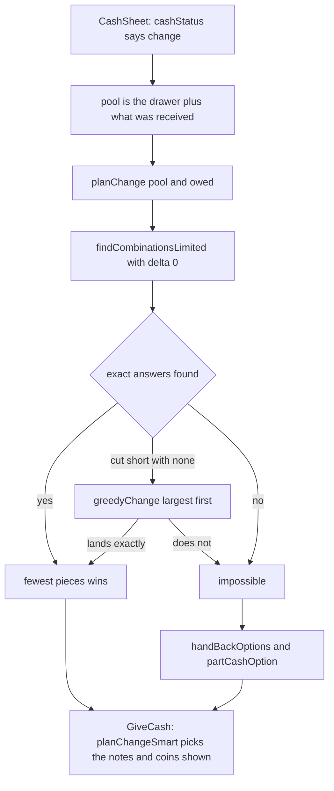

When a customer hands over more cash than is due, the POS works out which notes and coins to give back, using the drawer record. This page explains how it decides, and why it sometimes says it cannot.

## Basic

### What you will see
On the **Cash received** sheet, once you have tapped what the customer handed over, the line under **Due** says **Change to give: $…**. Tap **Next: give $… change** and the **Give change** screen shows **Take from the drawer** with the notes and coins to hand back. The buttons are explained on [[pay/cash]].

### The change is always exact
The POS only ever suggests change that adds up to exactly what is owed. It never suggests "close enough". If no mix of notes and coins makes the exact amount, it says so instead.

### Where the notes and coins come from
Two places, added together:
1. **The drawer record**, which is the notes and coins the POS believes are in the drawer (More ▸ Cash drawer). See [[cash]].
2. **What the customer just handed over.** Their own notes can go straight back.

Example: the bill is $7.00 and the customer hands over a $20 note, so $13.00 is owed. The record holds 1 × $20, 2 × $10, 3 × $5, 3 × $2 and 2 × $1. The POS suggests **1 × $10, 1 × $2, 1 × $1**: three pieces, the quickest to count out.

### Which notes and coins it picks
- **Normally:** the way that uses the **fewest pieces**.
- **With Smart change on** (Settings ▸ Payments): the way that leaves the drawer best stocked for the next sales, even if it is a piece or two more. See [[cash/smart-change]].

You can always hand back something different. Tap **I'll give different notes and coins** and tap what you really give. The total has to match the change owed before **Gave this** works.

### What "Can't make change" means
It means **no mix of the notes and coins the POS knows about adds up to exactly that amount**. It is about the mix, not the total.

Example: the record holds one $20 note. A customer hands over a $50 note for a $37.00 bill, so $13.00 is owed. The POS has a $20 and a $50 to work with. No combination of those makes $13.00, even though together they are worth $70.

It does **not** necessarily mean you have run out of cash, and it can be wrong, because the POS only knows what has been tapped. There are three possible reasons:
- You really do not have the right notes and coins.
- The record is out of date (a note went to the safe, or change was given without being tapped). Fix it with **Correct contents**. See [[cash/open-close]].
- The drawer was never opened or counted, so the record is empty. The box then says **No cash in the ledger**.

### What to do about it
The red box offers the ways round it, each explained with its buttons on [[pay/cash]]:
- **Ask for less:** take a smaller part of what they handed over and give the rest straight back.
- **Part in cash:** take some of the bill in cash and put the rest on card or another method.
- **Card:** take the full amount by card.

If you can see the drawer does have the change, tap **The drawer has it (ledger is out of date)**, then confirm the denominations you actually give (unless you choose not to track them). Put the record right afterwards. For the cashier steps, see [[fix/cant-make-change]].

You can also ask before taking the cash, with Check change. See [[cash/check-change]].

### Change on a cash refund
When a refund pays out cash, the **Give cash refund** sheet works the same way. The notes and coins come from the drawer record only, because nobody has handed anything over. The same buttons are there, including **Done, but don't track it**.

## Deep

### Why only exact change
The finder is asked for combinations that hit the amount with **no tolerance at all**. A drawer that cannot make $13.00 might be able to make $12.95 or $13.05, but handing back the wrong amount is never what you want, so those are not offered. The finder can look at near amounts (the float report uses that), but the change screens do not.

### Why the customer's notes count
If a customer hands you a $20, a $10 and a $5 for a $25.00 bill, a drawer with no small notes can still give the $10 straight back. Leaving their own notes out of the search would make the POS say "can't" when any cashier would simply hand them back.

### Fewest pieces
Of all the exact ways to make the change, the POS counts the pieces in each and takes the lowest. Fewer pieces is quicker to count out and quicker to check. If two ways tie, one of them is picked.

### A very full drawer
The search tries combinations one after another, and stops after 150,000 steps so a drawer with huge piles of coins cannot freeze the iPad. If it stops before finding any exact answer, it falls back to giving the largest notes and coins first, which almost always lands exactly. When that happens you see **The drawer holds a lot, so this is a good answer, not the only one.** In the very rare case where neither finds an answer, you get "can't make change" even though a combination might exist; use **The drawer has it** and tap what you give.

### How "Ask for less" is chosen
The POS looks at every part of what the customer handed over, keeping some and handing the rest back. It rejects any part that does not cover the bill, and any part whose change the drawer could not make. Of what is left it picks the **smallest amount kept**, and then the fewest pieces. Keeping everything is not an option, because that is the situation you started in. Example, with the record holding one $5 and a customer who hands over $20, $10 and $5 for $25.00: keep the $20 and $5 and hand the $10 back, so no change is needed. There is another example on [[pay/cash]].

### How "Part in cash" is chosen
Starting just under the bill and going down in 5c steps, the POS looks for the **largest cash amount** such that the leftover from what the customer handed over can be made out of the drawer plus their notes. The first one that works is offered, and the rest of the bill is left for another method. It needs the customer to have handed over more than the bill. Example: the record holds one $20, the customer hands over a $50 for $37.00. The $13.00 change is impossible, but taking $30.00 in cash works (the $20 comes back from the drawer), which leaves $7.00 for card.

### "Impossible" is only as good as the record
The record is a count of what was tapped. Every skipped tap (the **don't track** buttons) and every note moved without telling the POS makes it a little wrong, and a wrong record gives wrong answers in both directions: it can say "can't" when the drawer could, or suggest a note that is not there. That is why a count at closing, or **Correct contents** mid-shift, matters. See [[cash/open-close]].

## Advanced

### From owed change to the screen

### Where the code is
| Job | Where |
|---|---|
| The two steps of the cash sheet, the red box | `CashSheet` in `src/screens/CashSheet.tsx` |
| The change step (also used for cash refunds) | `GiveCash`, `GiveCashSheet` in `src/screens/CashSheet.tsx` |
| Due, short, exact, change | `cashDue`, `cashStatus` in `src/lib/cashSale.ts` |
| Exact change, fewest pieces | `planChange` in `src/lib/cashSale.ts` |
| The search itself | `findCombinationsLimited`, `findCombinations` in `src/lib/changeFinder.ts` |
| Largest-first fallback | `greedyChange` in `src/lib/cashSale.ts` |
| Ask for less | `handBackOptions` in `src/lib/cashSale.ts` |
| Part in cash | `partCashOption`, `reachableSums` in `src/lib/cashSale.ts` |
| Empty record check | `ledgerEmpty` in `src/lib/cashSale.ts` |
| Smart pick on the change step | `planChangeSmart` in `src/lib/changeScore.ts` |
| Where the drawer record lives | `Pos` in `src/state/store.ts` (`pos.ledger`); rules in `src/lib/cashLedger.ts` |

### The limits
| Limit | Value | What happens past it |
|---|---|---|
| Steps for one change search (`planChange`) | 150,000 | falls back to `greedyChange`, and `truncated` is true |
| Steps per search inside Ask for less | 20,000 | the search falls back to largest-first, and a part that still fails is skipped |
| Parts of the handover looked at by `handBackOptions` | 600 | it stops looking and uses the best so far |
| Sums remembered by `reachableSums` | 50,000 | it stops adding more |

`planChange` ignores any count that is zero or negative, so a drawer record with stray negatives cannot make a combination out of nothing. The finder's own tolerance argument is 500 cents by default, but `planChange` passes 0.

### Reading the code for a fault
- **The big button is greyed and the box says Can't make change, but the drawer has it.** The record is out of date. `planChange` only sees `pos.ledger.counts`. Use **The drawer has it**, then fix the record.
- **The box says No cash in the ledger.** `ledgerEmpty` is true: the record has no cash at all. It was never opened or counted on this iPad, or the saved copy could not be read. Open the drawer, or use **Correct contents**.
- **The suggestion includes a note the drawer does not have.** The record is too high. Someone used **Done, but don't track it**, or gave change without confirming.
- **No Ask for less option appears.** `handBackOptions` found no part of the handover that covers the bill and has makeable change, or hit its 600-parts limit when many different notes were handed over.
- **No Part in cash option appears.** `partCashOption` needs more handed over than the bill, and no 5c-step amount below the bill works, or one was already chosen.
- **The drawer holds a lot appears.** `truncated` is true: the search hit its step limit.
- **Tests.** `tests/cashsale.test.ts` (due, change, ask for less, part in cash, ledger entries), `tests/cashledger.test.ts` (the change finder, checked against your original function on random drawers).
