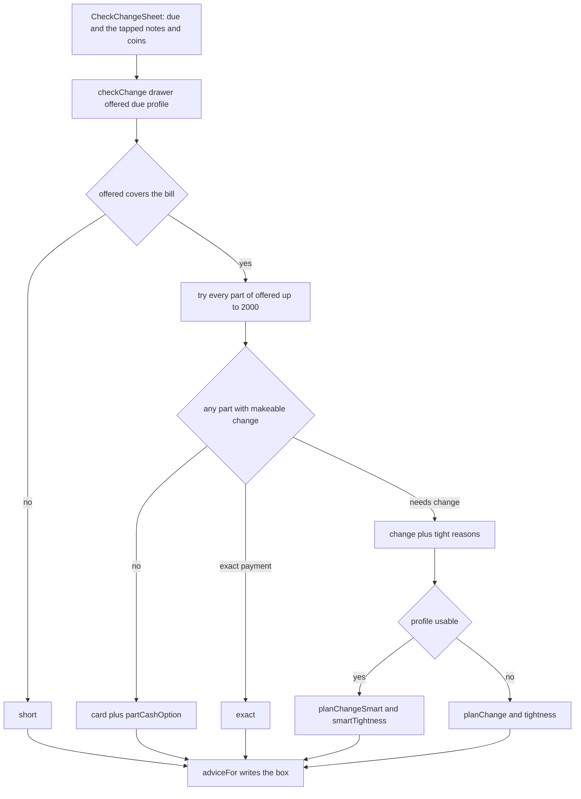

**Check change** answers one question before any money changes hands: *the customer says they have these notes. Can we give them change for this sale?* Nothing is recorded and the cart is not touched.

## Basic

### Opening it
There are three ways in:
- **A grid tile** called **Check change** (Edit grid ▸ Add tile ▸ Actions). A new grid has it already. A grid made before the tile existed does not, so add it. See [[sales/grid]].
- **The cart ••• menu**: **Check change**, with *Can we make change for this cart?* under it.
- **The guided checkout**: **More options** ▸ **Check change**.

### What you see
- At the top, **Cart total** and the amount. This is what is still owing on the sale, and when **Cash rounding (5c)** is on it is rounded to the nearest 5c, the same as the cash sheet would ask for.
- **Check a different amount** lets you key in any amount instead, and **Use the cart total** switches back. With an empty cart the keypad is already open under **Amount to check**.
- **What the customer says they have**, the same tap pad as the cash sheet. Tap each note and coin they say they have. **Customer has** shows the total. The pad has the **Add / Remove** switch, **Undo** and **Start over**, as on [[pay/cash]].
- Underneath, a coloured box with the answer.

Until you tap something it says *Tap their notes and coins to see what we can do.*

### The answers
| Colour and title | What it means | What to do |
|---|---|---|
| Green: **Cash works: no change needed** | Part of what they hold pays the bill exactly | Ask for those notes and coins. The box also says what they keep. |
| Green: **Cash works: $… change** | They hand over a note or two and we can give the change | Ask for the notes and coins listed, and give the change listed. |
| Amber: **We can make $… change, but it may not be worth it** | We can, but it would leave the drawer thin | Card is the safer choice. The box says why. |
| Red: **We can't make the change** | No part of what they hold works | Ask for card, or take the part in cash the box suggests and put the rest on card. |
| Red: **They're $… short in cash** | What they hold is less than the bill | Ask for card, or take what they have as a part payment. |

### How it picks what to ask for
It looks at every part of what the customer says they have:
1. If some part pays the bill **exactly**, that wins, using the fewest notes and coins.
2. Otherwise it asks for the **smallest handover** that covers the bill and whose change we can make. That means they keep the most of their own money.

For example, a $37.00 bill, a drawer with plenty of change, and a customer with a $50 and a $20: it asks for the $50 and tells you the customer keeps the $20, because the $20 alone is not enough.

### Is it worth it?
The amber box appears when making the change would leave the drawer thin. With **Smart change** off, that means either:
- the change **uses up the last** of a note or coin of $20 or smaller (for example *uses up the last $10*), or
- the change **takes more than half** the cash in the drawer.

With **Smart change** on, the warning is based on what the next sales are likely to need instead. See [[cash/smart-change]].

Amber is advice, not a block. You can still take the cash.

### If the box says the ledger is empty
A red line says *The drawer ledger is empty, so this can't know what change you have.* The POS has no record of cash in the drawer, so it cannot say. Open the drawer or use **Correct contents** first. See [[cash/open-close]].

### Using the answer
Check change does not take any payment. When the customer agrees, go to **Charge** ▸ **Cash** and tap what they actually hand over, as normal. See [[pay/cash]].

## Deep

### Why it is separate from the cash sheet
The cash sheet works with what the customer **has already handed over**, and the change it works out comes from that whole handover. Check change works earlier, from what they **say they have**, and it considers handing over **only part** of it. That is how it can tell you to ask for the $50 and let them keep the $20, before they have handed anything over. (The cash sheet's **Ask for less** reaches a similar answer, but only after the notes are in your hand.) Both use the same change search. See [[cash/change]].

### How the best handover is ranked
Every part of what the customer holds that covers the bill is tried. Each one is ranked by three things, in order:
1. **Exact payment** beats everything.
2. **Less change** beats more change (so they keep more).
3. **Fewer pieces** breaks any tie.

Parts whose change the drawer cannot make are skipped. If nothing is left, the answer is "can't make the change".

### What the card answer suggests
When no part works, the POS also looks for **part in cash**: the biggest cash amount, in 5c steps, whose change can be made, with the rest on card. Example: the record holds one $20, a customer says they have a $50, and the bill is $37.00. The $13.00 change cannot be made, but $30.00 in cash can (the $20 comes back from the drawer), so the box says to take $30.00 in cash and put the other $7.00 on card.

### The short answer has no part-cash suggestion
If what they hold is less than the bill, the box says they are short and suggests card or a part payment, but does not work out a cash amount for you. You can simply take what they have as a part payment.

### Two meanings of "worth it"
Plain rules are used when Smart change is off, so the answer is something you can check by looking at the drawer. With it on, the answer comes from the learned profile, so it can warn about a note that is not yet *quite* gone but will be needed. Neither ever changes whether change can be made, only the advice. The line at the bottom of the sheet says which is in use and what it is based on.

### A very large handover
If the customer holds a great many notes and coins, the POS stops looking after trying 2,000 parts of the handover. It then answers from the best found so far, which could be "can't make the change" even though a part it never reached would have worked. In practice, ask a customer holding that much cash what they would like to hand over.

## Advanced

### From taps to a verdict

### Where the code is
| Job | Where |
|---|---|
| The sheet | `CheckChangeSheet` in `src/screens/CheckChange.tsx` |
| The verdict | `checkChange` in `src/lib/checkChange.ts` |
| The words in the box | `adviceFor` in `src/lib/checkChange.ts` |
| The plain worth-it rule | `tightness` in `src/lib/checkChange.ts` |
| The learned worth-it rule | `smartTightness`, `profileNote` in `src/lib/changeScore.ts` |
| The cash due, with rounding | `cashDue` in `src/lib/cashSale.ts`; what remains comes from `usePriced` and `paidTotal` |
| The profile (null when Smart change is off) | `useCashProfile` in `src/state/cashProfile.ts` |
| The tap pad | `DenomPad` in `src/ui/DenomPad.tsx` |
| The grid tile | the `check_change` action in `src/lib/grid.ts`, handled in `src/screens/Checkout.tsx` |
| The cart menu and guided checkout entries | `src/screens/CartPane.tsx`, `src/screens/GuidedCheckout.tsx` |

### Result shapes
`checkChange` returns one of four:
- `short`: `shortBy`, and `part` which is always null.
- `exact`: `take` (what to ask for) and `handBack` (what they keep).
- `change`: `take`, `handBack`, `change` and `tight`, a list of reasons it may not be worth it. An empty list means no concerns.
- `card`: `part`, the part-cash option or null.

The amber or green tone is decided in `adviceFor`: a `change` result with any `tight` entries is amber.

### The plain worth-it rule
`tightness` looks at the drawer after taking the customer's notes in and giving the change out. It flags a denomination of $20 or smaller that is in the change and is at zero afterwards, and it flags change worth more than half of the drawer plus what was taken in. The smart version is `smartTightness`: it flags a coverage of less than half of usual change amounts, a drop of 15 percentage points or more, or a note or coin the profile expects to run short of.

### Reading the code for a fault
- **Nothing happens when I tap notes.** `due` is zero (empty cart) and no amount has been keyed in. Use **Check a different amount**.
- **The answer is always can't make the change.** The record is empty or out of date. The red ledger line is shown when `ledgerEmpty`. Use **Correct contents**.
- **The tile is missing from the grid.** The layout was made before `check_change` existed. Add it from Edit grid ▸ Add tile ▸ Actions. A register on an older app version drops the tile type from a synced layout, so update every register first.
- **The amber warning mentions usual sales.** Smart change is on, so `smartTightness` is in use.
- **The amount differs from the Cash sheet.** Check change always uses what remains on the whole sale (rounded with `cashDue` when **Cash rounding (5c)** is on). The cash sheet uses the amount of the payment being taken, so after **Split amount** the two differ. Use **Check a different amount**.
- **Tests.** `tests/checkchange.test.ts` (verdicts, ranking, part cash, worth-it rules), `tests/changescore.test.ts` (the smart rules).
