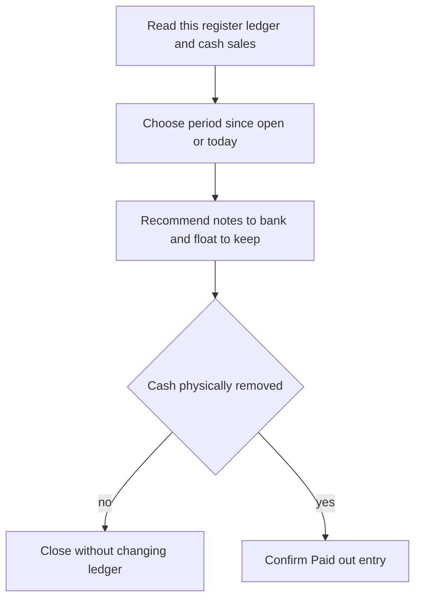

The **Daily float report** helps you decide what notes and coins to bank and what to leave in the drawer. It is a suggestion: count and handle the actual cash yourself.

## Basic

### Open the report
Go to **More ▸ Cash drawer** and tap **Daily float report**. If the drawer is open, the report covers the time since it was opened; otherwise it covers today.

### Read the figures
- **Cash takings** is cash sales minus cash refunds for the chosen period.
- **Take out (bank)** suggests notes and coins to remove. **Leave in the drawer as the float** shows what the ledger expects to remain. Each is drawn as notes and coins in squares with a count badge (**x3**), the same as the change screen, with the total beside the heading.
- **Show another way** cycles through up to two other suggestions, when available.
- A warning may say the ledger and sales disagree. Count the drawer before banking if the count might be wrong.
- **Top up if you can** suggests notes and coins to add if the remaining float is below the recommended amount. Notes that are rarely used as change may be listed as better banked.

If the suggestion is right and you have physically taken the money out, tap **I took this out: record it**. Confirm the prompt. Do not record it before the cash has actually left the drawer. Tap **Close** to leave without changing the ledger.

### Where the cash history comes from
The report uses sales on this register and its own drawer ledger. It does not combine cash from other iPads. Cash sales or change you chose not to track can make the ledger differ from the sales total. Correct it or count and close the drawer if needed: [[cash/open-close]].

## Deep

### How it chooses what to bank
The report tries to take out an amount close to the period's cash takings while leaving notes and coins that are useful for future change. If it has enough history, it uses the same learned profile as [[cash/smart-change]], whether Smart change is switched on or off. With little or no usable history it takes the largest notes first.

The suggested float can be higher than the amount needed for today's takings. The report may suggest a top-up to move the remaining drawer towards its estimate. These are recommendations only; the cashier still takes out or adds the physical notes and coins.

### A banking entry changes the ledger
The report does not move money automatically. After you confirm that cash was removed, **I took this out: record it** writes a **Paid out** entry with the selected denominations. If you close the report or do not confirm, it makes no ledger change. It records at most the option currently shown, so do not press it twice for one physical banking.

## Advanced

### Calculation and ledger write

| Job | Where |
|---|---|
| Report sheet and confirmation | `FloatReportSheet` in `src/screens/FloatReport.tsx` |
| Period cash total | `cashSince` in `src/screens/Drawer.tsx` |
| Recommendation | `recommendFloat`, `ledgerTakings` in `src/lib/floatReport.ts` |
| Ledger entry | `newEntry`, `applyEntry` in `src/lib/cashLedger.ts` |
| Learned cash profile | `useCashProfile` in `src/state/cashProfile.ts` |
| Tests | `tests/floatreport.test.ts` |

`recommendFloat` limits the amount it recommends taking out to what the ledger says is present. With a usable profile, it compares candidate denomination combinations within $10 of takings and scores the drawer left behind; without a profile it uses largest notes first. The UI offers the best option and up to two alternatives. The cash report calculation is bounded, so an unusually large search can show that its result is good but not the only possible one.

### If the figures look wrong
- **The ledger saw a different amount from sales.** Denominations may have been entered incorrectly, cash may have moved outside the POS, or the ledger needs a count. Use **Count & close (Z-report)** or **Correct contents** before relying on the suggestion.
- **There is no amount to take out.** There may be no cash takings, or the ledger has no cash available to bank.
- **The report asks for a top-up.** It cannot add cash itself; take the displayed denominations from your safe or bank and add them by hand.
- **I took this out: record it** is missing. There is no positive amount in the suggested banking option to record.

### Known boundaries
The report is per register, uses the local ledger and local sales, and does not move cash or connect to hardware. Its profile is rebuilt from available local data; recommendations do not guarantee the next customer's change can be made. Always check the physical drawer.
