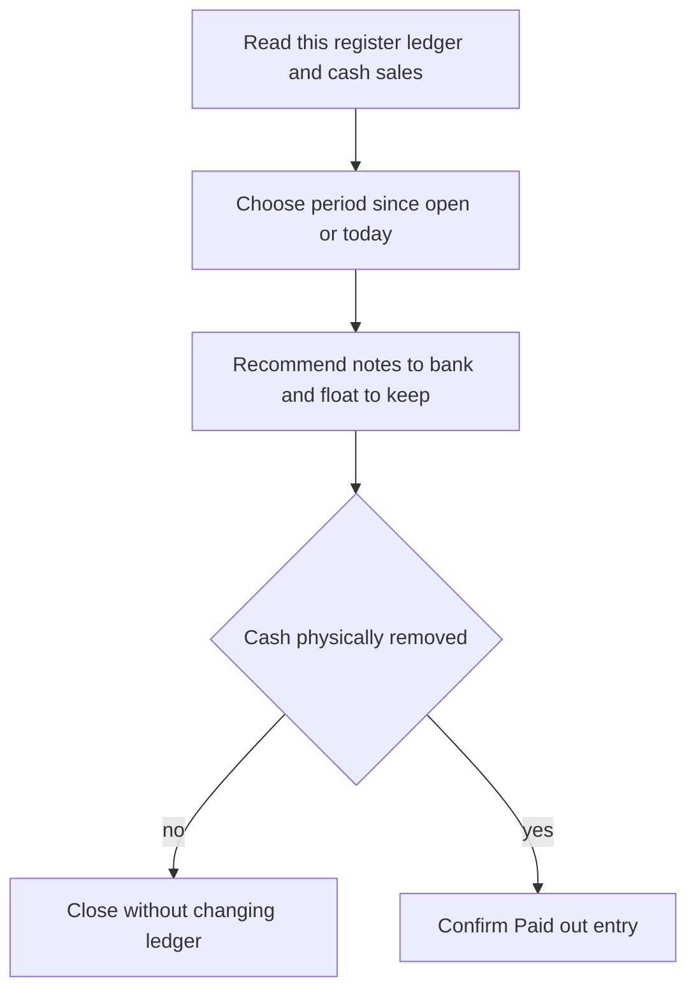

The **Daily float report** helps you decide what notes and coins to bank and what to leave in the drawer. It is a suggestion: count and handle the actual cash yourself.

## Basic

### Open the report
Go to **More ▸ Cash drawer** and tap **Daily float report**. If the drawer is open, the report covers the time since it was opened; otherwise it covers today.

### Read the figures
- **Cash takings** is cash sales minus cash refunds for the chosen period.
- **Take out (bank)** suggests notes and coins to remove. **Leave in the drawer as the float** shows what the ledger expects to remain. Each is drawn as notes and coins in squares with a count badge (**x3**), the same as the change screen, with the total beside the heading.
- **Show another way** cycles through up to two other suggestions, when available.
- A warning may say the ledger and sales disagree. Count the drawer before banking if the count might be wrong.
- A line under the float says how many of a typical day's cash sales it could give exact change for (for example *about 94%*), and how that compares with the drawer as it is now.
- **Top up if you can** appears only when a typical day would often go without exact change. It lists the few notes and coins that fix the most, and says what the percentage becomes with them. If nothing needs adding it says so. Notes that are rarely used as change may be listed as better banked.
- The report takes a moment to work out when you open it (it says *Working it out*).

If the suggestion is right and you have physically taken the money out, tap **I took this out: record it**. Confirm the prompt. Do not record it before the cash has actually left the drawer. Tap **Close** to leave without changing the ledger.

### Where the cash history comes from
The report uses sales on this register and its own drawer ledger. It does not combine cash from other iPads. Cash sales or change you chose not to track can make the ledger differ from the sales total. Correct it or count and close the drawer if needed: [[cash/open-close]].

## Deep

### How it chooses what to bank
The report tries to take out an amount close to the period's cash takings while leaving notes and coins that are useful for future change. If it has enough history, it uses the same learned profile as [[cash/smart-change]], whether Smart change is switched on or off. With little or no usable history it takes the largest notes first.

To judge a float it imagines a whole day of your cash sales (the change amounts and notes your customers usually give, 30 imagined days at a time) and counts how many could not be given exact change from that drawer. Notes handed over by one customer are available as change for the next, so a float does not have to hold a whole day's change at the start. Every way of banking the takings is tried against a short version, the best 30 against the full version, and the one whose float copes best wins, with a small penalty for each dollar it is away from the exact takings.

### Why it asks for a top-up
It adds notes and coins one small step at a time, always the step that cuts the failure rate the most for what it costs, and stops as soon as about 97% of imagined sales work or nothing left is worth adding. Every dollar counts against a step, so a $20 note is only asked for when $20s really fix failures; it is not chosen because it is worth the most. A drawer that already copes, even with no $20s or $10s, is asked for nothing. It never asks for $50 or $100 notes, never more than $200 in one go, and never gives up more than about a second and a half of thinking: if it runs out of time it shows the best it had.

These are recommendations only; the cashier still takes out or adds the physical notes and coins.

### A banking entry changes the ledger
The report does not move money automatically. After you confirm that cash was removed, **I took this out: record it** writes a **Paid out** entry with the selected denominations. If you close the report or do not confirm, it makes no ledger change. It records at most the option currently shown, so do not press it twice for one physical banking.

## Advanced

### Calculation and ledger write

| Job | Where |
|---|---|
| Report sheet and confirmation | `FloatReportSheet` in `src/screens/FloatReport.tsx` |
| Period cash total | `cashSince` in `src/screens/Drawer.tsx` |
| Recommendation | `recommendFloat`, `ledgerTakings` in `src/lib/floatReport.ts` |
| Day simulation, top-up and ranking | `dayScript`, `failRate`, `planTopUp`, `rankTakeOuts` in `src/lib/floatPlan.ts`; `makeScript`, `play` in `src/lib/changeImpact.ts` |
| Ways of banking the takings | `findCombinationsLimited` (with `bigFirst`) in `src/lib/changeFinder.ts` |
| Ledger entry | `newEntry`, `applyEntry` in `src/lib/cashLedger.ts` |
| Learned cash profile | `useCashProfile` in `src/state/cashProfile.ts` |
| Tests | `tests/floatreport.test.ts`, `tests/floatplan.test.ts` |

`recommendFloat` limits the amount it recommends taking out to what the ledger says is present. With a usable profile, it lists combinations within $10 of takings (trying the most of each big note first, so a search that is cut short has still covered the ways that bank big notes), plays a short imagined day against every one with `rankTakeOuts`, plays the full day against the best 30, and picks the lowest cost, where cost is failure points plus 1.5 per dollar from the takings. `planTopUp` then adds pieces greedily from the float that stays. Without a profile it uses largest notes first and shows no percentages or top-up. The UI offers the best option and up to two alternatives. The imagined days are seeded, so the same drawer always gives the same answer. The calculation is bounded, so an unusually large search can show that its result is good but not the only possible one.

| Number | Value | What it does |
|---|---|---|
| `DAY_TRIALS` | 30 | imagined days per drawer in the full comparison |
| `DOLLAR_COST` | 0.04 points per dollar | what a dollar of float costs against failure points |
| `GOOD_ENOUGH` | 3% | at or below this failure share nothing more is added |
| `MIN_NET` | 0.5 points | a step must gain at least this, cost taken off |
| `MAX_TOPUP` | $200 | most ever asked for |

### If the figures look wrong
- **The ledger saw a different amount from sales.** Denominations may have been entered incorrectly, cash may have moved outside the POS, or the ledger needs a count. Use **Count & close (Z-report)** or **Correct contents** before relying on the suggestion.
- **There is no amount to take out.** There may be no cash takings, or the ledger has no cash available to bank.
- **The report asks for a top-up.** It cannot add cash itself; take the displayed denominations from your safe or bank and add them by hand. The line under it shows the percentage before and after. If the top-up looks too big, check the profile line at the bottom: with few tracked sales it leans on item prices, and many large change amounts make big notes look necessary.
- **No percentages and no top-up.** There is no profile yet (no tracked cash sales and no item prices), so it only takes the largest notes first.
- **I took this out: record it** is missing. There is no positive amount in the suggested banking option to record.

### Known boundaries
The report is per register, uses the local ledger and local sales, and does not move cash or connect to hardware. Its profile is rebuilt from available local data; recommendations do not guarantee the next customer's change can be made. Always check the physical drawer.
