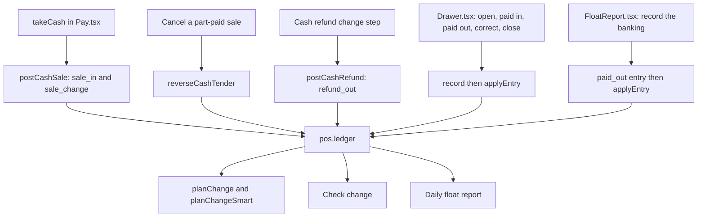

The **Cash drawer** screen (More ▸ Cash drawer) keeps track of the cash in the till: which notes and coins are in the drawer right now, and the shift figures for the day. Every role can open it.

## Basic

### What the POS keeps track of
There are two separate records, and the screen shows both:
- **The shift:** the float you opened with, the cash taken in sales, money paid in and out, and the amount the drawer **should** hold. This is for checking the day at closing time.
- **The ledger:** how many of each note and coin the drawer **should** hold, with a history of what went in and out. This is what the POS uses to work out change.

Money is Australian: $100, $50, $20, $10 and $5 notes, and $2, $1, 50c, 20c, 10c and 5c coins.

### What you see on the screen
- **No drawer open on this register.** with **Open drawer with float**, when there is no shift. Otherwise a card with **Float**, **Cash sales** (*Net of cash refunds*), **Paid in**, **Paid out** and **Expected in drawer**, and the buttons **Paid in**, **Paid out** and **Count & close (Z-report)**.
- **Notes and coins in the drawer:** a row for every note and coin with how many the ledger holds (× 3) and what that comes to, and **Total in the drawer**.
- **Correct contents** and **Daily float report** buttons.
- **Cash history:** the 15 most recent entries, newest first. Each says what happened, who was signed in, when, which notes and coins, and the reason if one was given. Money that came out shows with a minus sign (for example **-$15.00**).

Opening, paid in and out, correcting and counting at closing are explained on [[cash/open-close]].

### What changes the ledger
You rarely have to touch the ledger, because most of it happens as you work:
- **A cash sale.** When you tap the notes and coins the customer hands over, they go into the ledger. When you confirm the change you gave, those come out. See [[pay/cash]].
- **A cash refund** that pays out cash: the notes and coins you hand over come out.
- **Cancelling a part-paid sale** that had cash in it puts the ledger back.
- **By hand:** opening the drawer, paid in, paid out, **Correct contents**, **Count & close**, and recording the daily banking from the float report.

### It works with the drawer closed
A cash sale updates the ledger whether or not a drawer is open. The shift figures, though, only count sales made **after** you opened the drawer, so open it at the start of the day.

### Each iPad has its own
The ledger and the shift live on the iPad you are using. Another iPad has its own, and they are not added together. They are also not in the backup file. If you use two registers, each one needs its own drawer opened and counted.

### Keeping it honest
The ledger is only as right as what is tapped. If you skip the tapping for a rush (the **don't track** buttons on the cash screen), or hand out different change than you confirmed, or take a note out for lunch without telling the POS, the ledger will drift away from the real drawer. Two things put it right:
- **Correct contents**, when you spot a mistake mid-shift.
- **Count & close**, which resets the ledger to exactly what you counted.

If **Can't make change** shows when you know you have the notes, the ledger has drifted. See [[pay/cash]].

### Other things on this screen
The [[cash/float-report|Daily float report]] works out which notes and coins to bank at the end of the day and the float to leave. **Check change** (a grid tile and a cart menu entry) tells you whether you can make change for a customer's notes before you take them: see [[cash/check-change]]. **Smart change** (Settings ▸ Payments, off until you turn it on) picks the change that keeps the drawer well stocked: see [[cash/smart-change]]. How the change itself is worked out, and what "Can't make change" means, is on [[cash/change]]. The cash-tender machine switch is greyed out and marked **Under Construction**; see [[cash/tender-machine]].

## Deep

### Why two records
The shift figures are plain sums of dollars: float, plus cash sales, plus paid in, minus paid out. They answer one question, "is the money all there?". The ledger is a count of each note and coin, and answers another, "what can I hand back as change?". They are kept apart on purpose. A sale where you skipped the tapping changes the first (the sale is still a sale) but not the ledger (the POS never saw the notes). That is why the closing count can show the right amount while the ledger was out of line, and why closing fixes the ledger without changing the day's figures.

### How Expected is worked out
**Expected in drawer** = Float + Cash sales + Paid in − Paid out.
- **Cash sales** only counts cash payments, from this register, made since you opened the drawer. Card and gift card payments are not counted.
- For a sale it adds what was applied to the bill **plus any cash rounding**, which is the cash the customer really paid net of change. It does **not** add the notes handed over, because the change went back out.
- For a refund it subtracts the cash that was paid back.

So a $13.02 sale paid with a $20 note, rounding on, adds $13.00 to Cash sales (the change of $7.00 is not in the figure at all).

### The numbers never go below zero
If the ledger did not know about a note and you take it out, the count stops at 0 rather than showing −1. The history entry still records exactly what you entered.

### What is kept
The history keeps the newest 1,000 entries and the screen shows the 15 newest. Entries made by a sale carry the sale's id and the person signed in. Opening, paid in, paid out and closing also add a line to the events history file (`events.csv`, in the app's `pos-data` folder, which shows in the Files app), which is never cleared automatically. **Correct contents** adds a ledger entry but no events line.

### Worked example
A customer owes $35.00 and hands over a $50 note. You tap the $50, the POS works out $15 change, and you give a $10 note and a $5 note. The ledger records two entries for the sale: **Cash received** (+$50.00) and **Change given** (-$15.00). Its total has gone up by $35.00, and so has **Cash sales** on the shift. If you had used **Exact amount (don't track notes)** instead, Cash sales would still go up by $35.00 but the ledger would not move.

## Advanced

### What writes to the ledger

### Where the code is
| Job | Where |
|---|---|
| The screen, the shift, every sheet | `Drawer` in `src/screens/Drawer.tsx` |
| Cash taken since opening | `cashSince` in `src/screens/Drawer.tsx` |
| Ledger rules (counts, entries, never below zero) | `src/lib/cashLedger.ts`: `applyEntry`, `newEntry`, `cleanCounts`, `diffCounts`, `readLedger` |
| The notes and coins | `DENOMS` in `src/lib/cashLedger.ts` |
| History wording | `LEDGER_LABEL` in `src/lib/cashLedger.ts` |
| Writing sales, cancels and refunds | `postCashSale`, `reverseCashTender`, `postCashRefund` in `src/lib/cashSale.ts` |
| Banking from the float report | `FloatReportSheet` in `src/screens/FloatReport.tsx` |
| Where the data lives | `Shift` and `Pos` in `src/state/store.ts` (`pos.shift`, `pos.ledger`) |

### The ledger entry kinds
| Kind | History label | Written by |
|---|---|---|
| `open` | Opened drawer | Open drawer with float |
| `paid_in` | Paid in | Paid in |
| `paid_out` | Paid out | Paid out, and the float report's banking |
| `adjust` | Contents corrected | Correct contents |
| `close` | Counted at close | Count & close |
| `sale_in` | Cash received | A cash sale |
| `sale_change` | Change given | A cash sale, and cancelling a part-paid cash sale |
| `refund_out` | Cash refund given | A cash refund |

An entry's `delta` is what moved: positive for money that went in, negative for money that came out. `applyEntry` adds the delta to the counts, clamps each denomination at zero, and puts the entry at the front of `entries`, trimmed to `MAX_ENTRIES` (1,000).

### Saving
`patchPos` changes the in-memory state and saves the whole `pos` slice a moment later (a 400 ms delay that restarts on every change). On load, `readLedger` throws away anything it cannot read and starts with an empty ledger, so a damaged saved ledger shows an empty drawer rather than breaking the screen. The backup file holds settings and the grid only: it carries neither the shift nor the ledger.

### Reading the code for a fault
- **The drawer shows no notes but money is in it.** The ledger is empty: it was never opened or counted on this iPad, or the saved copy could not be read. Open the drawer or use **Correct contents**.
- **Expected is lower than it should be.** Cash sales only count from `shift.openedAt`. A sale made before the drawer was opened is not in it.
- **Expected looks too high after a refund.** A refund only subtracts cash tenders. A refund paid to the card does not.
- **The two iPads disagree.** They should: each has its own `pos.ledger` and `pos.shift`.
- **Tests.** `tests/cashledger.test.ts` (the tap pad, counts, applying entries, history cap, reading saved data, and the change finder), `tests/cashsale.test.ts` (writing sales, cancels and refunds to the ledger). The Expected sum and the Z-report text are written inside `Drawer` and have no test of their own.
