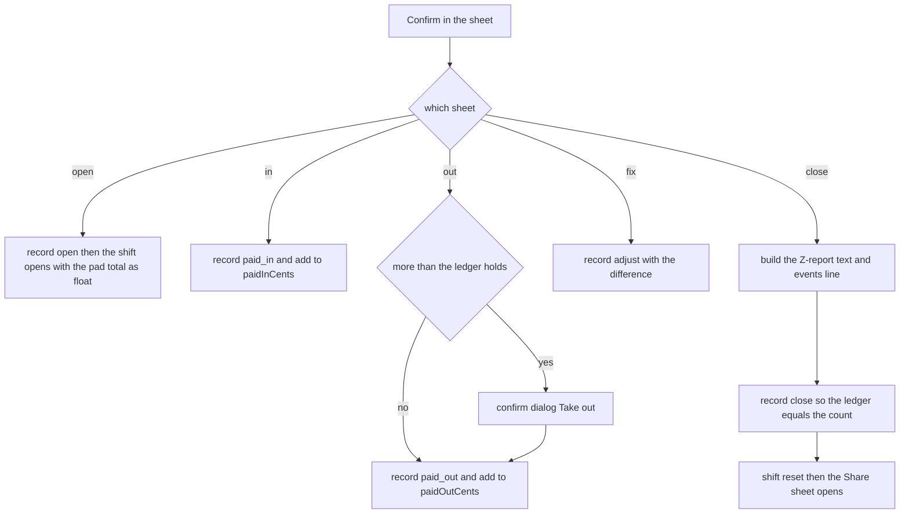

This page covers the jobs on the **Cash drawer** screen (More ▸ Cash drawer): starting the day, recording money that goes in or out, fixing the record, and counting up at the end.

## Basic

### Opening the drawer
1. Go to More ▸ Cash drawer. If it says **No drawer open on this register.**, tap **Open drawer with float**.
2. The **Opening float** sheet opens. The line under the title says what the drawer held last time (*Carried over from last time: $…*), and the pad already shows those notes and coins.
3. Tap **Add** or **Remove** and the notes and coins until the pad matches what you are really putting in the drawer. The big number is your float.
4. Tap **Confirm**.

The screen now shows **Float**, **Cash sales**, **Paid in**, **Paid out** and **Expected in drawer**. Open the drawer at the start of the day: **Cash sales** only counts sales made after this point.

### The tap pad
The same pad is used everywhere on this screen. Tap a note or coin to add one. **Add / Remove** switches between putting money in and taking it off the entry. **×1**, **×5** and **×10** set how many one tap adds, which is handy for rolls of coins. **Undo** takes back your last tap and tells you what it removed and the new total. **Start over** clears the entry. Removing something you have not tapped says *None of that to remove.* The full description is in [[pay/cash]].

### Paid in and paid out
Use these for cash that goes in or out of the drawer outside a sale: a top-up from the safe, banking, paying a supplier.
1. Tap **Paid in** or **Paid out**.
2. Type a **Reason** (it helps when you look back at the history).
3. Tap the notes and coins that went in or came out.
4. Tap **Confirm**.

Both change **Expected in drawer**, and both are added to the cash history.

- If you tap **Confirm** with nothing entered you get **Nothing entered**. Tap the notes and coins first.
- If you take out more of a note or coin than the record says is there, you get **More than the drawer should hold**, for example *You are taking 2 × $20 (ledger has 1)*. It may just mean the record has not caught up with recent cash sales. Tap **Take out** if the drawer really has them, or cancel and check.

### Correcting the contents
If the notes and coins on screen do not match the drawer, tap **Correct contents**. The pad starts from what the record holds. Add or remove until it matches what is really in the drawer, add a reason if you like, and tap **Confirm**. It does not change the float, the Expected figure or the Z-report. It only fixes the record of which notes and coins are there, so the POS works out change from the right ones. You can do it whether or not a drawer is open.

### Counting and closing
At the end of the day:
1. Tap **Count & close (Z-report)**.
2. The **Count the drawer** sheet opens, with *Count everything in the drawer. Expected $….* The pad starts empty. Tap every note and coin that is in the drawer, including the float you are leaving.
3. Under the pad you see **Matches the expected amount.** in green, or **Over by $…** or **Short by $…** in amber. If it is out, recount before you go on.
4. Tap **Confirm**.

Confirm closes the drawer straight away and does not ask again, so be sure of your count first. Then:
- The iPad's share sheet opens with the **Z-report**, a short text summary. Send it to yourself by email or Messages, or save it to Files. **This is the only copy the app gives you**, so do it now.
- The drawer shows **No drawer open on this register.** again.
- The notes and coins you counted become what the record says is in the drawer, and the next opening starts from them.

### The Z-report
It lists the date and time, when the drawer was opened, and then:

| Line | What it is |
|---|---|
| **Float** | What you opened with |
| **Cash sales (net of refunds)** | Cash taken since opening, less cash refunds |
| **Paid in** / **Paid out** | The totals you recorded |
| **Expected** | Float + cash sales + paid in − paid out |
| **Counted** | What you counted |
| **Difference** | Counted minus Expected. A minus sign means short, no sign means over |
| **In the drawer** | The notes and coins you counted |

### Over or short?
Recount first, because a miscounted pile of coins is the usual cause. Then look at the Cash history for a paid in or paid out you forgot to record, and think about cash refunds and any sale where too much or too little change was handed back. A small difference now and then is normal. A difference that keeps coming back is worth a look at how change is being given.

## Deep

### Why opening starts from what is already there
When you close, the counted notes and coins become the record. The next morning's float is usually what is still in the drawer, so the pad starts there and you only adjust it. The float is the total of the pad when you confirm. A float of $0.00 is allowed.

If you tap **Confirm** without changing anything, you still get an **Opened drawer** line in the history, with nothing in it.

### Paid in and paid out and the record
A paid in adds those notes and coins to the record. A paid out takes them off, but the record never shows less than zero of anything, so taking out a note the record never knew about just leaves that count at 0. The history keeps what you entered.

The daily float report's **I took this out: record it** button records the banking in exactly the same way, as a **Paid out** with the note *Daily banking (float report)*. If a drawer is open it also adds it to the shift's paid out.

### Why Expected can be right while the record is wrong
**Expected** comes from sales and the paid in and out totals. The notes-and-coins record comes from what was tapped. Skipping the tapping on a cash sale (the **don't track** buttons) leaves **Expected** right, because the sale is still counted, but leaves the record out of line. So the closing count can match even when the record had drifted. Counting at close puts the record right, and **Correct contents** does it earlier.

### What the Z-report is, and is not
The text is made when you confirm and is only shown in the share sheet. The app keeps no copy of the text. What it does keep is one line in the events history file (`events.csv`) saying the drawer closed, who was signed in, and the counted amount, with a message holding the expected amount and the difference (both in cents) and the notes and coins counted. Opening, paid in and paid out add events lines too, and paid in and paid out include the reason you typed. **Correct contents** does not.

### Closing by mistake
There is no way to undo a close. If you closed early, open the drawer again: it carries the counted notes and coins forward, but it is a new shift, and **Cash sales** counts only from the new opening. The day's figures are then split across two Z-reports.

### Worked example
You open with a $200.00 float. During the day the cash sales come to $350.00 (net of refunds, with rounding included). You bank $300.00 with a **Paid out**. **Expected** is $200.00 + $350.00 − $300.00 = **$250.00**. You count $245.00 in the drawer, so the sheet says **Short by $5.00** and the Z-report says **Difference -$5.00**. After you confirm, the record says $245.00 is in the drawer, in exactly the notes and coins you tapped.

## Advanced

### What Confirm does

### Where the code is
| Job | Where |
|---|---|
| The screen and `submit` for every sheet | `Drawer` in `src/screens/Drawer.tsx` |
| Cash since the drawer opened | `cashSince` in `src/screens/Drawer.tsx` |
| The tap pad | `DenomPad` in `src/ui/DenomPad.tsx`; `tapDenom`, `undoLast`, `describeTap`, `draftCounts` in `src/lib/cashLedger.ts` |
| Changes to the record | `newEntry`, `applyEntry`, `diffCounts`, `shortfall`, `summariseCounts` in `src/lib/cashLedger.ts` |
| The events lines | `csv.event` in `src/lib/csvStore.ts`; kinds `shift_open`, `shift_close`, `paid_in`, `paid_out` in `src/lib/csvFormat.ts` |
| The shift | the `Shift` type in `src/state/store.ts`, saved as `pos.shift` |

### How each sheet works out its entry
The pad's starting point (`base`) is the ledger's counts for **Opening float** and **Correct drawer contents**, and empty for **Paid in**, **Paid out** and **Count the drawer**. `submit` then turns the pad into a change to the record:
- **Open** and **Correct** record `diffCounts(entered, ledger.counts)`, the difference between what is on the pad and what the ledger held. Opening also sets the shift (`open`, `openedAt`, `floatCents` = the pad total, paid in and out at 0, the staff name) and writes a `shift_open` event.
- **Paid in** records the entered counts and adds the total to `paidInCents`. **Paid out** records the same counts as negatives and adds the total to `paidOutCents`, after the `shortfall` check against the ledger. Both write an event with the reason.
- **Close** records `diffCounts(entered, ledger.counts)` as `close`, so afterwards the ledger holds exactly the counted notes and coins, then resets the shift to closed with all totals at 0, writes `shift_close`, and opens the share sheet.

Expected is `floatCents + cash + paidInCents - paidOutCents`, with `cash` from `cashSince(shift.openedAt, registerId, sales)`: cash tenders on this register's sales from this iPad since the drawer opened, a sale adding amount plus rounding and a refund subtracting its amount. Difference is counted minus expected.

### Reading the code for a fault
- **Expected is wrong by exactly one sale.** That sale is before `openedAt`, from another register, or paid by card or gift card. Only cash tenders on this register count.
- **The Opening float pad is empty.** The ledger was empty. It was never opened or counted on this iPad, or the saved copy could not be read.
- **You closed but cannot find the Z-report.** The share sheet was dismissed, and the text is not stored. The shift resets as soon as you confirm, whatever happens to the share sheet. The events line still has the counted amount, and the expected amount and difference in cents.
- **Tests.** `tests/cashledger.test.ts` covers the pad, applying entries, the history cap and reading saved data. The shift sums (Expected, Difference) and the Z-report text are written inside `Drawer` and have no test of their own.

### Known gaps
Close has no confirmation step, and the Z-report is not saved in the app. Both are noted rather than changed here.
