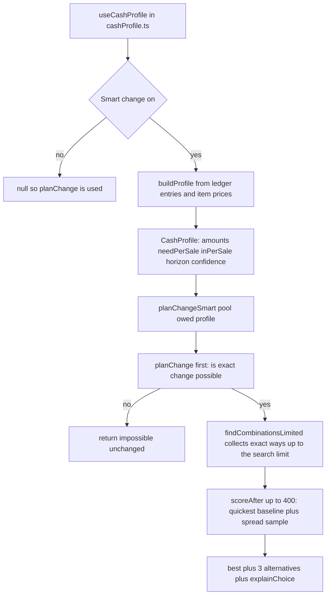

**Smart change** chooses which notes and coins to give as change so the drawer is still well stocked for the next customers, instead of just using the fewest pieces. It is off until you turn it on.

## Basic

### Turning it on
Settings ▸ Payments ▸ **Smart change**. It applies to **this iPad only**, like the drawer record it learns from. A line under the switch says what it is currently based on.

With it off, nothing changes: change is the fewest pieces, and Check change still judges "worth it?" using a spread of typical change amounts.

### What you will notice
- **On the Give change screen** (cash sales and cash refunds), under **Take from the drawer**, a line says why that choice was made. For example: *1 more piece to count, but keeps 1 more $5 and 1 more $1 in the drawer for upcoming change.* If the quickest way is also the best, it says *Quickest way, and it keeps the drawer well stocked.*
- **Show another way** steps through the next best choices. The button then reads **Show the next way**, and finally **Back to the suggested way**. While you are on another choice the line says *Another way to make the same change.*
- **In Check change**, the amber "may not be worth it" warning is based on your own usual change amounts, and it compares giving the change with asking for card, so it never warns about a shortage you already had. See [[cash/check-change]].

You can always ignore the suggestion and tap what you really give. See [[cash/change]].
The [[cash/float-report|Daily float report]] also uses the learned profile to choose what to bank and what float to leave, even when this switch is off.

### What it never does
It **never** decides whether change can be made. If exact change is possible without Smart change, it is possible with it, and the other way round. It only chooses between the ways that are already exact.

### What the line under the switch says
| Line | What it means |
|---|---|
| *no history or item prices to learn from yet, so it picks the fewest pieces* | Nothing to go on. It behaves as if it were off. |
| *No tracked cash sales yet, so it is guessing from your item prices.* | It assumes customers pay a bill with the next note up, and works out the change from your item library. |
| *learned from your recent cash sales (about N counted, newest weigh most)* | It has real sales to learn from. |
| *learned from about N recent cash sales plus your item prices* | A mix of both, and real sales take over as they build up. |

### Helping it learn
It learns from denomination-recorded cash sales where you tapped what the customer handed over and confirmed the change (**Gave this**). Cancellation entries are excluded from demand learning. Give it a few days of cash sales. See [[pay/cash]].

### When a suggestion feels wrong
Tap **Show another way**, or tap **I'll give different notes and coins**. Smart change is advice. If it keeps suggesting something you dislike, turn it off in Settings ▸ Payments.

## Deep

### What it is, and is not
It is a small statistical model that reads your own sales history, not a neural network or anything that phones home. Every number comes from the drawer record and the item library on this iPad, and the scoring is a short sum you can read below.

### What it learns from
Each time, the POS rebuilds a **profile** from three things:
1. **The drawer history.** Which change amounts you actually give ($8.00, $13.00…), how many of each note and coin that used, and what customers actually hand over. Newer sales count more: a sale 14 days old counts half as much as one today.
2. **The item library.** A customer buying a $12 item usually pays with a $20, so $8.00 back is likely. This is used while there are few real sales, and its weight fades as real sales build up, reaching equal weight at about 8 recent sales.
3. **The sales list.** Used only to size how far ahead to plan: about half an average cash-sale day (counting the last 28 days), kept between 4 and 12 sales, or 6 when there is nothing to go on.

Cash sales with recorded denominations inform the model. Cancellation reversals, cash refunds, and cash drawer adjustments are not treated as customer change demand.

### How a choice is scored
For every exact way of making the change, the POS imagines the drawer **after** giving it, and gives that a score. Higher is better:

**100 × coverage − 40 × depth − 0.5 × pieces**

- **Coverage** is the share of your usual change amounts that the drawer could still make exactly. 100% means you could still make all of them.
- **Depth** is how far each note and coin is below what the next few sales are expected to use. 0 is well stocked and 1 is out. Notes and coins used more often count more. Half of what customers usually hand over is counted as on hand, because it can be given back again.
- **Pieces** is a small push towards fewer pieces, so it only decides near-ties.

The best-scoring way is shown, and the next three are kept for **Show another way**.

### A worked example
Suppose your library has one item, at $12.00, and no sales have been tracked yet. The profile guesses that $8.00 of change is the most common (70%), followed by $38.00 (30%).

The drawer record holds 10 × $1, 10 × $2, 2 × $5, 3 × $10 and 2 × $20, and $8.00 is owed.

| Way | Pieces | Score |
|---|---|---|
| 1 × $5, 1 × $2, 1 × $1 (fewest pieces) | 3 | about 89.2 |
| 4 × $2 | 4 | about 90.6 |

Both keep full coverage, so it comes down to depth. The first uses one of only two $5 notes, and the profile expects $5 notes to be needed. So Smart change suggests 4 × $2 and says *1 more piece to count, but keeps 1 more $5 and 1 more $1 in the drawer for upcoming change.* The runner-up choices, 3 × $2 + 2 × $1, 2 × $2 + 4 × $1 and the $5 way, follow behind.

The weights are chosen to put stock first and speed second. They are a short list in the code if you ever want to tune them.

### When history is thin
Until there are sales to learn from, the guess is rough: it assumes bills are paid with the next note up. Real sales then pull it towards how your customers really pay, so it improves on its own. If you take little cash, it plans for fewer upcoming sales (as few as 4), so the suggestions stay close to the plain way.

### The learned profile is per iPad
The profile is built from this iPad's own ledger, so each register learns from its own sales. Nothing is shared between registers. See [[cash]].

## Advanced

### From history to a suggestion

### Where the code is
| Job | Where |
|---|---|
| The switch and the note under it | `Settings` ▸ Payments in `src/screens/Settings.tsx` (`SmartChangeNote`) |
| Building the profile for this iPad | `useCashProfile` in `src/state/cashProfile.ts` |
| History and prices into a profile | `buildProfile`, `fromLedger`, `fromPrices`, `horizonFrom` in `src/lib/changeScore.ts` |
| The score | `scoreAfter`, `coverage`, `depth`, `SCORE_WEIGHTS` in `src/lib/changeScore.ts` |
| The suggestion and the reason line | `planChangeSmart`, `explainChoice` in `src/lib/changeScore.ts` |
| The warning in Check change | `judgeChoices` in `src/lib/changeImpact.ts` |
| The line under the switch | `profileNote` in `src/lib/changeScore.ts` |
| The Give change screen and Show another way | `GiveCash` in `src/screens/CashSheet.tsx` |

### The numbers
| Name | Value | What it does |
|---|---|---|
| `SCORE_WEIGHTS` | coverage 100, depth 40, piece 0.5 | the weights in the score |
| Half-life | 14 days | a sale this old counts half |
| Confidence point | 8 recent change sales | history and the item-price guess count equally |
| Horizon | 4 to 12, default 6 | how many upcoming sales to plan for |
| Amounts kept | 60 | the most usual change amounts in a profile |
| Candidates scored | 400 | keeps the quickest options and samples across the full piece-count/search range |
| Alternatives kept | 3 | for Show another way |
| Prior notes | $5, $10, $20, $50, $100 | which notes a customer is assumed to pay with |
| Prior change from | $20 and smaller | note and coin sizes the guess builds change from |

### What counts as history
`fromLedger` only reads entries that carry a sale id. A `sale_change` entry counts as a change given if all its amounts are negative and its note does not start with *Sale cancelled*. A `sale_in` entry counts towards what customers hand over. Other kinds (`refund_out`, `paid_out`, `adjust` and so on) are skipped. The ledger keeps only the newest 1,000 entries, so very old sales fall out anyway.

### Falling back to the plain answer
`planChangeSmart` always runs `planChange` first and returns its answer if it is not exact, so the plain and smart paths can never disagree on whether change can be made. If the profile is unusable (no amounts), or the exhaustive search is cut short before finding any exact option, it returns the plain answer with `smart: false`. A truncated search with some exact options is marked as truncated in the UI; the smart pick is then best among the options found. To keep scoring bounded on large drawers, it scores at most 400 options: the quickest baseline and a deterministic spread across the full range, rather than only the first 400 quickest combinations.

### Reading the code for a fault
- **Show another way is missing.** Smart change is off, or there is only one exact way, or the search was cut short.
- **The reason line is missing.** `smart` is false: the profile has no amounts yet, so the plain answer is shown.
- **It keeps suggesting a large number of pieces.** The profile says those coins are needed. Check the line under the switch for the source, and the Cash history for the sales it learned from.
- **Suggestions do not change after many sales.** Only denomination-recorded cash sales count; `fromLedger` ignores cancellation and refund entries.
- **Two iPads suggest different things.** They should: each builds its own profile from its own ledger.
- **Tests.** `tests/changescore.test.ts` covers the profile, the score, 60 random drawers where the smart plan is exact exactly when the plain one is, and a mutation check that the stock-keeping test fails without the depth weight. `tests/changeimpact.test.ts` covers the worth-it check.
