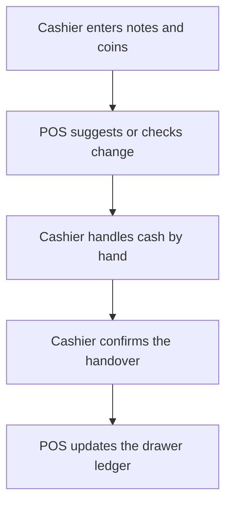

The cash tender machine is a future connection point, not a working feature. The POS does not connect to a Raspberry Pi or automatically count or dispense cash.

## Basic

### What to do today
Use the cash screen as normal. Tap the notes and coins the customer gives you, then check the suggested change or tap the denominations you actually hand back. Confirm the cash by hand. For cash refunds, the POS can suggest what to give, but you still take the notes and coins from the drawer yourself. See [[pay/cash]] and [[cash/change]].

### The setting
Settings ▸ Payments shows the cash-tender-machine option as **Under Construction** and locked off. You cannot turn it on. Cash sales, refunds and the drawer ledger continue to work manually.

## Deep

### Why it is not available
The hardware does not exist yet. The current app deliberately has no connection, pairing, socket, or machine control. The switch is not a way to enable a partial integration.

### What remains manual
The cashier enters the cash received, checks or enters the cash to give back, and confirms the physical handover. The ledger changes from those confirmed entries. Do not assume a machine counted or dispensed anything.

## Advanced

### Current implementation
`TENDER_MACHINE_READY` in `src/lib/tenderMachine.ts` is `false`. The exported `tenderMachine` function is intentionally empty, and no screen calls it. The switch is therefore locked off. The request type describes a future accept/dispense operation; it is not an active API.

| Job | Where |
|---|---|
| Locked feature flag | `TENDER_MACHINE_READY` in `src/lib/tenderMachine.ts` |
| Empty future port | `tenderMachine` in `src/lib/tenderMachine.ts` |
| Manual cash and change flow | `CashSheet` and `GiveCash` in `src/screens/CashSheet.tsx` |
| Ledger entries | `postCashSale` in `src/lib/cashSale.ts` |

When hardware is ready, the port still needs an implementation and explicit wiring into cash acceptance and dispensing. Until then, leave the switch off and follow the manual process.
