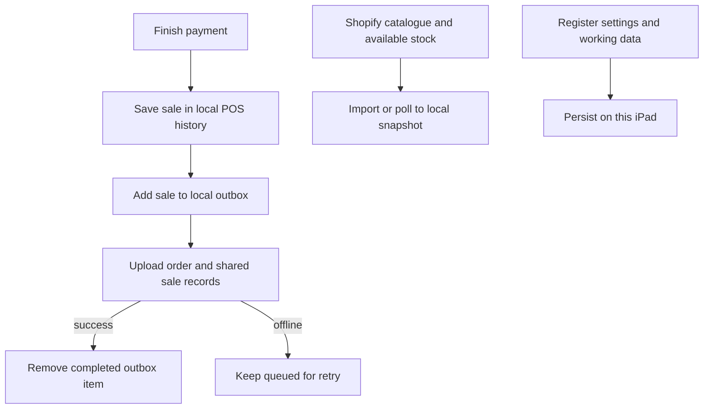

The register stores working data on this iPad and uses Shopify as the shared store for selected records. A sale is saved locally before its upload completes, so a temporary sync delay does not mean the sale disappeared.

## Basic

### What lives where
- **On this iPad:** the current cart, local Transactions history, saved carts, cash-drawer ledger, catalogue snapshot, register preferences and queued uploads.
- **In Shopify:** the product catalogue and available stock, customer records, completed Shopify orders, and shared POS data such as sale history, staff and shared settings.
- **On the Zeller terminal:** its pairing and terminal state. Pairing is device-specific and must be set up again if the app is reinstalled or moved to another iPad.

Cash and saved carts can be used offline. Card payments need the network to reach Zeller. A completed sale can stay in the upload queue until the register reconnects.

### What to do when sync is delayed
Check **Notifications** for the exact queued or blocked sale. Reconnect the register and let queued work retry. Correct a Shopify permission or settings error before using **Retry**. Do not make a duplicate sale or clear local history to force an upload. See [[fix/offline-sync]].

## Deep

### A sale has a local and shared path
When a sale finishes, the POS writes it to local history and the outbox. The outbox then uploads its steps to Shopify: the order, gift cards where relevant, sale entry and daily roll-up. Each completed step is recorded so a retry can resume. When stock changes elsewhere, registers poll Shopify and update their local snapshots.

An order can therefore be visible in local Transactions while its Shopify order is still pending. The outbox and the CSV history export are separate records; deleting or exporting one does not repair the other.

### Register-specific versus shared settings
The register ID and name, display preferences, cash drawer ledger, screensaver, inventory view and some device state belong to this iPad. Staff, display modes saved on staff, and selected operational settings are shared between registers through Shopify. A settings backup can transfer configuration, but it is not the same as the live sale queue or the catalogue.

If a shared-settings upload fails, the register keeps the pending change locally and retries from its foreground sync poll (about every 25 seconds). A remote settings pull will not replace that pending local change. Once the upload succeeds, other open registers can receive it on their next poll.

## Advanced

### Data path

| Job | Where |
|---|---|
| Persist settings, catalogue, cart and local POS data | `hydrate`, `patchSettings`, `patchData`, `patchPos` in `src/state/store.ts` |
| Save a completed sale and queue its upload | `recordSale`, `processOutbox` in `src/lib/sync.ts` |
| Push and pull shared staff/settings and saved carts | `pushSharedSettings`, `pullSettings`, `pushSaved`, `pullSaved` in `src/lib/sync.ts` |
| Import products and poll stock changes | `importFromShopify`, `pollShared` in `src/lib/sync.ts` |
| Export and restore a settings backup | `collectBackup`, `applyBackup` in `src/lib/backupIO.ts` |

The local store is persisted through the app's key-value storage. Shopify is the cross-register shared service; there is no separate POS server for the register's live data.
