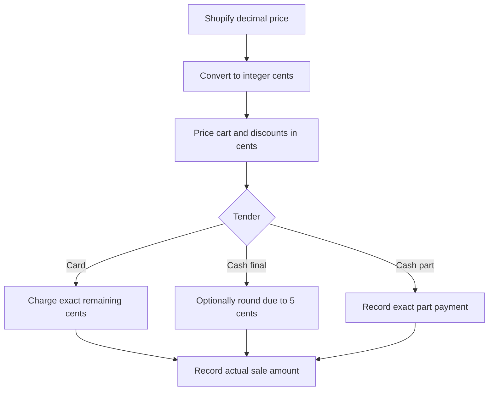

The POS works in Australian dollars. Prices and payments are kept as whole cents inside the app; cash rounding and GST display follow separate rules.

## Basic

### Cents and tender
An amount such as **$12.50** is stored as 1,250 cents. Shopify's decimal prices are converted when they enter or leave the app, which avoids doing normal price arithmetic with floating-point dollar values.

Card payments are charged to the exact remaining amount. If **Cash rounding (5c)** is on, only a cash payment that finishes the sale rounds the amount due to the nearest 5 cents. A cash part-payment is not rounded.

### GST on receipts
In **More ▸ Settings ▸ Receipts**, turn on **Registered for GST** only if the business is registered. The receipt is then titled **Tax invoice** and displays the GST included in GST-inclusive prices; gift-card sale lines are excluded. Check with an accountant before relying on the POS for tax reporting.

## Deep

### Cash rounding is not a price change
Rounding changes the final cash due by up to 2 cents. The sale retains its actual price and records the rounding separately. Card tender is never rounded, and a part-payment does not settle the final amount or apply cash rounding.

### GST display
The POS treats displayed item prices as GST-inclusive for this receipt calculation. When GST is enabled, the receipt displays one-eleventh of the eligible GST-inclusive amount as GST. Gift cards are excluded because GST applies when the card is redeemed. This receipt display is not a substitute for Shopify tax configuration, an accounting system or professional tax advice.

## Advanced

### Money path

| Job | Where |
|---|---|
| Convert dollars and cents, cash rounding | `toCents`, `toDecimal`, `roundCash` in `src/lib/money.ts` |
| Final cash tender and separate rounding record | `cashTender` in `src/lib/saleBuilder.ts` |
| GST-inclusive receipt calculation and gift-card exclusion | `gstIncluded` in `src/lib/receiptDoc.ts` |
| GST registration setting | `ReceiptSettings` in `src/screens/Settings.tsx` |
| Cash rounding preference | `cashRounding` in `src/state/store.ts`, toggle in `src/screens/Settings.tsx` |

GST is a receipt calculation based on the setting and recorded sale lines. It does not change the tender amount or the price stored on the sale.
