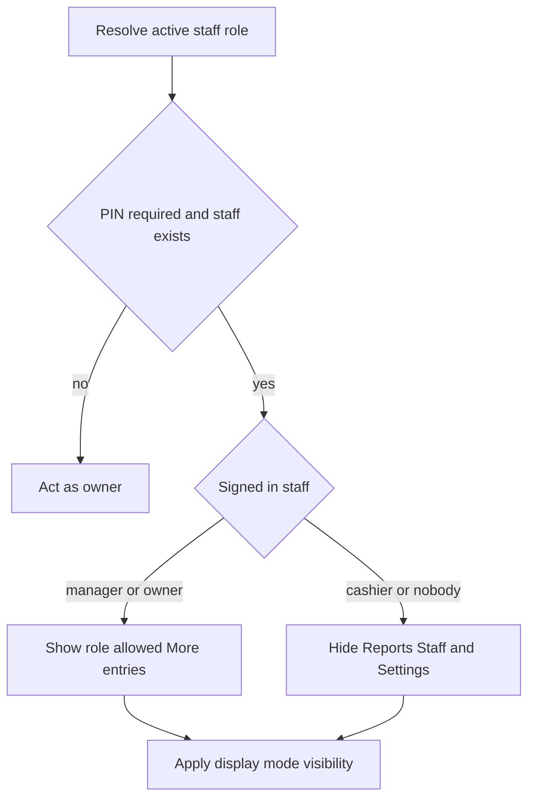

The POS has three roles: **Cashier**, **Manager** and **Owner**. A staff member's role travels with their staff record to the other registers.

## Basic

### What each role can open
- **Cashier:** everyday register screens, but not **Reports**, **Staff** or **Settings**.
- **Manager** and **Owner:** can also open Reports, Staff and Settings.

Display modes can hide tabs or More-menu items, but they cannot give a cashier access to manager-only entries. If PINs are not required or no staff members are set up, the register acts as the owner.

### PINs and passes
When **Require PIN to use the register** is on, staff sign in with their PIN or cashier pass. The active staff member is attached to the sale. Switching staff keeps the cart in place. See [[staff]] and [[staff/passes]].

## Deep

### Optional price-adjustment restrictions
An owner can choose whether Cashiers or Managers may set item, line or whole-order prices. By default, all roles can set them. A role restriction does not stop staff from removing an adjustment and returning the price to normal. Owners cannot be restricted from setting adjustments.

When an owner exists, only an owner can change these restrictions. If the team has no owner, a manager can manage them so the register does not become impossible to administer. See [[sales/cart-and-prices]] for the adjustment review rules.

### Role and display mode are separate
A staff member's Standard, Simple, Minimal or Custom mode controls presentation, not their role. A cashier cannot use a mode to reveal Reports, Staff or Settings. The only manager or owner keeps Staff and Settings visible even if their chosen mode would otherwise hide those entries, so they can change the mode back. See [[staff/modes]].

## Advanced

### Access decision

| Job | Where |
|---|---|
| Resolve the active role | `actingRole` in `src/lib/adjustPerms.ts` |
| Gate Reports, Staff and Settings in More | `visibleMoreRows` in `src/lib/uiMode.ts`, `src/screens/More.tsx` |
| Require PIN and create staff records | `src/screens/Staff.tsx` |
| Sign in and switch staff | `src/lib/staffAuth.ts`, `src/screens/StaffLogin.tsx` |
| Configure adjustment restrictions | `canEditAdjustPerms`, `canAdjust` in `src/lib/adjustPerms.ts` |

With PINs enabled, an unknown or locked staff identity resolves to the cashier role. This is the safe default for role-gated screens.
