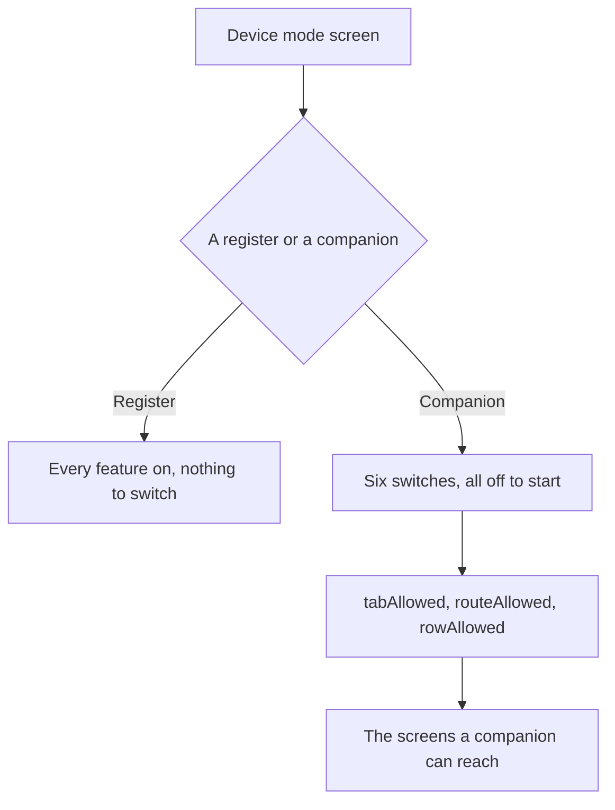

Open **More ▸ Device mode** to say what this device is. A **register** is a till and has every feature. A **companion** is a phone or tablet beside the till: it has the register features you switch on, and everything else the app can do. Everyone who is signed in can open this page.

## Basic

### See what this device is
- The top of the page says **This device is a register** or **This device is a companion**, with a line under it saying what that means.
- The list of features below shows a switch for each group. On a register every switch is on and cannot be changed.

### Switch a feature on or off
- **Selling.** The checkout, cart and payments.
- **Card reader.** The Zeller reader and terminal practice.
- **Cash drawer.** The drawer, its ledger and the change tools.
- **Till staff tools.** Lock register, staff pass scanning and switching staff.
- **Till display.** Screensaver, keep awake, item spotlight and the grid editor.
- **Till training.** The register courses.
- Under each switch is a line listing what the group holds. Switch a group off to take those things off this device, and on to bring them back.

### Change the mode
- Tap **Switch this device to Companion mode** or **Switch this device to Register mode** and confirm.
- Switching to a companion keeps the feature switches as they are: whatever was on stays on, and anything you switch on as a companion is still there if you switch back to a register.
- Nothing is deleted by a mode change. A hidden feature is hidden, not removed, so a cart, a saved sale or a cash count is still there when it comes back.

### What a companion shows
- The tab bar is **Today**, **Scan**, **Inventory**, **Transactions** and **More**, with **Checkout** added when Selling is on. Notifications is the bell on Today, and also opens from a notice link. A register keeps the five tabs it has always had and never shows Today or Scan.
- **Today** is a glance at the shop: today's sales and orders (managers and owners only, the same rule as Reports), items that are low, out or oversold, and any sales stuck in the upload queue. Each card opens the full screen, and pulling down refreshes it.
- **Scan** is one big button for a price check or a stock check. It opens the camera, and a Bluetooth scanner works once the check is open. It never touches a cart.
- A tab, page or More row that belongs to a feature the device does not hold is not shown. A page that is open when its feature is switched off closes itself. **Staff** is always shown for managers and owners, so a companion can always make or reset a PIN.

### PIN and locking on a companion
- A companion asks for a PIN when it opens, and locks itself again when nobody has touched it for a while or after it has been away in the background. **Locking** on this page sets how long: 1, 2, 5 or 10 minutes, or never. It never locks in the middle of a card payment.
- Anything that changes something that matters asks for your PIN again if you have not typed it recently: taking a payment, refunds, changing items, stock, customers or orders, the cash drawer, Settings, Staff and backups, and changing the mode, a feature or the locking choices on this page. Signing in counts as typing it. **Ask for my PIN again after** can be every time, 1, 5 or 15 minutes. Five wrong PINs lock the app.
- A register is not changed by any of this. It locks only if **Require PIN** is switched on in Staff, as before. Making a phone a companion never switches that shared setting on, so your tills are not affected.
- A companion needs an owner with a PIN to lock. Create one in Staff first; the setup checklist step ticks once there is an owner with a PIN.
- Practice and Demo mode show every feature and never lock.

### Open the checklist again
- Tap **Open the setup checklist** to see the first-run steps for this device and which are done. See [[start/setup]].

## Deep

### Two ways of narrowing, and neither one widens
A device's mode decides what exists here. A person's display mode (Standard, Simple, Minimal, Custom) decides how much of that they see. Neither can bring back something the other has taken away: a companion with Selling off stays without the checkout however the person's display mode is set, and a companion cannot grant a cashier a page their role does not allow.

Some things are on a companion whatever it has switched off, because they are not register features: Help, Demo mode, Notifications, the assistant, Settings for managers and owners, and the sync and Shopify diagnostics.

### The mode belongs to the device
The mode and the feature switches are stored on this device only. They do not sync to the other registers, and a [[settings/backup]] file does not carry them, so a device restored onto new hardware keeps its own answer. The mode is never taken from another register either: a device always reads its own.

### Which is which in the shop
A register is usually the iPad at the counter with the reader and the drawer. A companion is a phone in someone's pocket, or a tablet used for looking things up, taking a cart to the counter, or asking the assistant. Turning Selling on a companion is what makes it a second till.

## Advanced

### The rules
`src/lib/appMode.ts` holds the six group ids, the defaults (a register has all six, a companion has none until they are switched on), and the gate: `tabAllowed`, `routeAllowed` and `rowAllowed`. A stored mode that is not `register` or `companion` reads as a register, so an older app version or a hand-edited setting can never invent a companion.

| Job | Where |
|---|---|
| The groups, the defaults and the gate | `src/lib/appMode.ts` |
| The page and its six switches | `src/screens/DeviceMode.tsx` |
| The stored keys `appMode` and `registerFeatures` | `src/state/store.ts` |
| Keeping them out of a backup | `DEVICE_KEYS` in `src/lib/backupFile.ts` |
| The row in More | `src/screens/More.tsx` and `src/lib/uiMode.ts` |

### What the gate answers
- `tabAllowed`: a companion keeps Inventory, Transactions, Notifications and More, and needs **Selling** for Checkout.
- `routeAllowed`: `cart`, `pay` and `saved` need **Selling**; `drawer` needs **Cash drawer**; `terminalPlay` needs **Card reader**; `training` and `trainingRun` need **Till training**. Every other page is allowed.
- `rowAllowed`: the **Cash drawer** and **Training** rows follow their group (Staff does not, see above). The row is still subject to the display mode and the person's role.

### How the lock and the step-up decide
- `lockRequired` in `src/lib/appMode.ts` says whether the app is locked: a register follows Require PIN, a companion always locks.
- `stepUpNeeded` and `lockDue` in `src/lib/stepUp.ts` say whether a PIN is due, from the time of the last PIN entry, and whether to lock after being idle. Pages in `STEP_UP_ROUTES` ask before they open (`pay`, `createItem`, `editItem`, `drawer`, `settings`, `staff`, `deviceMode`), and the handlers for stock, customers, fulfilling orders, refunds and backups call `requireStepUp` from `src/lib/stepUpGate.ts` themselves. The prompt is `src/ui/StepUpHost.tsx`.
- `autoLockMinutes` and `stepUpMinutes` are per device and listed in `DEVICE_KEYS`, so a backup never copies them.

### Tabs, pages and rows
`deviceTabs` in `src/lib/appMode.ts` gives the tab bar, `homeTab` says where the app opens and where a hidden tab sends you, and `tabAllowed`, `routeAllowed` and `rowAllowed` answer for each tab, page and More row. `App.tsx` asks them for the bar and the panes, the `Routes` guard closes a page the device does not hold, and the More screen filters its rows. `src/screens/Today.tsx` draws the Today cards from `todayCards` in `src/lib/todayCards.ts`, and `src/screens/ScanTab.tsx` reuses `LookupSheet`.

### What is not wired yet
The card reader, the cash drawer and the sync pages following the same switches arrive with patch 0179 of `dev_docs/COMPANION_PLAN.md`, and the selling path with 0180.
