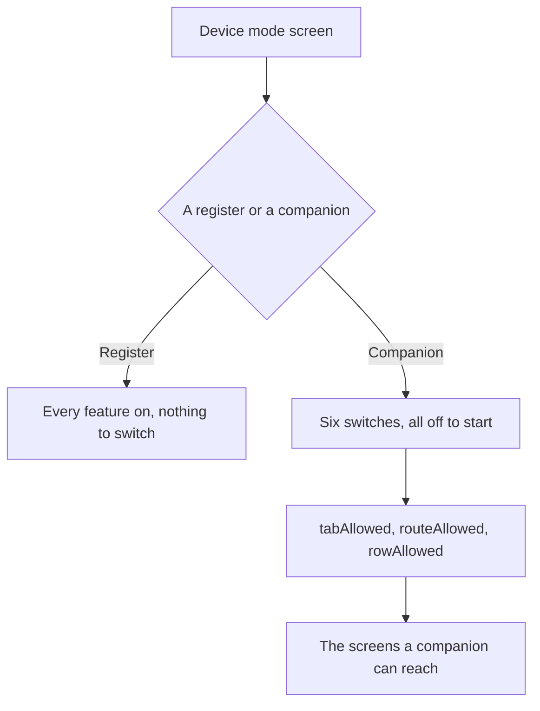

Open **More ▸ Device mode** to say what this device is. A **register** is a till and has every feature. A **companion** is a phone or tablet beside the till: it has the register features you switch on, and everything else the app can do. Everyone who is signed in can open this page.

## Basic

### See what this device is
- The top of the page says **This device is a register** or **This device is a companion**, with a line under it saying what that means.
- The list of features below shows a switch for each group. On a register every switch is on and cannot be changed.

### Switch a feature on or off
- **Selling.** The checkout, cart and payments.
- **Card reader.** The Zeller reader and terminal practice.
- **Cash drawer.** The drawer, its ledger and the change tools.
- **Till staff tools.** Lock register, staff pass scanning and switching staff.
- **Till display.** Screensaver, keep awake, item spotlight and the grid editor.
- **Till training.** The register courses.
- Under each switch is a line listing what the group holds. Switch a group off to take those things off this device, and on to bring them back.

### Change the mode
- Tap **Switch this device to Companion mode** or **Switch this device to Register mode** and confirm.
- Switching to a companion keeps the feature switches as they are: whatever was on stays on, and anything you switch on as a companion is still there if you switch back to a register.
- Nothing is deleted by a mode change. A hidden feature is hidden, not removed, so a cart, a saved sale or a cash count is still there when it comes back.

### Open the checklist again
- Tap **Open the setup checklist** to see the first-run steps for this device and which are done. See [[start/setup]].

## Deep

### Two ways of narrowing, and neither one widens
A device's mode decides what exists here. A person's display mode (Standard, Simple, Minimal, Custom) decides how much of that they see. Neither can bring back something the other has taken away: a companion with Selling off stays without the checkout however the person's display mode is set, and a companion cannot grant a cashier a page their role does not allow.

Some things are on a companion whatever it has switched off, because they are not register features: Help, Demo mode, Notifications, the assistant, Settings for managers and owners, and the sync and Shopify diagnostics.

### The mode belongs to the device
The mode and the feature switches are stored on this device only. They do not sync to the other registers, and a [[settings/backup]] file does not carry them, so a device restored onto new hardware keeps its own answer. The mode is never taken from another register either: a device always reads its own.

### Which is which in the shop
A register is usually the iPad at the counter with the reader and the drawer. A companion is a phone in someone's pocket, or a tablet used for looking things up, taking a cart to the counter, or asking the assistant. Turning Selling on a companion is what makes it a second till.

## Advanced

### The rules
`src/lib/appMode.ts` holds the six group ids, the defaults (a register has all six, a companion has none until they are switched on), and the gate: `tabAllowed`, `routeAllowed` and `rowAllowed`. A stored mode that is not `register` or `companion` reads as a register, so an older app version or a hand-edited setting can never invent a companion.

| Job | Where |
|---|---|
| The groups, the defaults and the gate | `src/lib/appMode.ts` |
| The page and its six switches | `src/screens/DeviceMode.tsx` |
| The stored keys `appMode` and `registerFeatures` | `src/state/store.ts` |
| Keeping them out of a backup | `DEVICE_KEYS` in `src/lib/backupFile.ts` |
| The row in More | `src/screens/More.tsx` and `src/lib/uiMode.ts` |

### What the gate answers
- `tabAllowed`: a companion keeps Inventory, Transactions, Notifications and More, and needs **Selling** for Checkout.
- `routeAllowed`: `cart`, `pay` and `saved` need **Selling**; `drawer` needs **Cash drawer**; `staff` needs **Till staff tools**; `terminalPlay` needs **Card reader**; `training` and `trainingRun` need **Till training**. Every other page is allowed.
- `rowAllowed`: the **Cash drawer**, **Staff** and **Training** rows follow their group. The row is still subject to the display mode and the person's role.

### What is not wired yet
The gate is used by the settings, the setup checklist and this page today. Hiding the tabs, guarding a page someone reaches by a link, and the Today and Scan home arrive with patches 0178 and 0179 of `docs/COMPANION_PLAN.md`; the step-up PIN that guards changing the mode arrives with 0177.
