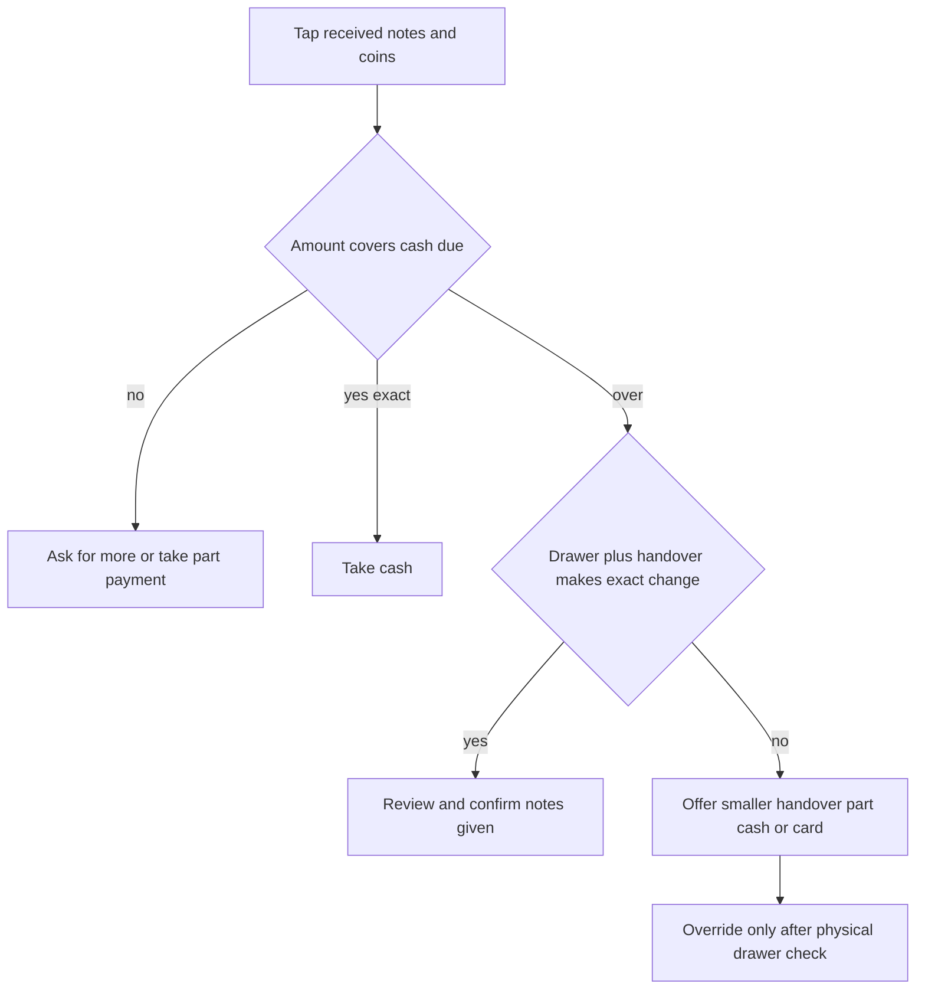

If the Cash sheet says it **Can't make … change**, the notes and coins recorded in the drawer cannot make that exact amount from the handover and current ledger. Review the displayed options before taking the cash.

## Basic

### Choose an offered option
The sheet may offer:
- **Use that smaller handover**: accept a smaller set of the notes the customer gave, return the rest, and make the change from the drawer.
- **Cash … + the rest another way**: take the displayed amount in cash and collect the remaining balance by card or another tender.
- Take the full amount by card.

If the ledger is empty or out of date, count the drawer and correct the ledger first. You can use **The drawer has it (ledger is out of date)** only when you have physically checked that the drawer can provide the displayed change.

### If you have already taken the cash
In **Give change**, the POS suggests an optimal set of notes and coins if it finds an exact combination. Check what you actually hand over, then tap **Gave this**. If needed, choose different denominations manually; confirming the count is required so the drawer ledger stays accurate.

For the normal cash flow and denominations, see [[pay/cash]] and [[cash/change]].

## Deep

### Ledger count versus physical drawer
The suggestion uses the ledger's note and coin counts plus the notes the customer just handed over. If the actual drawer differs from the ledger, the suggestion can be impossible or not match the physical cash. Count or correct the ledger before relying on a suggestion.

The override is a manual acknowledgement that the physical drawer can make the change despite the ledger. The **Give change** step requires confirmation of the denominations actually handed over and records them in the drawer ledger.

### Do not promise change the drawer cannot make
The POS blocks the normal overpayment path when it cannot make exact change. Ask for a different handover, use the suggested part-cash option, or use another tender. Even an exact-amount handover is entered by denomination so the drawer ledger stays current.

## Advanced

### Change decision

| Job | Where |
|---|---|
| Cash sheet prompts and handover options | `src/screens/CashSheet.tsx` |
| Cash amount states, exact-change plan and fallback choices | `cashStatus`, `planChange`, `handBackOptions`, `partCashOption` in `src/lib/cashSale.ts` |
| Note and coin counts | `src/lib/cashLedger.ts`, `src/ui/DenomPad.tsx` |
| Check Change tool | `src/lib/checkChange.ts`, `src/screens/CheckChange.tsx` |

The hardware tender machine is not active. The cashier enters received and given denominations and confirms them manually.
