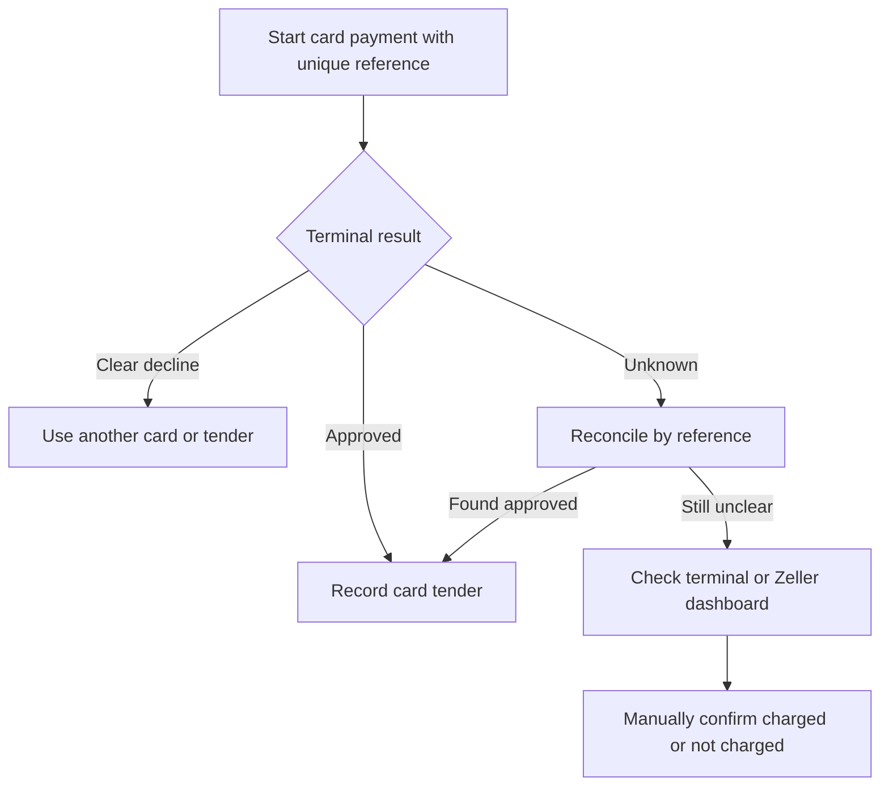

Read the result shown on the Payment screen. A clear decline means the card was not accepted; an **unknown** result means the POS has not confirmed whether the customer was charged.

## Basic

### A clear decline
Follow the message. Common next steps are to have the customer tap, insert or swipe again, use another card, or split the amount with another payment method. Contact the bank or Zeller if the message says to do so. Do not ask the customer to repeat their PIN where the screen does not request it.

If they want to use another method, select cash, gift card or split payment on the Payment screen. See [[pay/split-and-part]].

### The payment says it is checking or unknown
Do **not** start a second card charge yet. The POS checks the transaction reference with the terminal. If it still cannot confirm the result, check the terminal or Zeller dashboard:
- If it shows approved, choose the option confirming the customer **was** charged.
- If you have checked and it shows the payment did not happen, choose the option confirming the customer **was not** charged.

Only resolve it after checking. Confirming incorrectly can record a payment that was not made or allow a duplicate charge.

## Deep

### Declined versus unknown
A clean decline is safe to try again or use another tender. A timeout or connection loss after processing began can be ambiguous, so the POS reconciles using the transaction reference and blocks another card charge until resolved. A card-payment failure before the terminal interaction (for example, internet or pairing trouble) is a reader problem; see [[fix/reader]].

The Payment attempt is kept on this device. Reports and sales are not treated as paid until the result is approved or you manually confirm an unknown result.

## Advanced

### Payment result path

| Job | Where |
|---|---|
| Decline messages by response code | `lookupResponse` in `src/lib/responseCodes.ts` |
| Normalise terminal responses | `normalise`, `reconcile` in `src/lib/zeller.ts` |
| Payment UI, attempt and manual resolution | `src/screens/Pay.tsx` |
| Read-only attempt list and test purchase | `src/screens/Diagnostics.tsx` |
| Card and split payment guide | `help/pay/card.md`, `help/pay/split-and-part.md` |

`startCharge` records the attempt before calling Zeller. It checks the terminal transaction reference after ambiguous results; never treat a network timeout as a definite decline.
