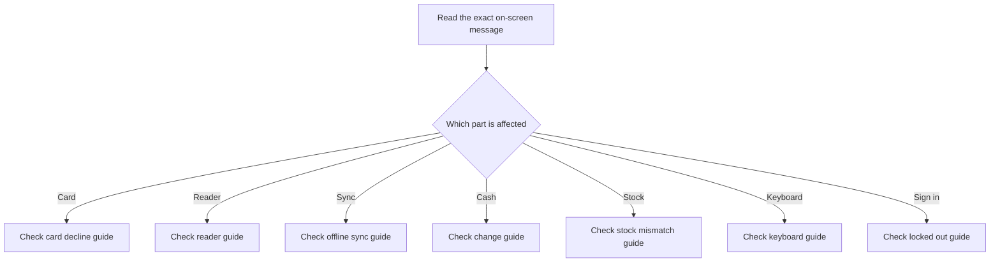

Start with the message on screen and choose the closest guide below. If a payment result is uncertain, do not charge again until you have checked whether the first attempt went through.

## Basic

### Choose a guide
- Card declined or the customer cannot pay by card: [[fix/card-declined]].
- Reader not ready, not paired or unavailable: [[fix/reader]].
- Sales waiting to upload or a sync error: [[fix/offline-sync]].
- Drawer cannot make the change offered: [[fix/cant-make-change]].
- POS stock differs from Shopify: [[fix/stock-mismatch]].
- HID scanner or keyboard trouble: [[fix/keyboard]].
- Cannot sign in with a PIN or cashier pass: [[fix/locked-out]].

You can also open **More ▸ Help** and search the words shown in the message. Help is bundled in the app and works offline.

## Deep

### Avoid repeating uncertain actions
Some actions can have succeeded even when the POS did not receive a clear reply. For an uncertain card result, check the terminal or Zeller dashboard and use the Payment screen's status check or manual resolution before trying another charge. For queued sales, retry the existing upload rather than making a duplicate sale.

### When to ask for help
If the matching guide does not resolve the issue, keep the exact error text and the time it happened. For payment issues, also note whether the terminal showed approved, declined or no result. Do not include card security codes or passwords in a support message.

## Advanced

### Support paths

| Area | Help page | App location |
|---|---|---|
| Card result | `fix/card-declined` | Payment screen |
| Reader setup | `fix/reader` | Support & diagnostics |
| Sales sync | `fix/offline-sync` | Notifications |
| Cash change | `fix/cant-make-change` | Cash sheet and drawer |
| Stock | `fix/stock-mismatch` | Inventory |
| Scanner input | `fix/keyboard` | Hardware test and Checkout |
| Staff access | `fix/locked-out` | Sign-in screen and Staff settings |

Each guide names the safest next action for its failure type. Avoid retrying a potentially successful payment or deleting a queued sale as a shortcut.
