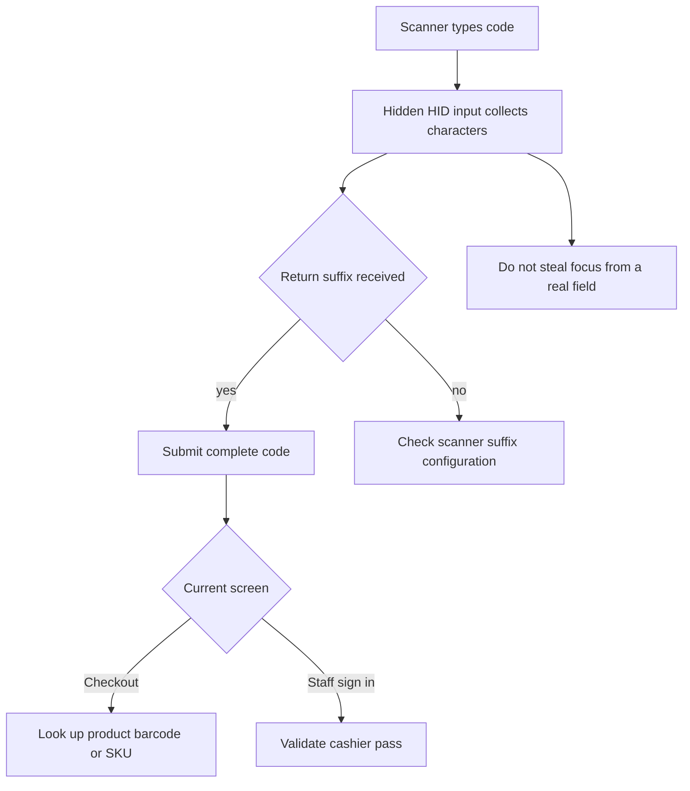

A Bluetooth HID scanner behaves like a keyboard: it types the scanned code and usually sends Return. Checkout reads product barcodes or SKUs; staff sign-in reads cashier passes. Check that you are scanning into the right screen. Shopify GIDs are internal IDs, not scanner codes; see [[concepts/glossary]].

## Basic

### Test a Bluetooth scanner
1. Check Bluetooth settings on the iPad and make sure the scanner is connected.
2. Open **More ▸ Settings ▸ Hardware** and use **Test scanner**.
3. Scan a known code. A successful test displays the scanned value; it does not add an item to the sale.
4. In **Checkout**, scan a product's barcode or SKU. At staff sign-in, scan the cashier pass instead.

The scanner's suffix must send Return to finish a scan. If the test shows a value without submitting it, set the scanner to append Enter/Return using its manufacturer instructions.

### If characters are missing or out of order
Check that the scanner is connected and test again with the iPad keyboard hidden. Keep the scanner close to the iPad and avoid scanning while another text field is active. Some scanner configurations add a prefix or suffix; reset it to the manufacturer's default barcode/keyboard settings, then configure Return as the suffix.

For supported scanner types and the camera scanner, see [[sales/scanners]].

## Deep

### Where the scan goes
Checkout's hidden HID input receives the whole code and submits when Return arrives. It does not grab focus while a real text field or the on-screen keyboard is active. Scanning a product then adds or finds it using the Checkout scan handler. At sign-in, only a cashier-pass code is accepted; an ordinary product code is not a staff login.

The camera scanner is a separate option and does not depend on Bluetooth keyboard focus. You can use it from Checkout or the cashier-pass scanner when those screens offer it.

### If a scan does nothing
- If Test scanner does not show characters, reconnect or pair the scanner with the iPad.
- If Test scanner shows the code but Checkout does not add an item, check that the code is a barcode or SKU on an imported variant, and that the correct register/location is loaded.
- If the scanner types into a name or search field, finish or close that field before scanning again.
- If staff sign-in says the code is not a pass, use the cashier's issued pass or enter their PIN.

## Advanced

### HID input path

| Job | Where |
|---|---|
| HID and camera scanning | `HidScanner`, `CameraScanner` in `src/screens/Scanner.tsx` |
| Checkout barcode/SKU handling | `onScan` in `src/screens/Checkout.tsx`, `findByBarcode` in `src/lib/cartOps.ts` |
| Pass scanning at sign-in | `StaffLoginPad` in `src/screens/StaffLogin.tsx` |
| Scanner test and connection instructions | `src/screens/Settings.tsx`, `help/settings/hardware.md` |
| Avoid taking focus from an active text field | `isUserTyping` in `src/lib/focusGuard.ts` |

The hidden field is keyed again after each Return to clear the previous scan before the next one.
