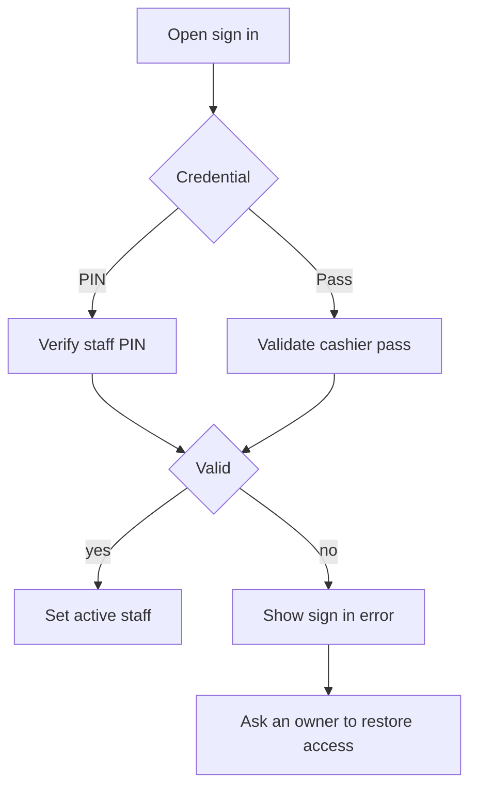

Check whether the register expects a staff PIN or an issued cashier pass. A forgotten PIN cannot be recovered from the POS; ask an owner or manager who can still sign in to manage the staff record.

## Basic

### Check the sign-in method
- Enter the PIN assigned to your staff account. PINs are 4-6 digits.
- For a pass, scan the current cashier pass barcode. A cancelled or replaced pass no longer signs in.
- If the pass is not recognised, use the PIN or ask an owner to check your Staff record and issue a replacement.

An owner can open **More ▸ Staff**, select your name, and issue or replace your cashier pass. The app does not show an existing PIN. If your PIN is forgotten, ask an owner to remove the old staff record and add you again with a new PIN and the correct role. Have the owner verify that another owner remains before removing any owner account.

### If nobody can sign in
Do not delete the app or clear its data; that can remove local sales and settings. Use a working owner account on another register to check shared staff settings, then contact your POS administrator or support if no owner account remains available.

## Deep

### Pass versus PIN
A cashier pass is a scannable credential tied to one staff record. Replacing or cancelling the pass invalidates the previous code. A pass can be printed or added to Apple Wallet; it is not a backup of the staff account or a way to reveal the PIN.

PINs are stored as salted hashes and shared with the other registers through Shopify settings. They cannot be read back as plain digits. A replacement PIN is set by adding a new staff record after removing the old one.

### Keep an owner available
Before removing a staff member, confirm that the team will still have an owner able to manage staff and settings. A register with no available owner may require administrator/support assistance to restore access.

## Advanced

### Sign-in path

| Job | Where |
|---|---|
| Verify PIN and cashier pass | `signInWithPin`, `signInWithPass` in `src/lib/staffAuth.ts` |
| Store salted PIN hashes | `hashPin`, `verifyPin` in `src/lib/pin.ts` |
| Add or remove staff and issue a pass | `src/screens/Staff.tsx`, `src/screens/StaffPass.tsx` |
| Scan a pass at sign-in | `src/screens/StaffLogin.tsx` |

Staff PINs are not recoverable from a backup as plain text. To protect local data, do not reinstall the app as a PIN-reset step.
