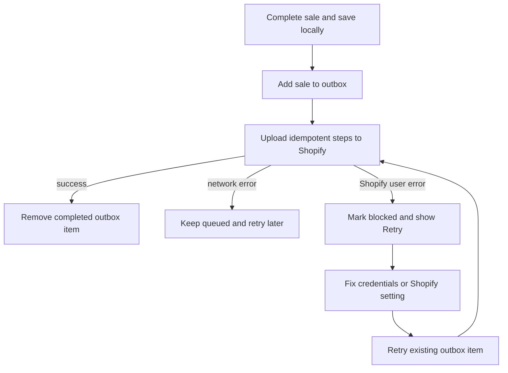

Sales are saved on this iPad first, then uploaded to Shopify when the connection is available. If a sale is queued, leave it in place; do not ring it through again just to make it appear online.

## Basic

### Check the sync status
Open **Notifications**. A queued sale says it will upload when the connection is back. A blocked sale shows an error and a **Retry** button.
- If the iPad is offline, reconnect it to Wi-Fi or another working network and leave the POS open.
- If Shopify credentials or permissions were rejected, fix the Shopify connection in **More ▸ Settings ▸ Shopify** before retrying.
- After fixing the cause, tap **Retry** on the blocked sale. The POS resumes its saved upload steps.

Cash and saved carts can work offline. Card payments require an internet connection to reach Zeller. To set up Shopify again, see [[settings/shopify]].

### If the sale stays queued
Check the exact error on Notifications and make sure the iPad can reach Shopify. The app retries automatically when it processes the outbox; keep the app open and connected. A blocked sale needs the cause corrected and an explicit **Retry**.

## Deep

### The sale is not lost or duplicated
The POS records the completed sale locally and adds it to an upload queue. Upload steps use stable identifiers so a retry can resume rather than create a second order. A network failure leaves the sale queued; a Shopify user/permission error blocks that item until corrected.

The device's local Transactions history can show the sale while Shopify is still catching up. The catalogue and stock updates may also take time to refresh on other registers.

### What not to do
- Do not make a second POS sale for the same customer purchase just because the upload has not finished.
- Do not clear local history to fix a queue. CSV history and the sale upload queue are separate.
- Do not repeatedly retry a blocked permission/configuration error without correcting its cause first.

## Advanced

### Outbox retry path

| Job | Where |
|---|---|
| Process and retry sale uploads | `processOutbox`, `retryBlocked` in `src/lib/sync.ts` |
| Locally stored sales and outbox | `Pos`, `OutboxItem` in `src/state/store.ts` |
| Queue status and Retry button | `src/screens/Notifications.tsx` |
| Network vs Shopify configuration errors | `isNetworkError`, `ShopifyUserError` in `src/lib/shopify/client.ts` |
| Shopify credentials and import | `src/screens/Settings.tsx`, `help/settings/shopify.md` |

Completed outbox steps are marked individually. A retry skips those steps and uses the stored sale data for the work that remains.
