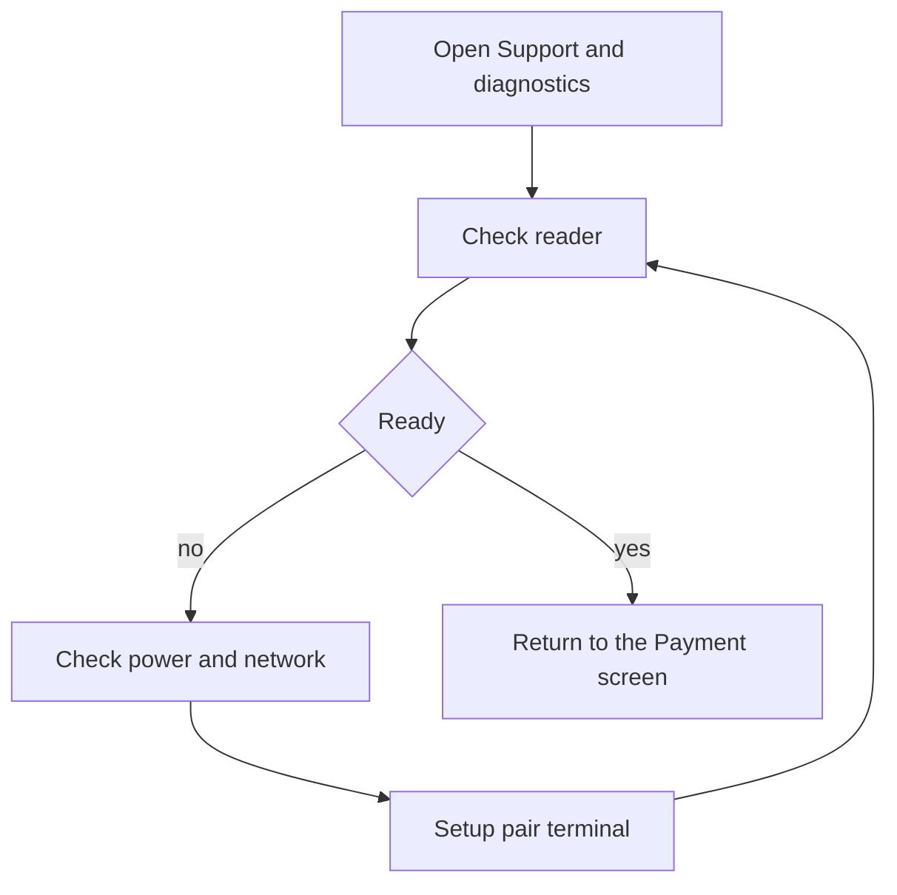

If the Payment screen says the reader is not ready, open **More ▸ Support & diagnostics** and check the Zeller reader status before starting another card payment.

## Basic

### Check or pair the reader
1. Make sure the terminal is on and connected to the network.
2. Open **More ▸ Support & diagnostics**.
3. Tap **Check reader**. If it is not paired, tap **Setup (pair terminal)** and follow the terminal's prompts.
4. When the status says ready, return to the sale and try again.

If the terminal is serving another register, wait for that payment to finish before retrying. Card payments need an internet connection; cash can still be taken offline.

### Test after setup
In Support & diagnostics, **Test purchase $1.00** makes a real $1.00 card transaction. Use it only when you intend to test with a card. If approved, the screen offers **Refund the $1.00 test**.

## Deep

### Reader trouble or card decline?
- **Reader not ready**, **not paired**, **offline** or **terminal unavailable** means the POS cannot start or reach the terminal. Check power, network and pairing.
- **Card declined** means the terminal returned a card or issuer decision. Follow [[fix/card-declined]] instead of repeatedly pairing the reader.
- If the customer may already have been charged, treat the outcome as unknown and check the terminal or Zeller dashboard before another attempt.

The POS keeps the Zeller provider mounted for the entire app session. If the app was reinstalled, pair the terminal again. Reader pairing is device-specific and is not carried in a backup.

## Advanced

### Reader diagnostic path

| Job | Where |
|---|---|
| Reader status, pairing and test purchase | `src/screens/Diagnostics.tsx` |
| One terminal handle and pairing calls | `checkReader`, `pairReader` in `src/zellerBridge.tsx` |
| Reader issue notifications | `src/zellerBridge.tsx`, `src/screens/Pay.tsx` |
| Terminal response mapping | `src/lib/zeller.ts` |
| Payment settings and Reader & pairing entry | `src/screens/Settings.tsx` |

Setup and check run through the Zeller SDK. If setup returns an error, read the message in the diagnostic screen; the app does not mark the reader ready until initialisation succeeds.
