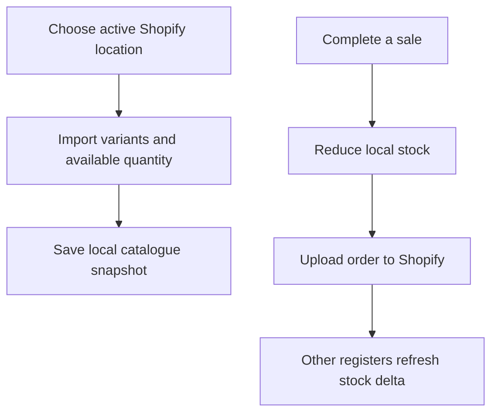

Inventory shows stock for the Shopify location selected on this register. Refresh from Shopify before comparing, and make sure you are looking at the same location and variant in both places.

## Basic

### Refresh the catalogue and stock
1. Check the location in **More ▸ Settings ▸ Shopify**.
2. Open **Inventory** and tap **Refresh stock from Shopify**.
3. In **Filters & sort**, check the import time and total variants on this iPad.
4. Search by variant name, SKU or barcode and check that the product status and stock filters do not hide it.

If this register is connected to the wrong location, select the correct active location and refresh again. For the filter meanings and stock update controls, see [[stock/inventory]].

### Check whether the item is tracked
**—** means inventory is not tracked; **0** means tracked and currently out of stock. A negative number means more units have been sold than the available count. Check the tracked setting and available quantity for that exact variant in Shopify.

## Deep

### Why registers can temporarily differ
Shopify is the shared source. Each register keeps a local catalogue and stock snapshot. Sales update this register's local count immediately, while the sale upload and the other registers' stock refresh happen separately. A register that is offline or has not polled yet can show an older count.

The POS reads the selected location's **available** quantity. Shopify's other inventory states or another location may not match that number.

### When a sale is queued
A completed sale reduces the local count and queues its Shopify order. If it is still queued, correct the sync issue rather than adjusting stock to make the local display look right. See [[fix/offline-sync]].

## Advanced

### Stock update and refresh path

| Job | Where |
|---|---|
| Select location and full catalogue import | `src/screens/Settings.tsx`, `importFromShopify` in `src/lib/sync.ts` |
| Read tracked and available stock | `fetchVariants` in `src/lib/shopify/catalogue.ts` |
| Poll location stock changes | `fetchStockDelta` in `src/lib/shopify/catalogue.ts`, `pollShared` in `src/lib/sync.ts` |
| Mirror completed sale stock locally | `applyLocalStock` in `src/lib/sync.ts` |
| Set or adjust stock from the POS | `src/screens/Inventory.tsx`, `src/lib/shopify/inventory.ts` |

Compare the same variant, location and Shopify quantity name (**available**). A manual Inventory count or adjustment writes to Shopify; do not use one to conceal a delayed sync.
