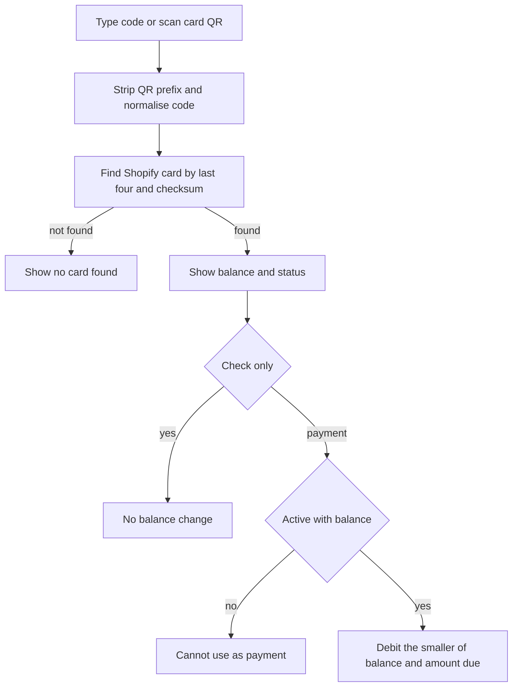

Check a gift card before a sale without changing its balance, or apply it as a payment during checkout.

## Basic

### Check a balance
Open **More ▸ Gift cards** and tap **Check balance**, or use **Check gift card** from the cart menu. Type the code or tap **Scan** and scan the gift card QR. Tap **Check**. The sheet shows its balance, last four characters, and whether it is **Active** or **Disabled**. If the card can be found, the Gift cards screen can also show its recent credits and redemptions.

Checking a balance does not use any of it. To pay with the card, use the **Gift card** button on the Payment screen: [[pay/gift-card]].

### Scan the right QR
- **Gift card QR (for scanning at a register):** contains the card code. Use it to check a balance or pay with the card.
- **Claim QR: customer adds their email:** opens the claim page so the recipient can give Shopify their email. It does not contain the spendable card code. See [[gift/claim-page]].
- A QR with a `shopify-giftcard` prefix is cleaned automatically. You do not need to edit it.

### Messages
- **No gift card found for that code.** Check the printed code or scan the Gift card QR again.
- **Lookup failed** with a reason: the POS could not reach Shopify. Check the connection and try again.
- **Disabled:** the card cannot be used. Ask an owner to check it in Shopify.
- **code could not be verified:** the card may have been created outside this POS. The POS can only accept it when it finds one unmarked candidate and the entered code is long enough.

## Deep

### What a balance check reads
Shopify holds the card's current balance and enabled status. The POS searches candidate cards by their last four characters, then checks the full code against a fingerprint stored on cards created by the POS. For a card made elsewhere, it can show an unverified result when exactly one candidate is unmarked and the code has at least eight characters. Otherwise it reports no card found.

The Gift cards screen shows the 30 most recent card transactions when available. Credits add value; redemptions take value off. The Sales report gives totals for gift cards sold, redeemed and outstanding; it is not the history of one individual card.

### Paying with a card
At payment, **Use as payment** takes the lesser of the current payment amount and the card's balance. Shopify is charged immediately. If that does not cover the whole sale, the unpaid amount remains for another tender. A balance check alone does not reserve or debit the card.

If a part-paid sale is cancelled after the card was charged, **Refund & cancel** credits the amount back to that same Shopify gift card. If the card cannot be identified or Shopify is unavailable, the sale remains in cancellation mode so you can retry or resolve it without charging the customer again. See [[pay/gift-card]] for the full payment steps.

## Advanced

### Balance check and payment

| Job | Where |
|---|---|
| Gift cards hub and history | `src/screens/GiftCards.tsx` |
| Check code and balance sheet | `GiftCheckSheet` in `src/screens/sheets.tsx` |
| Code normalisation and QR prefix | `stripGiftPrefix`, `normaliseCode` in `src/lib/giftCode.ts` |
| Lookup and transaction history | `lookupGiftCard`, `giftCardHistory` in `src/lib/shopify/giftcards.ts` |
| Payment debit | `useGift` in `src/screens/Pay.tsx`; `debitGiftCard` in `src/lib/shopify/giftcards.ts` |
| Gift-card report totals | `outstandingBalance` in `src/lib/shopify/giftcards.ts`; `src/screens/Reports.tsx` |

`lookupGiftCard` returns the balance and status but makes no debit. `useGift` calls Shopify's debit mutation before adding the tender to the payment list. Gift cards are not cash, are not rounded, and do not change the cash drawer ledger.
