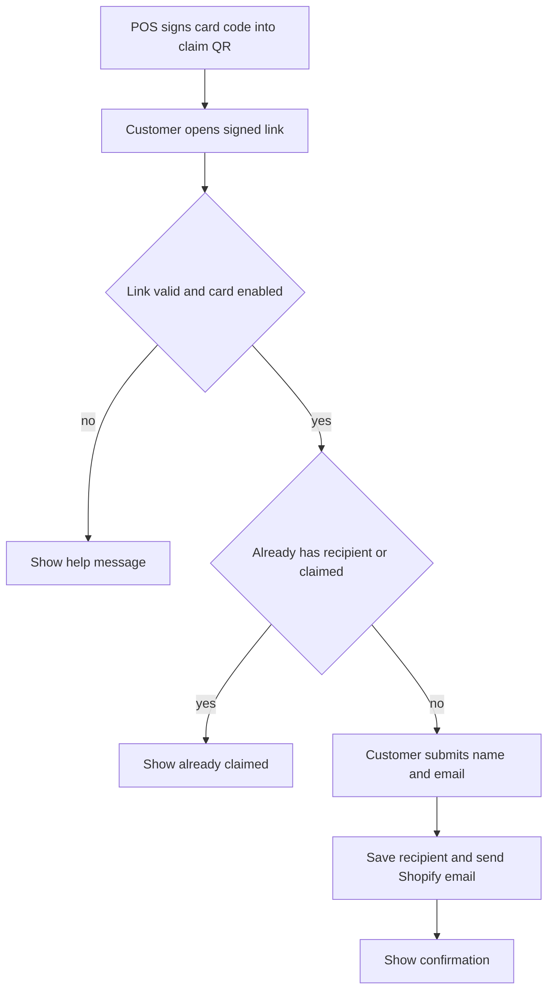

The claim page is an optional website for gift cards sold without an email address. The customer scans a QR on the receipt, enters their name and email, and Shopify sends the gift card to them.

## Basic

### Set it up
1. Deploy the separate Worker in `gift-claim-server/` using its README. It needs its own Shopify app and a `CLAIMS` KV namespace.
2. In the app, open **Settings ▸ Gift cards ▸ Gift card claim page**.
3. Enter the deployed Worker URL and the same secret used as its `CLAIM_SECRET`.
4. Save the settings. Leave the URL blank to turn off claim QR codes.

The regular email-at-sale flow does not need this Worker. For that, choose **Email it** when adding a gift card: [[gift]].

### What the customer does
After a gift card sale without an email address, open the receipt and tap **Claim QR: customer adds their email**. The customer scans it with a phone camera, enters their name and email, and submits. The page confirms when the email has been sent. Each card can be claimed once.

The QR is a claim link, not the card's spending code. The separate **Gift card QR** is for scanning the card at a register: [[gift/check-redeem]].

### If the QR is missing or fails
- **No Claim QR button:** check that the claim page URL and secret are set, and that the gift card line has no recipient email.
- **This link is not valid:** check the configured secret matches the Worker secret, and use the QR from the receipt without editing its link.
- **Already claimed:** the card already has a recipient or its claim was completed. Contact the shop if the email went to the wrong person.
- **Something went wrong:** ask the customer to retry in a minute. If it keeps failing, check the Worker and Shopify connection.

## Deep

### What the claim page changes
The Worker checks that the signed link belongs to a gift card created by this POS, finds an enabled card, and confirms it has not already been sent to a recipient. It then asks for the recipient's name, email and optional message, saves recipient details on the card, and asks Shopify to send its notification. It does not change the card's balance.

The page reveals only the card's last four characters. The claim link itself is sensitive: anyone who has the receipt QR can claim the card, so give it to the intended recipient.

### One claim and retry behaviour
The Worker stores a claim marker before it updates the card and sends the email, to prevent a double tap from sending twice. If the operation fails, it removes the marker so the customer can retry. The Worker also has an approximate per-IP request limit.

### Keep the secrets aligned
The POS signs the claim link with the secret saved in Settings. The Worker checks it with `CLAIM_SECRET`. If the values differ, the link cannot be verified. The Worker uses a separate Shopify app from the POS and needs permission to read and update gift cards and customers.

## Advanced

### Claim request flow

| Job | Where |
|---|---|
| Settings URL and secret | `Gift card claim page` in `src/screens/Settings.tsx` |
| Signed claim URL | `claimUrl` in `src/lib/giftClaim.ts` |
| Receipt QR and eligibility | `ReceiptPrompt` in `src/screens/Receipt.tsx` |
| Token verification and form validation | `verifyClaimToken`, `validateClaim` in `gift-claim-server/src/claim.ts` |
| Find card, save recipient and send | Worker handler in `gift-claim-server/src/index.ts` |
| Worker setup | `gift-claim-server/README.md` |

The token contains a normalised gift card code and a truncated HMAC-SHA-256 signature. The Worker finds only cards whose note checksum matches, and stores claim state in the `CLAIMS` KV namespace. KV is not atomic, so simultaneous requests have a small race window; Shopify remains the card balance and recipient record.

### Limits
The claim page is not Shopify's own gift-card storefront page. It collects the recipient details and triggers Shopify's gift card email. It works only for cards created by this POS with a matching checksum, and requires a live Worker, KV and Shopify connection.
