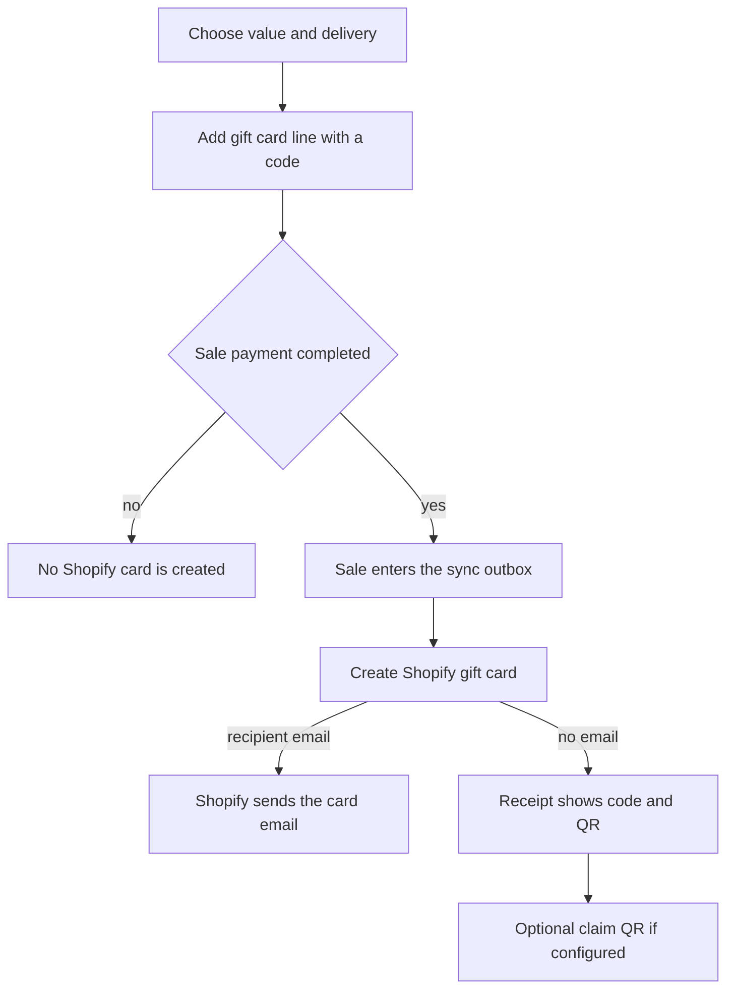

Sell a gift card from **More ▸ Gift cards** or the **Sell gift card** tile. The card is created in Shopify only after the sale is paid.

## Basic

### Add a gift card to a sale
1. Tap **Sell gift card** and choose a suggested amount, or enter an amount with the keypad and tap **Next**.
2. Choose how the customer will get it: **Hand over / print** or **Email it**.
3. For email delivery, enter the recipient's email. Name and message are optional. You can copy the current cart customer's email with the offered chip.
4. Tap **Add gift card to cart**. It is now a line in the cart, not a live gift card yet. Finish taking payment as usual.

Shopify creates the card after payment completes and sends the recipient email when an address was entered. A failed creation stays queued for retry; do not sell a second card just because creation is delayed.

### Give the customer the code
After payment, the receipt screen shows the gift card code and a **Gift card QR (for scanning at a register)**. Show or print that QR for the customer. It contains the gift card code for scanning at checkout.

If you chose **Hand over / print** and left the recipient email blank, the receipt may also offer **Claim QR: customer adds their email** when the claim page is configured. The customer scans it and enters their email later: [[gift/claim-page]].

### Check cards later
Use **More ▸ Gift cards** to **Check balance** or view a card's history. See [[gift/check-redeem]]. To take a gift card as payment, open Payment and tap **Gift card**: [[pay/gift-card]].

## Deep

### The card is made after payment
Adding the gift card to the cart reserves its amount and generates a code for the sale, but it does not create a Shopify gift card yet. Once payment is complete, the sale sync creates the Shopify card. This avoids creating cards for abandoned or declined sales. If sync is offline or Shopify fails, the paid sale remains queued and the create step can retry safely.

When **Email it** is selected, the recipient email, optional name and optional message are attached to the gift card. Shopify sends the card email after creation. The app does not send a second email.

### Receipts and QR codes
The **Gift card QR** is for scanning the card code at a register. The **Claim QR** is different: it opens the shop's claim page so a recipient can add their email when no email was entered at sale time. It is only offered when the claim page URL and secret are set in Settings ▸ Gift cards.

The code is visible on the receipt screen after sale. Treat it like cash: anyone with an active card's code may be able to spend its balance.

### If the card does not appear
Check that the sale completed and the register is online. A card can be waiting for sync; check again after the outbox syncs. If Shopify creation keeps failing, open the sync issue and ask an owner to investigate rather than making another gift card line.

## Advanced

### Sale-to-card flow

| Job | Where |
|---|---|
| Sell flow and recipient fields | `GiftSellSheet` in `src/screens/sheets.tsx` |
| Gift card hub | `src/screens/GiftCards.tsx` |
| Cart line and delivery data | `addGiftCardLine` in `src/lib/cartOps.ts`; `GiftRecipient` in `src/lib/types.ts` |
| Create after payment and retry safely | outbox processing in `src/lib/sync.ts` |
| Shopify create and email | `createGiftCard` in `src/lib/shopify/giftcards.ts` |
| Receipt code and QR | `src/screens/Receipt.tsx`, `giftQrPayload` in `src/lib/giftCode.ts` |
| Claim QR | `claimUrl` in `src/lib/giftClaim.ts` |

The sync outbox records completed gift-card codes in `giftDone`, so a retry skips cards already created. Card creation is idempotent by code. A sale with no email can still show a claim QR if the claim service is configured.

### Known receipt detail
The immediate receipt document currently prints the full gift card code in its payment line; the Shopify order keeps only the last four characters. Handle the immediate receipt link and its QR as sensitive. See the open note N30 in `docs/PROGRESS.md`.
