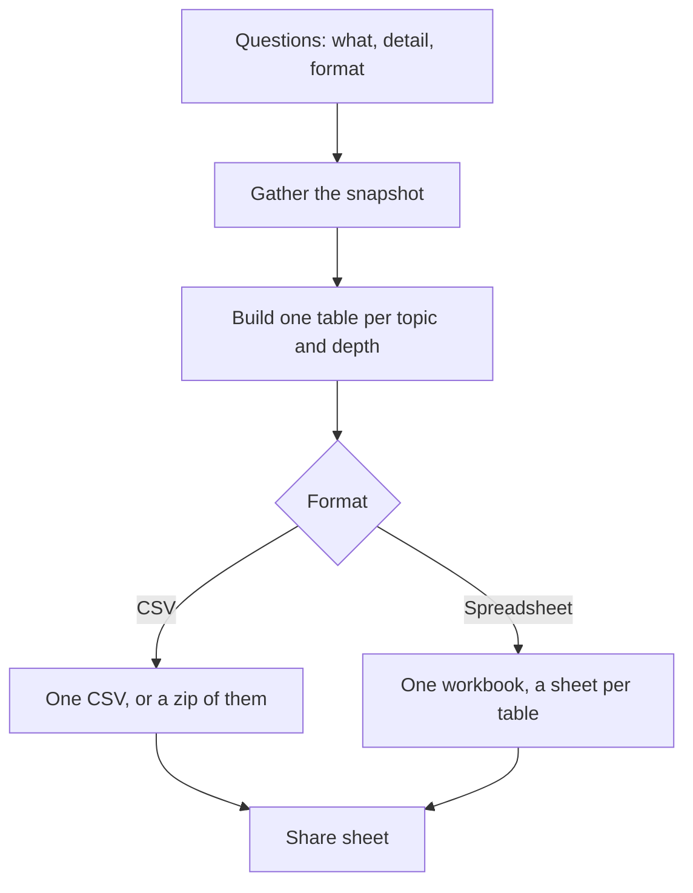

Export asks what you want, how much detail, and how to save it, then builds the file. Open it from the Reports page, or from Settings under Data.

## Basic

### What would you like to export?
- **Everything** builds every topic below, each with its summary and its full detail.
- **Choose the topics** lets you tick just the ones you want, group by group.

The groups are Sales and money, Cash, Stock and catalogue, People, and Till and system. Tap a topic to tick or untick it. **Select all** and **Clear** are at the top.

### How much detail?
Each topic asks for **Summary** (the totals view, usually one row per sale, item or day), **Full detail** (one row per line, movement or ledger entry), or **Both**. A few topics, such as Notifications and the raw history files, only have the full version.

### How should it be saved?
- **CSV files** gives you one comma-separated file per table. When there is more than one, they are zipped together.
- **Google Sheets workbook** gives you a single `.xlsx` workbook with one sheet per table, plus an Index sheet that lists them. Google Sheets and Excel both open it, and both keep the separate sheets.

Tap **Export** on the last screen. The share sheet opens so you can save the file, email it or send it to Drive.

## Deep

### What each topic holds
- **Transactions and sales**: every sale and refund; full detail adds each line sold.
- **Item and category sales**: totals per item, with category and SKU. Full detail adds a row per line.
- **Discounts and price adjustments**: automatic discounts, line discounts and price adjustments by reason.
- **Gift cards**: cards sold and redeemed here, by day, or one row each.
- **Cash ledger and drawer**: the shift, the float, what the drawer holds and its contents, and every ledger entry.
- **Inventory changes**: stock on hand and the units moved by sales and refunds, or every movement on its own row.
- **Catalogue**: every product and variant with prices, stock and collections.
- **Customers**: the customer list and what they have spent.
- **Sales by team member**: net sales per person, or per person per day.
- **Daily totals**: the day totals of every till that syncs, including imported Square history.
- **Saved carts**: how many are open or void and their value, or one row per cart.
- **Cart warnings**, **Notifications**, **Outbox and card attempts** and the **raw history files** are full detail only.

Money is written as a plain number such as `12.50`, with no currency symbol, so a spreadsheet adds it up straight away.

### What the dates cover
Sales, item, discount, gift card, stock-movement, team and daily-total figures come from every till that syncs to this shop: this till's own records plus the sales and day totals the other tills have shared. Sales still waiting to upload are included. Cash is the one exception: the drawer, its contents and its ledger are this device's only. A very old sale, or one made before a till started sharing, may be missing from the line-level topics even though its money still counts in the daily totals. There is no date filter here: the export covers everything the till holds, and you narrow it in the spreadsheet.

## Advanced

### How a file is built

| Job | Where |
|---|---|
| Questions and the file itself | `src/screens/Export.tsx` |
| The tables (pure) | `src/lib/exportSheets.ts` |
| Read the store and write the file | `src/lib/exportCollect.ts` |
| The spreadsheet (.xlsx) writer | `src/lib/xlsx.ts` |

The tables are built by a pure module, so the tests build every one from a fixed snapshot. The spreadsheet is the OOXML package zipped with `fflate`; no extra dependency is needed. The raw history files are the same CSVs this device writes on every sale, read back and split into a sheet.

### If something is missing
- A topic with no rows still produces its header, so an empty sheet is normal when there is nothing to show.
- The raw history files only exist once at least one sale has been made on this device.
- Large histories make large files; full detail of transactions across a busy year can run to many rows.
