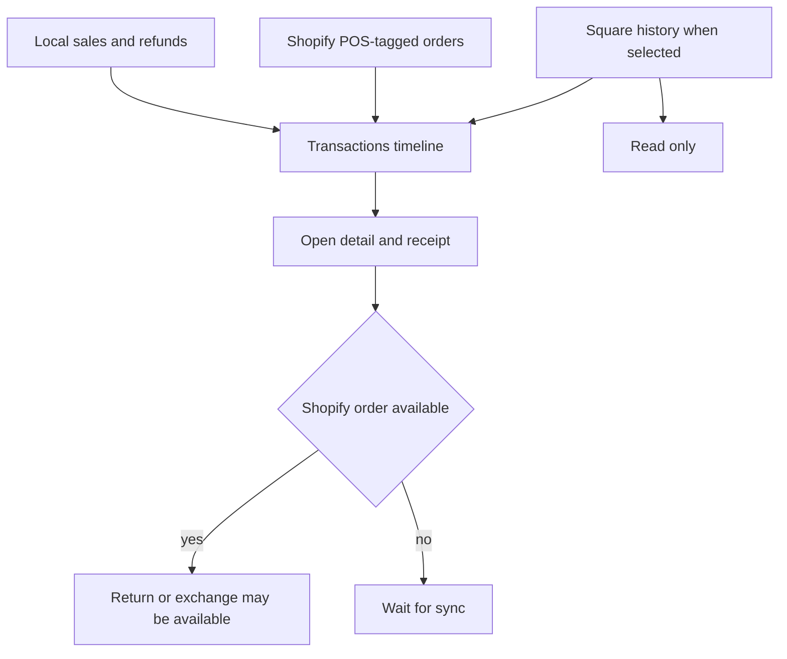

Use **More ▸ Orders** to manage Shopify orders. Use the **Transactions** tab to search the register's sales, refunds and imported Square history.

## Basic

### Orders
In **More ▸ Orders**, use **Open**, **Unfulfilled** and **Completed** to filter Shopify POS orders. Pull down to refresh. Tap an order to see its lines and choose **Mark fulfilled**, **Refund or return**, or **Receipt**. **Mark fulfilled** is hidden when Shopify already shows the order as fulfilled.

### Transactions
Open the **Transactions** tab. Completed local sales and refunds appear newest first, grouped by day. Tap one to see the lines and tenders. If an entry says **Waiting to sync to Shopify**, the sale is still local and a return is unavailable until its Shopify order exists.

Type a receipt number, customer, note or item to filter the loaded transactions. Press Search to look in Shopify for matching POS orders. **Load more** fetches the next page of orders. Tap **Square history** to include imported Square sales; those entries are read-only and cannot be returned here.

### Receipts and returns
Open a transaction and tap **New receipt** to show receipt options again. A Shopify-backed sale can offer **Return or exchange**: [[orders/refunds]]. Square history is read-only. Receipt delivery options are in [[pay/receipts]]. Sales totals and comparisons are in [[orders/reports]], and imported Square records are covered in [[orders/square-history]].

## Deep

### Orders and Transactions are different views
Orders is a live Shopify view with fulfillment filters and actions. Transactions combines local sale records with Shopify orders, so a sale can appear there before its order has finished syncing. Once Shopify returns the order, the transaction row can link to it and the return action becomes available.

The Square history chip adds previously imported Square records to Transactions; it does not write them to Shopify. It loads them from the history files on this iPad. Do not treat the Square entries as live Shopify orders.

### Search and loading
Transactions first filters entries already loaded on the device and the current order page. Press **Search Shopify** to ask Shopify for matching POS-tagged orders. The standard list loads recent Shopify orders in pages of 25; **Load more** requests the next cursor. Orders loads up to 30 for its selected status each time it refreshes.

If an order or transaction is missing, check the date, the active view, and whether the sale has synced. Square records appear only while Square history is selected and available on this device.

## Advanced

### Transaction sources

| Job | Where |
|---|---|
| Orders filters and actions | `src/screens/Orders.tsx` |
| Transactions timeline and search | `src/screens/Transactions.tsx` |
| Shopify order list and fulfillment | `listOrders`, `fulfillOrder` in `src/lib/shopify/orders.ts` |
| Shopify POS order tag and mapped order | `src/lib/shopify/orderModel.ts` |
| Local completed sales | `src/state/store.ts` |
| Imported Square transactions | `loadSquareSales` in `src/lib/squareHistoryIO.ts` |
| Refund flow | `src/screens/Refund.tsx` |

Shopify list queries use the `tag:pos` filter. The local list merges records by sale UUID to avoid showing the local sale and its Shopify order twice. Transactions search matches the loaded entries locally, then optionally sends a POS-tagged query to Shopify.
