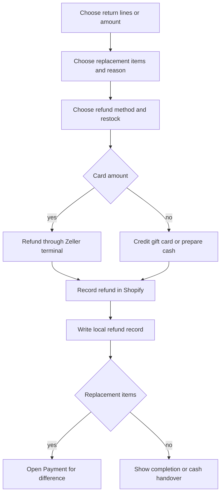

Start a return from a Shopify order or a synced sale in Transactions. Choose the items or amount, decide whether to restock, then confirm the refund or exchange.

## Basic

### Start a return
1. Open **More ▸ Orders** or **Transactions**, open the Shopify-backed sale, and tap **Refund or return** or **Return or exchange**.
2. In **Items**, use **+** and **−** to choose quantities, up to the refundable amount. Or switch to **Amount** and enter a value.
3. Add replacement items if this is an exchange. Their current prices and discounts are included.
4. Choose a **Reason** and whether to **Restock returned items**.
5. Choose where money goes: **Original**, **Cash** or **Gift card**, then tap the button showing the refund, charge or even exchange. When the original sale used a gift card and you choose **Gift card**, choose whether to reload its original card(s) or issue a new gift card.
6. Confirm. If the customer owes more for replacement items, the remaining amount goes to Payment. If cash is owed, the sheet tells you what to hand over.

For **Original**, the screen shows the amounts still refundable by card, cash and gift card. Card refunds need the Zeller terminal; the gift-card part goes back to the same original gift card(s). For **Gift card**, the cashier chooses the original card(s) or a new card when the original sale used gift cards; a sale without an original gift-card tender creates a new card.

### What happens next
- **Refund:** return value is greater than replacement value. The difference goes to the selected refund method.
- **Charge:** replacement items cost more. The customer pays the difference at Payment.
- **Even exchange:** the values match; there is no amount to collect or return.
- **Restock returned items** adds the returned quantity back to Shopify stock when the refund is recorded.
- A new gift card refund shows its code when complete. Give the customer that code.

### If something goes wrong
- **Reader not ready:** a card refund needs the Zeller terminal. Pair or reconnect it, then try again.
- **Card refund status is unknown:** check the Zeller dashboard before retrying; do not issue the same refund twice.
- **Refund taken but Shopify did not record it:** the money has already been returned. Check Notifications and ask an owner to reconcile Shopify before retrying.
- If Shopify says only part can go back to the original methods, the refund is larger than the unrefunded amounts those methods received.

## Deep

### Refund limits and methods
The app reads successful sale and refund transactions from Shopify to calculate what remains refundable for each original tender. **Original** routes card value back through Zeller, credits gift-card value to the original cards (up to what each card paid), and returns cash as cash. Choosing **Cash** directs the refund to cash. Choosing **Gift card** prompts the cashier to reload the original gift card(s) or issue a new one when the sale has an original gift-card tender; if not, it creates a new card. Zeller card refunds are processed before the Shopify refund record is written.

The amount mode cannot exceed the remaining refundable total. The selected returned lines determine which Shopify order lines are included. The reason is saved with the POS refund; Shopify receives the reason with `(POS)` appended.

### Exchanges
Replacement products are added to a temporary cart and priced using the current catalogue and discounts. The value of returned goods is compared with the replacement total. If the replacement total is higher, the difference is paid as a normal sale using exchange credit first. If it is lower, the difference is refunded using the selected method.

### Cash and gift card refunds
For a cash refund, the cashier physically hands over the money. The **Give cash refund** sheet suggests an optimal denomination set from the drawer when possible; otherwise, tap the notes and coins actually given. Confirming the denomination list is required and updates the local ledger. An **Original** refund credits the same original gift card(s), capped at their unrefunded tendered amounts. For **Gift card**, the cashier chooses those same card(s) or a new card if the original sale used gift cards. A new card's code is shown when complete. Original-card credits use a stable operation reference so retrying the same refund does not credit twice.

## Advanced

### Refund sequence

| Job | Where |
|---|---|
| Return screen and choices | `RefundScreen` in `src/screens/Refund.tsx` |
| Refund tender plan | `planRefund`, `refundableByGateway` in `src/lib/returns.ts` |
| Execute tender refunds and local record | `executeRefund` in `src/lib/refundFlow.ts` |
| Shopify refund and stock restock | `refundOrderInShopify` in `src/lib/shopify/orders.ts` |
| Card refund | `startRefund` in `src/lib/zeller.ts` |
| Cash handover | `GiveCashSheet` in `src/screens/CashSheet.tsx`; `postCashRefund` in `src/lib/cashSale.ts` |

### Important failure boundary
Card refunds happen before Shopify's `refundCreate`. If Shopify recording fails after money was returned, the app logs an error and adds a Notifications entry; it does not silently reverse the tender. For an unknown Zeller result, verify the transaction in Zeller before starting another refund.
