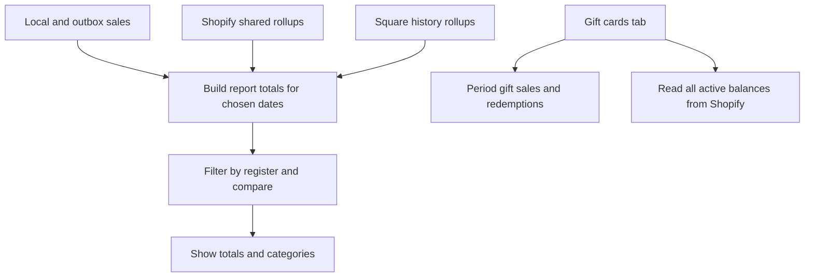

**Reports** summarises sales records from this and other registers, plus imported Square history when it is available.

## Basic

### Choose what to view
Open **More ▸ Reports**. The Sales tab starts on **1W**. Choose **1D**, **1W**, **1M**, **3M**, **1Y**, or **Custom**. Custom lets you enter start and end dates as `YYYY-MM-DD`.

Choose **Prev period** or **Last year** to compare, or **No compare** to hide the comparison. Tap **Customise** to choose **All devices** or one register. Imported Square data is labelled **Square (old)**.

### Read the Sales report
The report shows Gross sales, Discounts, Refunds, Net sales, Total collected, estimated Card fees, Net after fees, COGS, Gross profit, payment types and top categories. Price adjustments, when present, are listed by reason; their savings are already included in Discounts.

Tap **Refresh** to fetch shared reports again. Tap the share button in the top bar to export the current sales range and category totals as text.

### Gift card report
Switch to **Gift cards** for value of cards sold in the selected period, gift-card payments redeemed in that period, and the total balance across all active cards. Tap **Gift cards** to open the card hub and check an individual card.

For cash notes and drawer banking, use [[cash/float-report]] instead. Older imported Square sales are explained in [[orders/square-history]].

## Deep

### What the totals mean
- **Gross sales**, discounts and refunds make up **Net sales**. Gift card sales are shown separately in the rollup, not as ordinary item sales.
- **Total collected** includes net sales and gift card sales, minus other refunds.
- **Card fees (est. 1.4%)** are an estimate and are not taken off Net sales. **Net after fees** subtracts that estimate.
- **COGS** is shown separately; **Gross profit** is Net sales minus COGS.
- **Payment types** shows the amounts recorded for each tender. **Top categories** shows the leading categories by gross sales.

The comparison uses the same selected date range shifted to the previous period or the corresponding period last year. Selecting a register filters both the current totals and comparison.

### Where register data comes from
Shopify shared rollups are loaded when connected. Local register rollups and sales that are still waiting in the outbox are included. Imported Square rollups are added under their own **Square (old)** register. When data has not synced, registers are offline, or historical records are missing, totals may not match Shopify analytics yet.

The outstanding gift card figure is the balance of all active cards read from Shopify; it is not restricted to the selected sales period or register. The sold and redeemed figures are period-based.

## Advanced

### Report data flow

| Job | Where |
|---|---|
| Report screen and filters | `src/screens/Reports.tsx` |
| Combine local, remote, outbox and Square data | `useRollups` in `src/screens/Reports.tsx` |
| Period aggregation and derived totals | `src/lib/rollup.ts` |
| Gift card outstanding total | `outstandingBalance` in `src/lib/shopify/giftcards.ts` |
| Imported Square rollups | `loadSquareRollups` in `src/lib/squareHistoryIO.ts` |

The report labels this **Card fees (est. 1.4%)**. It does not read Zeller fee statements; POS sale records use the card fee rate configured for the register when the sale was made (1.4% card-present by default). Square's imported history can include its actual card fees. See [[orders/square-history]].

### If a number looks unexpected
- Check the date range and register selector first.
- Press **Refresh** when online. Local or outbox sales can be ahead of shared Shopify rollups.
- Check whether Square history is included as a separate register.
- Treat estimated card fees as an estimate, not a settlement figure.
