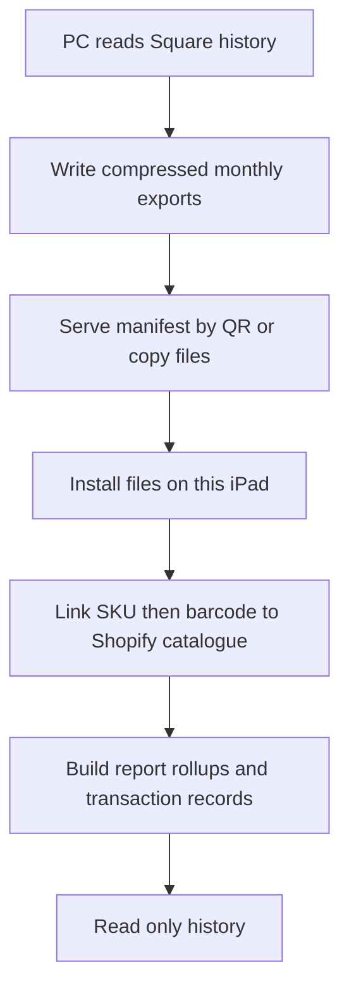

Square history is a one-time, read-only import of old Square sales and refunds. It never changes Shopify items, stock or customers.

## Basic

### Export from Square
On a PC, follow `tools/square-history/README.md`: create a Square developer app, put its production access token in the local `.env`, then run the export script. Choose a date range with `--from` and `--to`, or omit them to export the available history. Keep the script running while the iPad imports.

### Import to each iPad
On the iPad, open **Settings ▸ Square history** and either:
1. Tap **Scan QR from PC** while the PC and iPad are on the same Wi-Fi.
2. Type the address printed by the script and tap **Import from address**.
3. Copy the files from the PC's `out` folder to the iPad and tap **Pick files**.

The import shows how many sales and refunds were loaded and how many item lines matched a Shopify variant. After import, the PC script can be stopped. Repeat the import on each register that needs this history.

### Find the imported records
Imported sales appear in Reports as **Square (old)** and in Transactions when the **Square history** chip is selected. They are historical and read-only: they cannot be refunded from this POS.

If you refresh the Shopify catalogue, tap **Re-match to Shopify catalogue** in Settings ▸ Square history. Use **Delete imported Square history** to remove it from this iPad.

## Deep

### What is imported and matched
Completed sales and refunds are included. Square variations link to Shopify variants by SKU first, then UPC/barcode. A match gets Shopify's item name, cost and category for reports. An unmatched line stays a custom Square line, with Square's category. The import also carries over Square's tender details, discounts, tips, fees and customer names on their sales; it does not create Shopify customer records.

### Where the files live
History is stored compressed in monthly files under the app's `Documents/square-history/` folder. Reports use a small daily rollup file; Transactions reads the detailed monthly files. Re-match rebuilds the links and report rollups from those local files without contacting Square.

### Connection and import problems
- **Timed out / could not reach the PC:** use the same Wi-Fi, leave the export script running, check the local-network permission in iOS Settings, or transfer the output files and use **Pick files**.
- **No matching SKU:** refresh Shopify catalogue, then re-match. A missing match does not lose the sale; it remains a custom line.
- **Wrong or incomplete date range:** rerun the PC export with the desired dates and import the resulting files.
- The PC script serves only the export folder while it runs. Stop it when import is done.

## Advanced

### Import path

| Job | Where |
|---|---|
| PC export | `tools/square-history/export.ts` |
| PC setup and use | `tools/square-history/README.md` |
| Import screen | `SquareHistorySettings` in `src/screens/SquareHistory.tsx` |
| Download, file copy and storage | `installFromUrl`, `installFromPicked`, `rebuild` in `src/lib/squareHistoryIO.ts` |
| SKU/barcode matching and rollups | `linkSale`, `addToRollups` in `src/lib/squareHistory.ts` |
| Transactions and reports display | `src/screens/Transactions.tsx`, `src/screens/Reports.tsx` |

The manifest is checked before file names are used. Each month is compressed separately so detailed history can be loaded without expanding the entire export at once.
