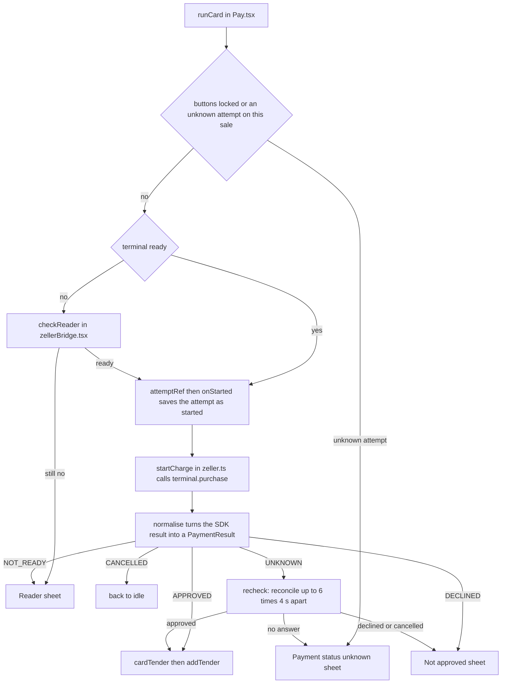

Card payments go through the Zeller terminal. The POS tells the terminal the amount, the customer pays on the terminal, and the result comes back to the Payment screen.

## Basic

### Taking a card payment
1. On the **Payment** screen tap **Card** (**Pay by card** in Simple and Minimal modes). The amount is shown on the button: it is what remains, or the next split amount.
2. A strip appears at the top: **Waiting on terminal · $…**, with a line saying what the terminal is doing. Zeller's own screen also appears on top while it works.
3. The customer taps, inserts or swipes their card, and enters their PIN or signs if the terminal asks.
4. When it is approved the payment is added to the list, and if nothing remains the sale finishes.

```screen
title: Payment
label: Payment
row: Card | $28.50
row: Cash | $0.00
row: Gift card | $0.00
row: Split
label: Due
row: $28.50
primary: Pay by card
note: A strip at the top will show "Waiting on terminal…" while the Zeller reader works.
```

The line on the strip changes as it goes. You may see: *Tap, insert or swipe card on the terminal*, *Customer is choosing the card application* or *the account*, *Customer is entering their PIN*, *Waiting for signature*, *Signature cleared - sign again*, *Retrying - present the card again*, *Processing…*, and *Customer is choosing a tip*.

Wait for the result before touching anything else. While the terminal is working the other payment buttons are greyed out and there is no Back button, so a second charge cannot start by accident.

### Cancel
**Cancel** on the strip asks the terminal to stop. If the customer has not paid yet, the strip disappears and you can choose any payment method again. If the customer had already paid by the time you cancelled, the POS finds the payment and counts it, so you will not charge twice. If the customer cancels on the terminal itself, you are simply back at the payment buttons with nothing taken.

### Not approved
A sheet called **Not approved** says why in plain words, for example *Insufficient funds - try another card or split with another tender* or *Card expired. Try another card.* A number such as *Code 51* is the bank's code. **The cart is kept.** Choose:
- **Try card again**: starts a new card payment for the same amount.
- **Use another method**: closes the sheet so you can pay by cash, gift card or a split.

For more detail on responding safely to a decline, see [[fix/card-declined]].

A few messages mean the customer can fix it: *Incorrect PIN - try again*, *Please insert the card*, *Card read failed - tap, insert or swipe again*. Others mean the card cannot be used and they need another one. If the message says *contact Zeller*, the terminal's set-up needs attention and card payments will keep failing until Zeller fixes it. Take cash in the meantime.

### Payment status unknown
Sometimes the POS loses contact in the middle of a payment (the internet drops, the terminal times out) and cannot tell whether the customer was charged. A sheet called **Payment status unknown** opens and says *Checking…*.

**Do not charge the card again.** The customer may already have been charged. The POS asks Zeller about the payment by itself, up to six times, a few seconds apart. Usually it finds the answer:
- If it was approved, it is added to the sale as a card payment.
- If it was not, you see that the payment did not go through, and you can try again.

If it still cannot tell, the sheet stays and gives you four buttons:
- **Check again**: asks Zeller again.
- **Customer WAS charged**: only if you have **seen it approved on the terminal or the Zeller dashboard**. It records the payment as paid by card.
- **Customer was NOT charged**: only if you have checked and it is not there. It lets you charge again.
- **Close**: leaves the question open.

Both of the middle buttons ask you to confirm, and your name is saved with the decision. Until an unknown payment on this sale is settled, **Card** refuses with *A previous card payment has no result yet. Resolve it before charging again.* Cash and gift cards still work.

### Reader not ready
If the terminal cannot be used, a **Reader** sheet says what is wrong, with **Retry** and **Close**. The messages are:
- *Terminal not paired - open Diagnostics ▸ Zeller ▸ Setup.* The terminal has never been paired with this iPad (or the app was reinstalled).
- *No internet - card payments need a connection. Cash still works.*
- *Terminal is busy. Please wait and try again.* Or *The terminal is serving another register.*
- *Can’t reach the terminal - check its power and Wi‑Fi.* Or *Couldn’t connect to the terminal.*

If the reader is not ready you also see **Reader issue** in red at the top right of the Payment screen, and a **Reader issue** notice is added to your notifications.

To check or fix the reader, open **More ▸ Support & diagnostics**. Under **Zeller reader** you have **Check reader**, **Setup (pair terminal)**, and **Test purchase $1.00** with **Refund the $1.00 test** afterwards. After reinstalling the app you must pair the terminal again.

For a step-by-step reader troubleshooting guide, see [[fix/reader]].

### Good to know
- Card amounts are never rounded.
- A card payment can be refunded from the terminal if you cancel a part-paid sale (see [[pay]]).
- The register will not lock, and staff cannot be switched, while a card payment is waiting.

## Deep

### Why a card payment is never repeated by accident
Every card attempt gets its own reference, made from the sale's id and the attempt number. The POS saves the attempt on the iPad **before** it tells the terminal anything, then asks the terminal to take the payment. If the answer is ever unclear, it looks the payment up by that reference instead of guessing. That is how it can tell "the customer paid just as you pressed Cancel" from "nothing happened".

The same care explains the rule about unknown results: charging again before you know could take the money twice, so the POS blocks it until the first attempt is settled.

### What counts as "unknown"
The POS treats a result as unknown when it cannot be sure no money moved: the connection dropped after the terminal had started, the terminal timed out, the bank's answer could not be read, or a reversal was still pending. A plain decline before the card was processed is **not** unknown, and neither is a failure to start (no internet, not paired).

### The kinds of decline
Each bank or terminal code is put in one of four groups, and the message follows from the group:
- **Try another card**: insufficient funds, expired, lost or stolen, blocked, over the limit, not supported.
- **The customer can fix it**: wrong PIN, signature problem, card not read, card needs inserting.
- **Try again**: a bank, network or terminal hiccup.
- **Contact Zeller**: the merchant or terminal set-up is wrong. Retrying will not help.
A code the POS does not know shows the terminal's own wording, or *Declined (code …)*. The **Not approved** sheet always offers **Try card again**, whatever the group, so use the message to decide.

### Fees
Zeller's result does not include a fee, so the POS works one out. The rates are in **Settings ▸ Payments**: **Card-present fee %** (1.4% unless changed) and **Keyed / card-not-present fee %** (1.7%). A manually keyed or online-style payment uses the keyed rate. The fee is kept on the payment as an estimate. A refund does not return the original fee.

### Offline and the reader's state
The POS asks the terminal whether it is ready when the app starts, and again about every minute while it is not ready, so **Reader issue** clears by itself once the problem is fixed. A card payment needs the internet; cash and gift cards are separate, so cash always works.

### Cancelling a sale that already has a card payment
Choosing **Refund & cancel** on a part-paid sale refunds each card payment through the terminal, one after another. If a refund does not complete you see **Refund did not complete**, nothing is cancelled, and the problem is written to the history so you can follow it up. Check the terminal before trying again.

## Advanced

### What happens when you tap Card


### Where the code is
| Job | Where |
|---|---|
| The flow, sheets and strip | `runCard`, `recheck`, `manualResolve` in `src/screens/Pay.tsx` |
| Which states may draw a sheet | `showsOwnSheet`, `showsWaitingStrip`, `lockPayButtons` in `src/lib/payUi.ts` |
| Talking to the SDK | `startCharge`, `startRefund`, `reconcile`, `normalise`, `describeEvent` in `src/lib/zeller.ts` |
| One terminal for the whole app | `ZellerRoot`, `getTerminal`, `checkReader`, `pairReader` in `src/zellerBridge.tsx` |
| Code to message | `RESPONSE_CODES`, `lookupResponse` in `src/lib/responseCodes.ts` |
| Fees | `feeFor`, `feeRateFor` in `src/lib/fees.ts`; `cardTender` in `src/lib/saleBuilder.ts` |
| Pairing, test purchase, attempts list | `src/screens/Diagnostics.tsx` |
| Saved attempts | `Attempt` in `src/state/store.ts` (`pos.attempts`) |
| Locking while waiting | `paymentActive` in `src/lib/screensaver.ts`, used by `lockDecision` in `src/lib/posLock.ts` and by staff switching in `src/lib/staffAuth.ts` |

The SDK returns errors instead of throwing them. `normalise` turns either kind of result into one of five outcomes: `APPROVED`, `DECLINED`, `CANCELLED`, `UNKNOWN` or `NOT_READY`, and nothing outside `zeller.ts` reads a raw SDK result. A network or connection failure is `NOT_READY` when the terminal had not started, and `UNKNOWN` once it had.

`startCharge` does one more thing before it returns. If the result is cancelled or unknown, or a decline arrived after the terminal had started processing, it calls `reconcile`, which looks the reference up with `getTransactions`. An approved match turns the result into `APPROVED`. That lookup is what makes Cancel safe.

The attempt's status moves `started`, then `approved`, `declined`, `cancelled`, `unknown` or `resolved`. A **started** attempt keeps `paymentActive` true for five minutes, which is what blocks locking and staff switching; an attempt left at **started** by a closed app stops blocking after that. The waiting state itself is not saved, so reopening Payment shows the buttons again, but an `unknown` attempt on the sale still blocks **Card** through `blockedByUnknown`.

Events are written to the history CSV with `csv.event`: `declined`, `cancelled`, `unknown_payment`, `unknown_resolved`, `refund_failed` and `void`.

### Reading the code for a fault
- **Card button does nothing.** The amount is $0 (`runCard` returns when it is 0 or less), the buttons are locked by a waiting card phase, or an `unknown` attempt exists for this sale.
- **"Reader issue" that will not clear.** In More ▸ Support & diagnostics tap **Check reader**: it calls `initialise` on the terminal. `Setup Required` means pair it. `Network Failure` shows as *Reader offline - no internet*.
- **The customer was charged but the sale shows no card payment.** It is an `unknown` attempt: check **Card attempts (this device)** in Support & diagnostics (the last eight, with their reference and who resolved them) and look for the same reference in the Zeller dashboard. The reference is the sale id followed by the attempt number.
- **A decline message is vague.** The code is not in `RESPONSE_CODES`, so the SDK's own text is shown. Add it there if you want better wording.
- **The reader says busy.** *Paired Device Busy* means another register is using the terminal. Only one register can charge at a time.
- **Tests.** `tests/lib.test.ts` covers the response codes, fees, `normalise`, and `startCharge` (approve; a cancel after processing that still approves through `reconcile`; a timeout that stays unknown; a decline that keeps the cart) and `startRefund`. `tests/payui.test.ts` covers which states may draw a sheet.
