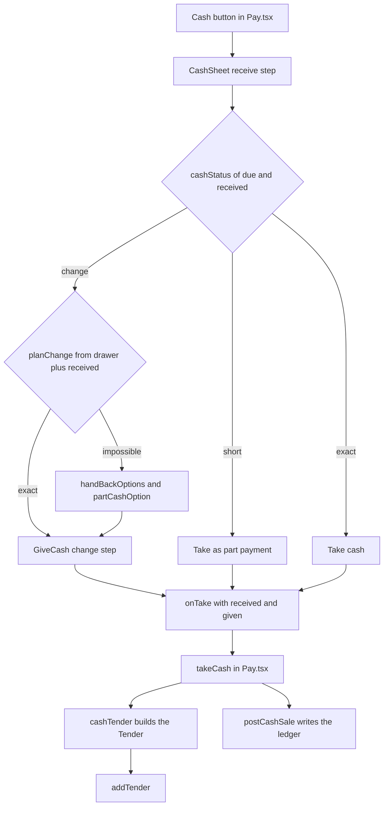

Cash is taken by tapping the notes and coins the customer hands over. The POS works out the change, shows which notes and coins to take from the drawer, and keeps a record of what is in the drawer as it goes.

## Basic

### Taking cash
1. On the **Payment** screen tap **Cash** (**Pay with cash** in Simple and Minimal modes).
2. The **Cash received** sheet opens. At the top it shows **Due**, the amount the customer owes in cash.
3. Tap each note and coin the customer hands you. Each tap adds one. The number under the note or coin shows how many you have tapped, and **Received** shows the total.
4. The line under **Due** tells you where you are:
   - **Tap what the customer hands over**: nothing tapped yet.
   - **Short by $…** (red): they have not given enough.
   - **Exact** (green): the right amount.
   - **Change to give: $…** (green): they gave too much and you owe change. It turns red if the drawer cannot make that change (see below).

```screen
title: Cash received
text: Due $28.50
text: Change to give: $1.50
label: Notes
tile: $50
tile: !1 $20 | × 1
tile: $10
label: Coins
tile: $2 | × 1
tile: 50c
tile: 20c
button: Undo
primary: Next: give $1.50 change
note: Each tap adds one note or coin, and the count under it shows how many you have tapped.
```

### The tap pad
- **Add / Remove** switch: choose **Remove** to take notes or coins off what you have tapped. Removing something you have not tapped says *None of that to remove.*
- **Each tap** (**×1**, **×5**, **×10**): how many one tap adds, handy for rolls of coins.
- **Undo** takes back your last tap and tells you what it removed and the new total. **Start over** clears everything.
- Notes are $100, $50, $20, $10 and $5. Coins are $2, $1, 50c, 20c, 10c and 5c.

### What happens next
- **Exact:** tap **Take cash**. The payment is added and, if nothing remains, the sale finishes.
- **Short:** you can ask for more, or tap **Take $… as part payment**. The cash is recorded as a payment of what they gave, and the rest is paid another way. On a split bill the screen instead offers to move the shortfall into a later payment, spread it, or go back and change the split. See [[pay/split-and-part]].
- **Change to give:** tap **Next: give $… change**. The **Give change** screen shows **Take from the drawer** with the notes and coins to hand back.
  - **Gave this** confirms you handed over exactly that.
  - **I'll give different notes and coins** lets you tap what you really gave. The total must match the change owed.
  - **Show another way** appears only when Smart change is on in Settings ▸ Payments and there is more than one good option. It steps through them. See [[cash/smart-change]].
  - **Back** returns to the notes you tapped.

### When the drawer cannot make the change
A red box says **Can't make $… change** and **Next** is greyed out. See [[cash/change]] for what that means and how each option is found, or [[fix/cant-make-change]] for what to do at the till. It lists what could work:
- **Ask for less:** take a smaller part of what they handed over and give the rest straight back. Tap **Use that smaller handover** to do it.
- **Cash $… + the rest another way:** take part of the bill in cash (the most the drawer can make change for) and put the remainder on card or another method.
- **Or take the full amount by card.**

If the box says **No cash in the ledger**, the drawer was never opened or counted, so the POS has no idea what is in it. Open the drawer from More ▸ Cash drawer first. See [[cash/open-close]].

If you can see the drawer really does have the change and the record is out of date, tap **The drawer has it (ledger is out of date)**. You then tap the notes and coins you give. Fix the record later with **Correct contents** or **Count & close** in the cash drawer. See [[cash/open-close]].

### Cash rounding
If **Cash rounding (5c)** is on in Settings ▸ Payments, the cash due on the **last** payment is rounded to the nearest 5c. 1c and 2c round down, 3c and 4c round up. So $10.02 is due as $10.00 and $10.03 as $10.05. Earlier payments in a split are never rounded.

### Free sales
If the total is $0.00 the only button is **Complete $0.00 sale**.

### Cancelling a sale that has cash in it
If you back out of a part-paid sale, the app asks you to collect any exact change previously given and return the exact notes and coins originally received. Follow the prompts and confirm the denominations physically exchanged; cancellation does not use the change optimizer.

## Deep

### Where the change comes from
The change is made from the notes and coins in the drawer record **plus what the customer just handed over**. So the customer's own notes can go straight back as change, and a drawer with no small notes can still change a $20 if the customer handed over a $10 and a $5 as well. Among all the exact ways to make the change, the POS picks the one with the fewest pieces, which is quickest to count out. With **Smart change** on it picks the way that leaves the drawer best stocked for the next sales instead (see [[cash/smart-change]]). The full story of how change is found is on [[cash/change]], and you can check a customer's notes before taking them with [[cash/check-change]].

### How rounding is worked out
Rounding is applied to the cash **due**, not to what was handed over, and only when that cash payment clears the whole of what remains. The sale keeps the real amount and records the rounding separately, so receipts and reports can show it. Rounding down means the customer paid up to 2c less than the bill, rounding up means up to 2c more. If the cash is only part of the bill, nothing is rounded.

### Short payments are not change
If the customer hands over less than is due, the payment is recorded as the amount handed over, with no change. That is what **Take $… as part payment** does.

### What each button writes to the drawer record
| You tap | Notes and coins in | Change out |
|---|---|---|
| **Take cash** (exact) | recorded | none |
| **Take $… as part payment** | recorded | none |
| **Gave this** (suggested or manually counted) | recorded | recorded |
| **Cash refund** (suggested or manually counted) | none | recorded |
| **Cancel part-paid sale** | exact original tender is removed | previously given change is collected back |

### The two ways round a drawer that cannot make change
- **Ask for less** looks for the smallest amount you could keep from what they handed over that still covers the bill and whose change the drawer **can** make. Example: the drawer has one $5, the customer hands you $20, $10 and $5 for a $25 bill. Keep the $20 and $5 and hand the $10 straight back, so no change is needed at all.
- **Part in cash** looks for the largest cash amount below the bill, in 5c steps, whose change can be made. Example: the drawer has one $20, the customer hands you a $50 for a $37 bill. The $13 change cannot be made, but $30 in cash works ($20 change from the drawer), leaving $7 for card.

### The record can drift
The record is only as good as what is tapped. It lives on each iPad separately. See [[cash]]. Count & close and Correct contents are the ways it gets reset or corrected.

## Advanced

### From Cash to a payment


### Where the code is
| Job | Where |
|---|---|
| The sheet and its two steps | `CashSheet` in `src/screens/CashSheet.tsx` |
| The change step (also used for cash refunds) | `GiveCash`, `GiveCashSheet` in `src/screens/CashSheet.tsx` |
| The tap pad | `DenomPad` in `src/ui/DenomPad.tsx`; the maths in `src/lib/cashLedger.ts` |
| Due, short, exact, change | `cashDue`, `cashStatus` in `src/lib/cashSale.ts` |
| Which notes and coins to give | `planChange` in `src/lib/cashSale.ts`; `planChangeSmart` in `src/lib/changeScore.ts` when Smart change is on |
| Ask for less, part in cash | `handBackOptions`, `partCashOption` in `src/lib/cashSale.ts` |
| Building the payment | `cashTender` in `src/lib/saleBuilder.ts`; `takeCash` in `src/screens/Pay.tsx` |
| Writing and reversing the drawer record | `postCashSale`, `recordCancelledCashTender` in `src/lib/cashSale.ts` |
| Rounding | `roundCash` in `src/lib/money.ts` |
| Empty drawer check | `ledgerEmpty` in `src/lib/cashSale.ts` |

### The payment record
A cash payment (a `Tender` of kind `cash`) has these fields:
- `amountCents`: what was applied to the bill. For a settling payment this is the amount due **before** rounding. For a short payment it is what was handed over.
- `tenderedCents` and `changeCents`: what was handed over and what went back.
- `roundingCents`: the rounded due minus the amount (can be negative).
- `cashIn` and `cashOut`: the notes and coins received and given.

`cashTender` settles when the amount handed over is at least the due amount (rounded if rounding is on). Rounding is only passed in when `takeCash` sees `isFinal`: the payment is for everything that remains and it is not a part-cash amount (`applyCents` is not set). The sheet shows the same rounded amount because it gets it from `cashDue`.

`takeCash` writes the denominations received and given to the drawer record. On a cancelled sale, the cashier collects back the previously recorded change and returns exactly the originally received denominations; `recordCancelledCashTender` logs that physical exchange.

### Reading the code for a fault
- **Next is greyed out and the box says Can't make change.** `planChange` found no exact combination from the drawer plus what was received. Check the record in More ▸ Cash drawer.
- **The drawer record differs from the physical drawer.** The denominations entered may not match what was physically exchanged. Use Correct contents or Count & close.
- **Rounded amount looks wrong.** Check Settings ▸ Payments ▸ Cash rounding (5c). It only applies when this payment clears the remaining amount.
- **Show another way is missing.** Smart change is off, there is only one way to make the change, or the search was cut short.
- **Tests.** `tests/cashsale.test.ts` (status, change, ask for less, part in cash, ledger entries), `tests/cashledger.test.ts` (the tap pad and ledger), `tests/changescore.test.ts` (Smart change), `tests/sale.test.ts` (building cash payments).
