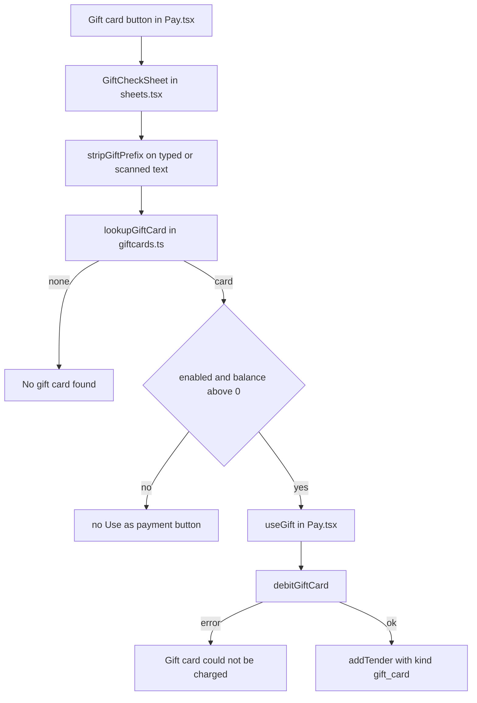

A gift card pays part or all of a sale. The balance lives on the card in Shopify, so a card works on any register as long as the iPad is online.

## Basic

### Taking a gift card payment
1. On the **Payment** screen tap **Gift card** (**Pay with a gift card** in Simple and Minimal modes).
2. The **Check gift card** sheet opens. Tap **Scan** and scan the QR code on the card or receipt, or type the code into **Code** and tap **Check**. **Check** stays greyed out until at least four characters are typed.
3. The sheet shows the card (**Card ••••** and its last four characters), its balance, and whether it is **Active** or **Disabled**. It may also say **code could not be verified** or **expires** with a date.
4. Tap **Use as payment**. This button only appears when the card is **Active** and has a balance.
5. The amount is taken from the card straight away and the payment is added to the list as **Gift card**.

```screen
title: Check gift card
text: Scan or type the code on the card.
input: Code | ABD2-4EF6
button: Scan
label: Result
row: Card •••• 4EF6
row: Balance | $15.00
row: Status | Active
primary: !1 Use as payment
note: The amount is the balance or the next payment amount, whichever is less.
```

The amount taken is the card's balance or the next payment amount, whichever is **less**. If the balance is smaller than what is owed, the rest stays under **Remaining** and you take it another way.

### Typing and scanning the code
- Letters and numbers only. Capitals, spaces and dashes do not matter.
- A scanned gift card QR carries a prefix that starts with `shopify-giftcard`. You never have to remove it, the POS strips it for you.

### Messages
- **No gift card found for that code.** Check the code and try again. Look at the card or receipt rather than guessing.
- **Lookup failed** with a reason: usually no internet. Gift cards need a connection, cash does not.
- **Disabled** next to the balance: the card has been switched off in Shopify. There is no **Use as payment** button. Ask the owner.
- **code could not be verified:** the card was not made by this POS, so the POS can only partly check it. It can still be used if **Active**.
- **Gift card could not be charged** with a reason: Shopify refused. Nothing was taken from the card and nothing was added to the sale.

### Good to know
- A gift card is never rounded and has no card fee.
- You cannot pay for a gift card with itself. A gift card sold in the same sale does not exist until that sale is paid.
- If you cancel a part-paid sale, the money is **not** put back on the gift card. The POS tells you to deal with it by hand. Ask someone who can edit gift cards in Shopify.
- To check a balance without paying, use the **Check gift card** option in the cart menu or More ▸ Gift cards.
For a balance check, redemption history, and the difference between a card QR and a claim QR, see [[gift/check-redeem]].

## Deep

### Why the card is charged first
The balance is taken off the card the moment you tap **Use as payment**, before the sale is finished. That stops two registers spending the same balance at once, but it means a cancelled sale leaves the money gone. The POS charges the card, and only if Shopify agrees does it add the payment to the sale.

### How a code is found
Shopify can only search for gift cards by their last four characters. The POS searches that way, then looks at a hidden note on each candidate that holds a fingerprint of the full code, made when the POS created the card. A match is a verified card. If none match, the POS accepts a card **only** when exactly one candidate has no POS note at all and the code has eight or more characters, and then shows **code could not be verified**. Anything else is **No gift card found**.

### What the sale records
The payment keeps the card's Shopify id and the code. On the Shopify order it appears as a **Gift card** payment of that amount, with only the last four characters of the code stored. Refunds to the original gift card use the same id.

### Expiry
The sheet shows an expiry date but the POS does not check it. If Shopify refuses an expired card you see **Gift card could not be charged** with Shopify's reason.

## Advanced

### From Gift card to a payment


### Where the code is
| Job | Where |
|---|---|
| The sheet (also used by Check gift card) | `GiftCheckSheet` in `src/screens/sheets.tsx` |
| Taking the payment | `useGift` in `src/screens/Pay.tsx` |
| Code cleaning | `stripGiftPrefix`, `normaliseCode` in `src/lib/giftCode.ts` |
| Finding and charging the card | `lookupGiftCard`, `debitGiftCard` in `src/lib/shopify/giftcards.ts` |
| The payment record | `giftCardId`, `giftCardCode` on `Tender` in `src/lib/types.ts` |
| Shopify order and stored code | `GATEWAY` in `src/lib/shopify/orderModel.ts`; `encodeTender` in `src/lib/saleCodec.ts` |
| Refunds to a gift card | `src/lib/refundFlow.ts` |

`useGift` takes the smaller of the card balance and the current target, charges it with a note naming the sale, then adds the payment with the cleaned code. It does not touch the cash drawer record.

### Receipts
The receipt built straight after the sale uses the full code in the payment line, as **Gift card** followed by the code. A receipt rebuilt later from the Shopify order only knows the last four characters. Only the last four are stored on the order.

### Reading the code for a fault
- **Use as payment is missing.** The card is disabled or has a zero balance (`GiftCheckSheet` checks both).
- **A card the customer swears is valid is not found.** More than one card ends in the same four characters and none carries this POS's fingerprint, or the code was typed wrongly.
- **Charged but the sale shows no gift card payment.** The charge succeeded and the app stopped before `addTender`. Look at the card's history in Shopify.
- **Tests.** `tests/giftcode.test.ts` (prefix and cleaning), `tests/lookup.test.ts` (scanning a gift QR), `tests/sale.test.ts` (the stored code and refund split).
