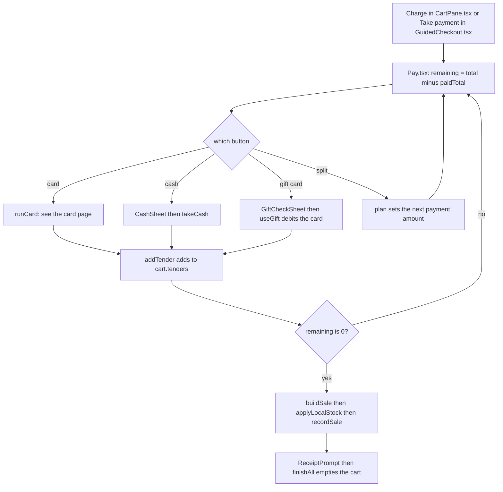

The Payment screen is where a sale is paid for. You reach it with **Charge** on the cart (or **Take payment** in the guided checkout). Nothing is taken from the customer until they pay.

## Basic

### Getting there
Tap **Charge** on the cart. Three checks can come first, only if they apply:
1. A **Customer warning**, if something in the cart has one set. See [[sales/cart-warnings]].
2. A list of **price adjustments** on the sale, which you keep, change or remove. See [[sales/cart-and-prices]].
3. **Check these bundles**, if a bundle deal is not a recommended pair. See [[sales/bundles]].

Then the **Payment** screen opens.

### What you see
- The big number is **Total due**. Once part of the bill is paid it changes to **Remaining**, with *of $…* underneath.
- Under it, a list of the payments taken so far (card, cash, gift card) and what each paid.
- The ways to pay. In standard mode the buttons read **Card**, **Cash**, **Gift card** and **Split amount**. In Simple and Minimal modes they read **Pay by card**, **Pay with cash**, **Pay with a gift card** and **Split the payment**, each with a line under it saying what it does, and a heading *How is the customer paying?*
- If the card reader is not ready you see **Reader issue** in red at the top right. Cash and gift cards still work.

### The four ways to pay
- **Card**: the customer taps, inserts or swipes on the Zeller terminal. See [[pay/card]].
- **Cash**: a sheet opens where you tap the notes and coins the customer hands over. It works out the change and which notes and coins to give back. See [[pay/cash]], and [[cash]] for the drawer record behind it.
- **Gift card**: scan or type the gift card code. The amount taken is the card's balance, or what is still owed, whichever is less. The gift card is charged straight away. See [[pay/gift-card]].
- **Split amount** (**Split the payment**): take part of the bill one way and the rest another way, or divide it equally. Pick **Split equally 2**, **3** or **4**, or key in the first amount and tap **Continue**. The next payment then says *Next payment: $…*. The amount must be less than what remains. Tap **Cancel split** to go back to paying the lot. See [[pay/split-and-part]].

Every payment taken is added to the list. Pay the rest any way you like, in any order, until **Remaining** reaches $0.00.

### When it is fully paid
The sale finishes by itself the moment nothing remains. It is saved and sent to Shopify in the background, and the **Receipt** sheet opens: show a QR code, email or text the link, share it, or tap **No receipt**. Tapping that (or finishing the receipt) clears the cart for the next customer. See [[pay/receipts]].

If the total is $0.00 (a free sale), there is one button, **Complete $0.00 sale**.

### Going back
- **Nothing paid yet:** **Back** returns you to the cart and nothing has changed.
- **Part paid:** the cart is locked, so you cannot change items, clear it or save it. **Back** asks **Cancel this sale?**. If you choose **Refund & cancel**, card payments are refunded to the customer's card, and gift-card payments are credited back to the same gift cards. For cash, collect any previously given change and return exactly the original notes and coins; the drawer ledger records the denominations. If an electronic return fails partway through, the sale stays in cancellation mode and remembers returns already completed; retry cancellation after resolving the problem. Do not take another payment for it.
- **While the terminal is working** there is no Back button. Use **Cancel** on the *Waiting on terminal* strip first.

### Good to know
- A cash payment can be rounded to the nearest 5c if **Cash rounding (5c)** is on in Settings ▸ Payments. It only changes the cash amount due, and only when cash pays the whole of what remains. Card amounts are always exact.
- The register will not lock, and staff cannot be switched, while a card payment is waiting on the terminal.
- If the iPad is offline the sale is kept on it and sent when it is back online. Card payments need a connection, so they will not work offline, but cash will.

## Deep

### Part payments and the order they are taken in
A sale is made of **payments** (the app calls them tenders). Each one has its own amount, and the sale is paid when they add up to the total. You can mix any methods, in any order, and as many as you like. The *Next payment* amount is just the figure the next card, cash or gift card payment will aim for: the split amount, an equal share, or everything that remains.

### Cash rounding in a part-paid sale
Rounding is worked out on the cash that is **due**, not on the amount handed over. If cash pays the whole of what remains, the due amount is rounded to the nearest 5c and the difference is kept on the payment. If cash is only part of the bill, nothing is rounded.

### The gift card is charged first, not last
When you choose a gift card, the amount is taken off the card's balance straight away, before the sale finishes. If Shopify cannot do it you see **Gift card could not be charged** with the reason, and nothing is added to the sale. Cancelling a part-paid sale credits the amount back to the same card; a failed cancellation stays locked for a safe retry.

### What "finished" means
When the last payment makes **Remaining** $0.00, the app builds the sale record, takes the sold units off the stock count on this iPad, puts the sale in a queue for Shopify, and, if the sale started from a saved cart, removes that saved cart. The queue creates the Shopify order and adjusts Shopify's stock. If that fails or the iPad is offline, the sale stays queued and is retried. You can see how many are waiting in More ▸ Support & diagnostics ▸ Sync.

### Why the cart locks
Once any payment is on the sale, changing the cart would make what was paid and what is owed disagree. So the lines, the keypad, Save cart and Clear cart all say **Payment in progress** until the sale is paid or cancelled.

## Advanced

### From Charge to a finished sale

### Where the code is
| Job | Where |
|---|---|
| The screen and all its state | `Pay` in `src/screens/Pay.tsx` |
| Total, what is paid, what remains | `usePriced` in `src/state/selectors.ts` gives the total; `paidTotal` in `src/lib/saleBuilder.ts` adds up the payments; `Pay` itself works out what remains |
| Building a payment | `cardTender`, `cashTender` in `src/lib/saleBuilder.ts`; the gift card payment is built in `useGift` in `Pay.tsx` |
| Finishing | the `finalising` effect in `Pay.tsx`: `buildSale`, `applyLocalStock`, `recordSale` (`src/lib/saleBuilder.ts`, `src/lib/sync.ts`) |
| Cash ledger | `postCashSale`, `recordCancelledCashTender`, `cashDue` in `src/lib/cashSale.ts` |
| Cancelling a part-paid sale | `abandon` in `Pay.tsx` |
| Which card states may use a sheet | `showsOwnSheet`, `showsWaitingStrip`, `lockPayButtons` in `src/lib/payUi.ts` |
| Simple mode wording | `payTitle`, `payHint`, `payQuestion` in `src/lib/simpleLabels.ts` |
| Receipt step | `ReceiptPrompt` in `src/screens/Receipt.tsx` |

The payments live on the cart as `cart.tenders`, so they survive leaving the screen and are what locks the cart. The sale's id (`cart.saleUuid`) is made at the first payment and kept until the sale is paid or cancelled. Card attempt references are built from it, which is how a payment can be matched to its sale later.

The finishing effect runs once (a `finalising` flag stops it repeating) when there is at least one payment, nothing remains, and the terminal is not waiting. The flag is only cleared by `finishAll`.

### Reading the code for a fault
- **Pay by card, Cash, Gift card and Split are all greyed out.** `lockPayButtons` is true while the card phase is waiting. If the app was closed mid-payment, reopen the Payment screen: the waiting state is not saved, but the attempt is. Check the card page for what happens to an unfinished attempt.
- **Paid in full but the sale did not finish.** The effect holds off while the card phase is `waiting`. Look for the strip at the top of the screen.
- **Cart is stuck as "Payment in progress" with nothing paid.** Something left a payment in `cart.tenders`. Open Payment and use **Back**, then **Refund & cancel**.
- **Sale is finished but missing in Shopify.** It is in the queue: More ▸ Support & diagnostics ▸ Sync shows how many are waiting and the last error, and **Sync now** retries.
- **A free sale has no payment buttons.** Expected: only **Complete $0.00 sale** shows, and it adds a $0 cash payment.
- **Tests.** `tests/payui.test.ts` (which card states may draw a sheet), `tests/sale.test.ts` and `tests/cashsale.test.ts` (building sales and cash payments), `tests/simplelabels.test.ts` (Simple mode wording).
