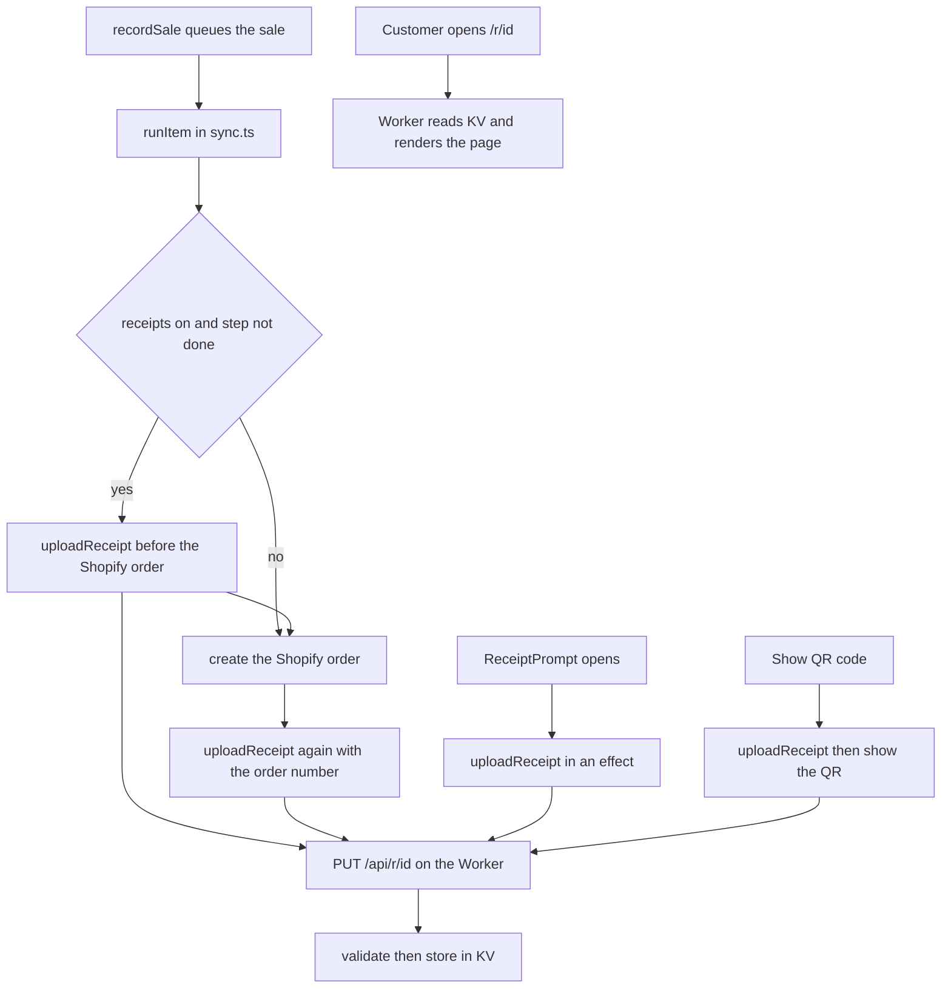

When a sale is paid, the **Receipt** sheet opens so you can give the customer their receipt. In normal use that is a link to a web page, which the customer opens by scanning a QR code or from a message.

## Basic

### The Receipt sheet
It opens by itself the moment the last payment is taken. At the top you see the total, **Sale complete**, and the Shopify order number when it is already known. If the customer paid cash and got change, **Change $…** shows in large type, so you can say it out loud.

There is no close button and you cannot swipe the sheet away. You finish with **No receipt**, which clears the cart for the next customer. The button keeps that name even after you have sent a link, so tap it when you are done.

### If the receipt page is set up
The buttons are:
- **Show QR code**: a QR code the customer scans with their phone camera. The page shows the itemised receipt, with **Download PDF**, **Save as image** and **Print**. **Back** returns to the buttons.
- **Email link**: opens the iPad's Mail app with the link already written. If the sale has a customer with an email address, it is filled into **To**. Otherwise you type it.
- **Text link**: the same, in Messages, with the customer's mobile if there is one.
- **Share…**: the iPad share sheet, for AirDrop or any other app.
- **No receipt**.

Selling a gift card adds a few extra buttons for that card (a QR for the customer to claim it, and a QR for scanning it at a register). They are covered with the gift card pages.

### If the receipt page is not set up
The buttons read **Email receipt**, **Text receipt**, **Share…** and **No receipt**. What is sent is a plain text receipt: shop name, date and time, the order number, each line with its price, discounts, the total, how it was paid, and *Thank you!*. There is no QR code, PDF or tax invoice. The receipt page is set up in Settings ▸ Receipts. The **Receipts** row in Settings says **Not set up** until a server address is entered. For configuration, see [[settings/receipts]].

### What the customer sees
The page lists your business name, ABN, address and contact details, then the receipt number (it looks like `R-1A2B3C4D`), the order number, the date and time, and who served them. Below that are the items with any discounts, then the totals, then how it was paid. Card payments show the card type, the last four digits, the approval code and the terminal reference. Cash shows what was handed over and the change. If your return policy is filled in, it is at the bottom.

Before downloading, the customer can type a **Billed to (name)** and a **Buyer ABN (optional)** on the page. These are only used for that download. Nothing they type is sent anywhere or saved.

### Tax invoice or receipt
- If **Registered for GST** is on in Settings ▸ Receipts, the document is titled **Tax invoice** and shows *Total includes GST of $…*. Gift card lines are left out of the GST.
- If it is off, the document is titled **Receipt** and has no GST lines.
- A refund is titled **Refund receipt**, or **Adjustment note (refund)** when GST is on, and says **Total refunded**.

Check the wording with your accountant. The page says so itself in the settings.

### Giving a receipt later
- Transactions ▸ pick the sale ▸ **New receipt** opens the same sheet again. Use it when a customer asks after they have left.
- **Share receipt text** on the same screen shares the plain text version.
- Orders ▸ pick the order ▸ **Receipt** also works, but the page it makes is plainer. See Deep.

### If something looks wrong
- **Not published yet. It goes live when this iPad can reach the receipt server.** appears under the QR code when the iPad could not upload the receipt (usually no internet). Show the QR code anyway: the page appears on its own once the iPad reconnects. Tell the customer to refresh in a minute.
- **Receipt not found** on the customer's phone: they scanned before the upload finished, or the iPad is offline. Ask them to try again shortly.
- **Receipt page not published** in Notifications: the iPad has no receipt server address or secret, or the server turned the upload down. See Deep, then fix Settings ▸ Receipts.
- **Could not open that app** after tapping **Email link** or **Text link**: the iPad has no Mail account, or cannot send texts. Use **Share…** instead.

## Deep

### Why a link and not a printed slip
One page holds the Shopify order lines **and** the card details from Zeller, so it works as the single record for tax. Because it is a web page, the customer can download a PDF or an image, and the same link works if they need it again.

### The link never changes
Each receipt's address is made from the sale itself (an unguessable 80-bit code), so the link for a sale is always the same. Uploading again overwrites the same page rather than making a second one. Search engines are told to ignore the pages, and they never expire, because they are tax records.

### When the page is published
It can happen up to four times, and all of them are safe to repeat:
1. As soon as the Receipt sheet opens, so the QR code usually works straight away.
2. When you tap **Show QR code**, which waits for the upload before showing the code. If the upload fails, the code still shows, with the note above.
3. In the background queue (the same one that sends the sale to Shopify), **before** the Shopify order is made, so a customer scanning within seconds still finds a page.
4. In the queue again **after** the order exists, so the page carries the Shopify order number.

If the server cannot be reached (offline, or a server error), the queue item stays where it is and only the receipt step is repeated later. This never holds up the Shopify order.

If the server address or secret is missing, or the server refuses the receipt, the queue shows **Receipt page not published**, and then **gives up on that sale's receipt**. It does not retry, because retrying cannot fix a wrong setting. After fixing Settings ▸ Receipts, open the sale in Transactions and tap **New receipt**: that uploads it again.

### Gift card payments
Today a gift card payment shows as **Gift card** followed by the code on a receipt built straight after the sale. A receipt rebuilt later only knows the last four characters. See [[pay/gift-card]].

### Cash rounding on the receipt
The payment amount on a receipt includes any cash rounding, so the payment line matches what the customer actually handed over less change. Rounding also shows as its own **Rounding** line in the totals, and **Subtotal** only appears when there is a discount, rounding or tip to explain.

### Receipts made from an order, not from the sale
Transactions ▸ **New receipt** on a sale made on this iPad uses the saved sale, so it is identical to the original. A sale from another register is rebuilt from its Shopify order. That works, but it has no discount names, no tip and no staff name, and because it uses the same link it **replaces** the original page with the plainer one. Orders ▸ **Receipt** rebuilds from the order too, but makes a **different** link, and it shows each line at its original price with no discount row. Both still show the right total.

### Business details are copied at upload time
Your name, ABN, address and the GST switch are read from Settings ▸ Receipts every time a receipt is uploaded. If you change them later and then reopen an old sale's **New receipt**, that page is rewritten with the new details.

## Advanced

### From a finished sale to a page

### Where the code is
| Job | Where |
|---|---|
| The sheet and its buttons | `ReceiptPrompt` in `src/screens/Receipt.tsx` |
| Plain text receipt (no server set) | `receiptText` in `src/screens/Receipt.tsx` |
| Building the snapshot | `buildReceiptDoc` in `src/lib/receiptDoc.ts` (its type, `ReceiptDoc`, is in `receipt-server/src/types.ts`) |
| The address, number and GST | `receiptId`, `receiptNumber`, `receiptUrl`, `gstIncluded` in `src/lib/receiptDoc.ts` |
| Uploading | `uploadReceipt`, `receiptsEnabled`, `ReceiptConfigError` in `src/lib/receiptSync.ts` |
| Sample receipt | `uploadSampleReceipt` in `src/lib/receiptSync.ts` (the **Send test receipt** button) |
| Background steps | `runItem` and `processOutbox` in `src/lib/sync.ts` |
| Settings ▸ Receipts | `ReceiptSettings` in `src/screens/Settings.tsx` |
| The Worker | `receipt-server/src/index.ts` (routes), `receipt-server/src/validate.ts` (what it accepts), `receipt-server/src/render.ts` (the page and its titles), `receipt-server/src/clientScript.ts` (PDF, image, print) |
| Old sales | `Detail` in `src/screens/Transactions.tsx` (**New receipt**) and the **Receipt** button in `src/screens/Orders.tsx` |

### The snapshot
`buildReceiptDoc` copies everything the page shows, so the Worker needs no Shopify access:
- `receiptId` is the first 20 hex characters of the SHA-256 of `rcpt:` plus the sale's uuid. Nothing is stored or synced for it, so any iPad that has the sale makes the same id. `receiptNumber` is `R-` plus the first eight characters in capitals.
- Totals: `totalCents` is the sale total plus rounding for a sale, and the refund total as it is for a refund (refunds carry no rounding).
- Payments: `payment` builds one row per payment. Cash rounding is added into the row's amount. Card rows keep scheme, masked number, approval code, RRN, a short terminal id, the external reference, time and Zeller's own receipt link. The page shows **Original card receipt** only when that link starts with `https://`.
- GST is `gstIncluded`: one eleventh of the non-gift-card lines when registered, otherwise 0.

### The Worker
`PUT /api/r/<id>` needs `Authorization: Bearer <RECEIPT_SECRET>` (compared in constant time), refuses bodies over 64,000 characters, and runs the body through the validation file, which trims and limits every field and rejects an id that does not match. Anything else is a 4xx. `GET /r/<id>` renders the page with a one-time script nonce, so the page's own PDF script is the only script allowed. The PDF and image are drawn in the customer's browser.

### How failures are handled
`receiptStep` inside `runItem` has three outcomes: success marks the step done; a `ReceiptConfigError` (no URL, no secret, or any non-5xx failure) raises the **Receipt page not published** notification and marks the step done; anything else (a network failure or a 5xx) is held until the end so the item stays queued. `uploadReceipt` throws a `ReceiptConfigError` for a 4xx and a network error for a 5xx.

### Reading the code for a fault
- **QR shows but the page says Receipt not found.** The upload has not landed. Check More ▸ Support & diagnostics ▸ Sync for a queued sale, then the receipt server address and secret.
- **A page has the wrong business name or address.** Something re-uploaded it after the settings changed (see Deep). Fix Settings ▸ Receipts and tap **New receipt** on the sale.
- **A refund receipt shows the wrong title.** The title rule is in `receipt-server/src/render.ts`: it decides from the document's kind and the GST flag.
- **The page shows no order number.** Only the second queue upload adds it. If the Shopify order step is still waiting, so is the number.
- **No Wallet pass button on a gift card sale.** It is hidden while `GIFT_CARD_PASSES` in `src/lib/features.ts` is false.
- **Tests.** `tests/receipt.test.ts` covers the receipt id, GST, the merged lines and card details, cash rounding, refund titles, the Worker's validation and the page's escaping.
