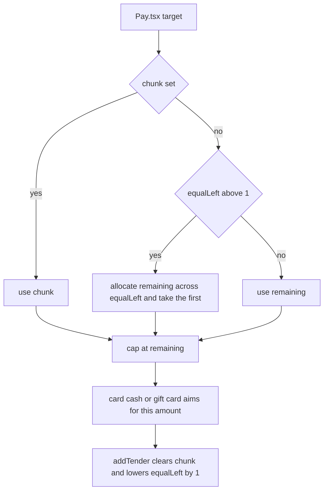

One sale can be paid with as many payments as you like, in any mix of card, cash and gift card. The sale finishes by itself when nothing remains.

## Basic

### Splitting
On the **Payment** screen tap **Split amount** (**Split the payment** in Simple and Minimal modes). The **Split amount** sheet opens with **First payment** and a keypad.
- **Split equally 2, 3 or 4:** the bill is shared into that many equal payments. Cents that do not divide evenly go to the first payments.
- **Key in an amount and tap Continue:** that is the first payment. It must be less than what remains, otherwise you see *Amount must be less than the remaining total*. **Continue** stays greyed out until the amount is above $0.00.

After you choose, the screen shows **Next payment: $…**. Now tap **Card**, **Cash** or **Gift card** and that payment aims for the next payment amount. Tap **Cancel split** to go back to paying the lot.

Example: $100.00 split equally 3 ways is $33.34, then $33.33, then $33.33.

### Each payment counts as one share
With **Split equally**, every payment you take counts as one share, whatever it was and whatever its size. After each one the rest is shared between the people left. Example: $90.00 split 3 ways.
1. The first person pays $30.00 by card. $60.00 remains for 2 people.
2. The second hands over only $20.00 in cash and you take it as a part payment. That counts as their share, so $40.00 remains for 1 person.
3. The last payment is the whole $40.00.

A card that is declined or cancelled takes nothing, so it does not use up a share.

### Part payments without splitting
You do not have to split first. A payment can simply be less than the bill:
- **Cash:** if the customer hands over less than is due, tap **Take $… as part payment**. See [[pay/cash]].
- **Cash and card:** if the drawer cannot make the change, the cash screen can offer **Cash $… + the rest another way**.
- **Gift card:** a card with less balance than the bill pays what it has. See [[pay/gift-card]].

In every case the **Payment** screen then says **Remaining**, with *of $…* under it, and the payments so far are listed. Pay the rest any way you like.

### While part of the sale is paid
The cart is locked, so you cannot change items, clear it or save it. **Back** asks **Cancel this sale?**. **Refund & cancel** refunds the card payments to the customer's card through the terminal. Cash and gift card payments are **not** returned automatically. Hand the cash back yourself (the drawer record is put back for tracked cash) and deal with gift cards by hand. See [[pay]].

### On the receipt
The receipt lists every payment with its amount, and the sale is sent to Shopify with one payment per entry.

## Deep

### How the next payment amount is chosen
The next payment aims for the first of these that applies, never more than what remains:
1. The amount you keyed in on the split sheet.
2. An equal share, when **Split equally** is active and more than one share is left.
3. Everything that remains.

A keyed amount only applies to the **next** payment. Once any payment is added, the screen goes back to aiming for everything that remains, unless you split again. Example: $100.00 with $30.00 keyed. After the $30.00 is paid, $70.00 remains and the next payment aims for $70.00, not $30.00.

### Equal shares and cents
The shares are worked out from what **remains**, so they are re-worked after every payment. Spare cents go to the earliest shares, which is why the first payer can be one cent more. The shares always add up exactly to what remains.

### Rounding in a split
Cash rounding only applies to the payment that clears the whole of what remains. Earlier shares are always exact, and so are card payments. See [[pay/cash]].

### Each payment is its own record
Every payment keeps its own method, amount, and for cards its own fee. The Shopify order gets one payment per entry, named **Zeller**, **Cash** or **Gift card**.

### Cancelling
**Refund & cancel** refunds each card payment through the terminal, one after another. If a refund does not complete nothing is cancelled and you see **Refund did not complete**. Cash drawer entries for tracked cash are reversed. Gift cards stay charged.

## Advanced

### Working out the next payment

### Where the code is
| Job | Where |
|---|---|
| The next payment amount (`target`), `chunk`, `equalLeft` | `Pay` in `src/screens/Pay.tsx` |
| Adding a payment | `addTender` in `src/screens/Pay.tsx` |
| Equal shares | `allocate` in `src/lib/money.ts` (largest remainder) |
| What has been paid | `paidTotal` in `src/lib/saleBuilder.ts` |
| Cancelling a part-paid sale | `abandon` in `src/screens/Pay.tsx` |
| The keypad on the split sheet | `Keypad` in `src/ui/kit.tsx` |

`target` is the smaller of what remains and `chunk`, or the first result of `allocate` over `equalLeft` equal weights, or what remains. `addTender` sets `chunk` back to nothing and lowers `equalLeft` by one (never below zero), on any payment of any size. The split setting lives only in the `Pay` screen's state, so it is not saved. The payments themselves are saved on the cart as `cart.tenders`.

`Keypad` greys out **Continue** for $0.00, and the split sheet refuses an amount at or above what remains, so a split can never be zero or the whole bill.

### Reading the code for a fault
- **Next payment shows the wrong amount.** A payment was added since you split (any payment resets `chunk`), or the equal shares were re-worked from a smaller remainder.
- **Cancel split is missing.** It only shows while `chunk` is set or `equalLeft` is above 1. With one share left the screen is simply aiming for what remains.
- **The split is gone after reopening the app.** Expected: it is screen state. The payments already taken are still on the cart.
- **Tests.** The sharing maths is covered in `tests/lib.test.ts` (`allocate`). The `target` rule is inside the `Pay` screen and has no test of its own. Cash and sale building are in `tests/cashsale.test.ts` and `tests/sale.test.ts`.
