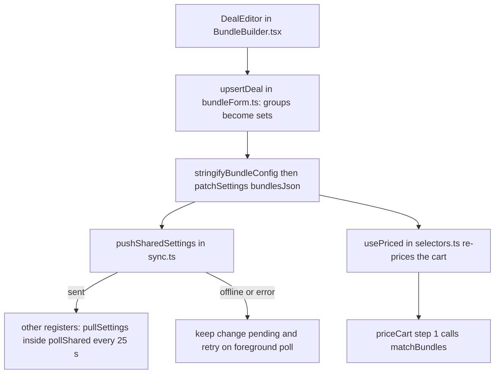
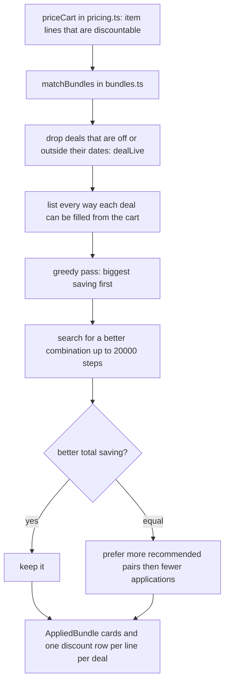

A bundle deal changes the price when a customer buys certain items together, for example *2 Highland Cows for $2 off*. You build them in Settings, and the cart applies them by itself.

## Basic

### Who can make them, and where
Open **More ▸ Settings ▸ Discounts & bundles**. Managers and owners can open Settings. When staff accounts and the PIN requirement are in use, a signed-in cashier cannot, so they only ever see the deals working in the cart. With no accounts set up, the till acts as the owner and anyone can. See [[staff]] for how staff roles work.

The list shows every deal with its name, whether it is **Live**, **Scheduled**, **Ended** or **Off**, and a one-line summary such as *2 × Highland Cow → $2.00 off*. The switch on the right turns a deal on or off without deleting it. Tap a row to change it.

### Making a deal
Tap **New bundle deal**, then work down the screen:
1. **Deal name**: this is what the customer sees on the cart and receipt. Use something short, like *Cow pair*.
2. **What the customer buys**: each **Group** is "this many items from this list".
   - Tap **Pick items** and search. Tapping a product includes **every variation** of it. To be stricter, tap the options icon beside a product that has several variations and tick only the ones you want.
   - Use the **−** and **+** to set how many from the group are needed (it shows as *2 ×*).
   - **Add another group of items** if the deal mixes different things, such as one dragon and one egg.
3. **The deal**: choose **$ off**, **% off** or **Set price**, then type the amount.
   - **$ off**: takes that many dollars off the items together.
   - **% off**: takes that percentage off the items.
   - **Set price**: the items together cost exactly that amount.
4. **Take it off** appears when the deal has more than one item. **Spread over all items** shares the saving across everything in the deal. **Only group 1** (or 2, 3 …) takes the whole saving from that group's items only.
5. **Limits** (all optional): **Most times per order**, and **Starts** and **Ends** dates written like `2026-12-24`. The end date counts the whole day.
6. **Recommended pairs** (optional, see below).
7. Tap **Create deal**. The **Summary** box at the bottom shows what you have built before you save.

If something is missing, red notes appear under the form when you tap **Create deal** and say what (for example *Give the deal a name.* or *Group 1 has no items. Pick at least one.*). **Delete deal** asks first, and the deal stops applying straight away.

### Recommended pairs
Some deals only make sense for certain combinations, like matching colours. Under **Recommended pairs** tap **Add a recommended pair** and choose one variation for each item in the deal.

Every variation still gets the deal. A recommended pair only changes two things:
- If the cashier rings up a different combination, they are asked to check it before payment (see below).
- When two ways of matching save the customer the same amount, the POS picks the recommended one.

If you change the items or quantities after adding pairs, you are asked **Clear recommended pairs?**, because the old pairs no longer fit.

### In the cart
When items qualify, a **Bundle deals** block appears under the lines with one card per deal. Each card names the deal, the saving, and every item and variation in it. A green tick says **Recommended pair**. An amber warning says **Not a recommended pair**.

The deal also appears as its own row under each line it discounted, showing the deal's name and the amount.

### The check before payment
If any deal in the cart is **Not a recommended pair**, tapping **Charge** first opens **Check these bundles**. The customer still gets the deal. Look at the items and ask whether it is what they want, then tap **Continue to payment**, or **Edit cart** to change something. You are only asked again if the combination changes. In the guided checkout the same warning appears on the **Check** step, headed *Check these deals with the customer*.

If the sale also has price adjustments, those are reviewed first, then the bundle check.

### Good to know
- A single item unit can only be in **one** deal. If two deals could use the same unit, the POS gives the customer the bigger saving.
- A line that gets a bundle discount does not also get its own line discount.
- Items tagged `no-discount`, gift cards and custom amounts never count towards a deal.
- A deal needs enough units. A group of 3 needs 3 of those items in the cart.
- **Price check** (see [[sales/lookup-tiles]]) lists the bundle deals an item can be part of. That is only a hint: it cannot know what else is in the cart.
- Changes you save are shared with the other registers. They get them within about 25 seconds while the app is open.

## Deep

### How the POS chooses between deals
Several deals can apply to one order, and a unit can only be used once. When the cart could be matched more than one way, the POS tries the possible ways and keeps the one with the **biggest total saving**. If two ways save exactly the same, it prefers, in order:
1. more recommended pairs,
2. fewer deal applications (so a bigger lot beats two smaller ones),
3. the deal with the lower priority number,
4. the deal that comes first in the list.

A recommended pair never beats a bigger saving. The customer is never worse off to keep to the recommendation.

### Worked examples
- *2 Highland Cows for $2 off*, customer buys 3 cows: one application ($2 off two cows). The third cow is at full price.
- *Dragon + Egg, set price $12*, customer buys a dragon ($9) and an egg ($4): together $13, so the deal takes $1 off. If they already cost less than the set price, the deal does nothing. A deal never raises a price.
- *% off pair, 10%*, with **Only group 2**: the 10% is worked out on, and taken off, group 2's items only.
- A cashier changed a unit's price for the sale. Deals use the changed price, and never take a price below $0.

### How the saving is shared between items
For **Spread over all items** the saving is divided between the units in proportion to their prices. For **Only group N** only that group's units take it, and never more than they cost.

### Dates
The Starts date is the first moment of that day and the Ends date is the last moment of that day, both by the iPad's own clock and time zone. A deal is live when it is switched on and inside its dates. A wrong date or time on a register changes which deals it applies.

### Sharing between registers
Deals are kept with the other shared settings (staff, fees, cash rounding, the PIN requirement and price adjustment limits). Saving a deal sends the whole set. If the upload fails, this register keeps the change pending and retries while the app is open, about every 25 seconds. Other registers receive it on a later poll after the upload succeeds. Check **Support & diagnostics ▸ Sync** if the shared-settings upload reports an error.

### Where deals sit in the price
Bundles are worked out first, before Shopify automatic discounts, a line's own discount, the cart discount and any price adjustments. Units used by a bundle are not used by an automatic discount. See [[sales/cart-and-prices]] for the full order.

## Advanced

### From the editor to a discounted cart

### How a match is found

The greedy pass always gives a valid answer first. If the search hits its step limit it keeps the best result found so far, so a very large cart can get a good answer that is not guaranteed to be the best.

### Where the code is
| Job | Where |
|---|---|
| The list, editor, item picker, pair picker, JSON view | `BundlesEditor`, `DealEditor`, `ItemPicker`, `PairPicker`, `JsonEditor` in `src/screens/BundleBuilder.tsx` (Settings ▸ Discounts & bundles is drawn by `Settings.tsx`) |
| Form to deal and back, ids, dates, save checks | `formToDeal`, `dealToForm`, `upsertDeal`, `removeDeal`, `pruneSets`, `makeDealId`, `formProblems`, `dealWindow` in `src/lib/bundleForm.ts` |
| Reading and checking the saved JSON | `parseBundleConfig`, `validateBundleConfig` in `src/lib/bundles.ts` |
| Matching | `matchBundles`, `dealLive`, `bundleStatus` in `src/lib/bundles.ts` |
| Pricing step | step 1 of `priceCart` in `src/lib/pricing.ts` |
| Reading the setting | `bundleConfig` in `src/lib/sync.ts`; `usePriced` in `src/state/selectors.ts` |
| Check before payment | `needsBundleCheck`, `bundleReviewKey`, `oddBundles` in `src/lib/bundles.ts`; the **Check these bundles** sheet in `CartPane.tsx`; the **Check** step in `GuidedCheckout.tsx` |
| The card in the cart | `BundleRow` in `src/screens/CartPane.tsx` |
| Exchanges | `Refund.tsx` prices the replacement items with `bundleConfig` too |

### How a deal is stored
The setting is `settings.bundlesJson`, a JSON text of `{ version, items, discounts }`. `items` is a map of **set id to a list of product or variation ids**. Each deal's `sets` lists set ids, once per unit needed, so *2 cows* is `["x", "x"]`.

The builder saves each group as a set named `<dealId>_1`, `<dealId>_2` and so on, and repeats a set for its quantity. A new deal's id comes from its name (`makeDealId` makes it unique, for example `cow_pair_2`). Editing keeps the id even if the name changes. `pruneSets` removes sets that no deal uses.

The three modes are stored as `mode` `delta` (`price_delta_cents` negative), `fixed_price` (`price_delta_cents` is the price) and `percent` (`percent`). `apply_to` names the set the saving comes from. `recommended` is a list of variation id lists, one id per unit.

A product id in a set matches all of its variations. A variation id matches only that one. The JSON view (**Advanced: edit as JSON**) edits the same text, and saving it rewrites the deals in the list.

### Reading the code for a fault
- **No deal applies at all.** `bundleConfig` returns null when the saved text cannot be read, and pricing then skips bundles with no message. Open Settings ▸ Discounts & bundles: if the text is unreadable the editor opens on the JSON view and says why.
- **One deal does not apply.** Work through it in this order: is it **Live** (switched on, inside its dates by this iPad's clock)? Is the item or its product in the group, and is it still in the catalogue (the editor warns about items that are no longer synced)? Does the cart hold enough units for every group? Is the item tagged `no-discount`, or a gift card or custom amount? Has **Most times per order** been reached? Does the deal save anything (a **Set price** at or above what the items cost saves $0, so it is skipped)? Did another deal win with a bigger saving?
- **The saving is on the wrong item.** Check **Take it off** (`apply_to`).
- **A change did not reach another register.** Look at the **Sync** strip and wait one 25 second tick. If the saving register was offline, there was no retry (see Sharing).
- **A line discount you set disappeared.** The line also got a bundle discount, which blocks the manual one (see [[sales/cart-and-prices]]).
- **Tests.** `tests/bundleform.test.ts` covers percent and dated deals, recommended pairs, the form round trip, the checkout check, and a deal built in the GUI running through `priceCart`. `tests/lib.test.ts` covers a price override feeding a bundle.
