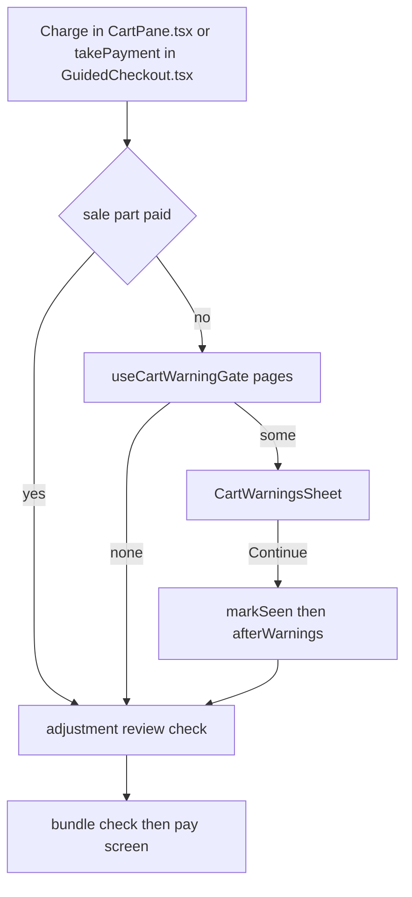

A customer warning is a message the till shows the cashier when they press **Charge**, before payment starts. Use it for things the customer should be told, for example *Joints are fragile, do not bend or apply pressure as it will snap* on a mini dragon.

## Basic

### What the cashier sees
Tap **Charge**. If anything in the cart has a warning, a window called **Customer warning** (or whatever header was set) opens before the price adjustments and bundle checks.
- It shows one warning at a time, with *Warning 1 of 3* at the top and **For:** under the message naming the items that set it off.
- Tap **Next** and **Back** to move between them.
- On the last warning, tap **Continue to payment**. **Back to cart** closes the window so you can change the cart.
- If a warning needs ticking, tap **I have read this and dealt with it** on each one. **Continue to payment** stays off until every warning that needs it has been ticked, and a note says how many are left.

Once you have carried on from a warning, it is not asked again on the same sale unless it changes (its text is edited, or another line sets it off). A warning set to always show comes up every time you press Charge.

### Setting them up
Open **More ▸ Settings ▸ Cart warnings** (managers and owners). Tap **Add warning**, then:
1. **Header**: the title of the window. Leave it blank for *Customer Warning*.
2. **Message for the cashier**: the text shown.
3. **Show on every sale**: turn on to show it on every Charge, whatever is in the cart.
4. **Cashier must tick it**: turn on to stop payment until the cashier ticks that they have read it and dealt with it.
5. **Shows when the cart has**: pick **Variation**, **Product** or **Category**, search, and tap the one you want. A *Product* covers every variation of it. A *Category* is a Shopify collection, so it covers every product in it. This is hidden when **Show on every sale** is on.
6. Tap **Save**. **Save** stays off until there is a message and something to attach it to (or Show on every sale is on).

In the list, **On** and **Off** switch a warning without deleting it. **Edit** and **Delete** are on each card. Delete asks first.

### Good to know
- Gift cards and custom amounts never set a warning off.
- Warnings are shared with the other registers, like the staff list and bundle deals.
- Practice runs in Training never show the shop's real warnings.
- A warning for an item or category that has since been removed from the catalogue shows its name as *no longer in the catalogue*. It never fires. Edit it or delete it.

## Deep

### Order of the checks
Charge runs the checks in this order, and each one only appears if it applies: customer warnings, then **Check the price adjustments**, then **Check these bundles**, then the Payment screen. A sale that is already part paid goes straight to Payment and skips all three.

### What counts as "already seen"
When you tap **Continue to payment**, the till remembers each warning you carried on from, along with which cart lines set it off and the exact header and message. If you come back to the cart and press Charge again, only warnings that are new or changed appear. Warnings set to always show are never remembered. Starting a new sale (an empty cart) forgets everything.

### Ticking
Ticking is per warning, and it resets each time the window opens, so a cashier cannot tick on one visit and skip on the next. Ticking again un-ticks. **Next** and **Back** are always free, and **Continue to payment** only appears on the last warning so every one is paged through.

### Order of the warnings
Warnings appear in the order they were added in Settings.

## Advanced

### From Charge to payment

### Where it lives
- `src/lib/cartWarnings.ts`: `matchCartWarnings` finds which warnings the cart sets off (variant, product, or collection through `collectionsOfProduct`; `category` is read as `collection`), `warningKey` fingerprints one, `pendingCartWarnings` drops those already seen, `unacknowledged` lists those still to tick.
- `src/screens/CartWarningsSheet.tsx`: the window, and `useCartWarningGate`, the hook both checkouts use.
- `src/screens/CartWarningsSettings.tsx`: the editor under Settings ▸ Cart warnings.
- `Settings.cartWarnings` in `src/state/store.ts`, typed by `CartWarning` in `src/lib/types.ts`.
- Shared between registers by `pushSharedSettings` and `pullSettings` in `src/lib/sync.ts`.
- `sandboxSettings` in `src/lib/trainingSandbox.ts` sets `cartWarnings: []` so practice never meets the real ones.
- Window controls are the `warning.*` spots in `src/lib/trainingSpots.ts`, placed on `sheet_cart_warnings` in `src/lib/appControls.ts` and `src/app.navgraph`.

### Tracing a warning that does not show
1. Is it **On** in Settings ▸ Cart warnings, and does it have a message and a target (or Show on every sale)?
2. Does the cart line come from the catalogue? Gift cards and custom amounts are skipped.
3. Does the line's product sit in the collection? A category warning uses the collection's product list from the last sync.
4. Was it already carried on from on this sale? Only a change to the warning or its lines brings it back, unless it is set to always show.
5. Is the sale part paid? Part-paid sales skip the warnings.

Tests: `tests/cartwarnings.test.ts`.
