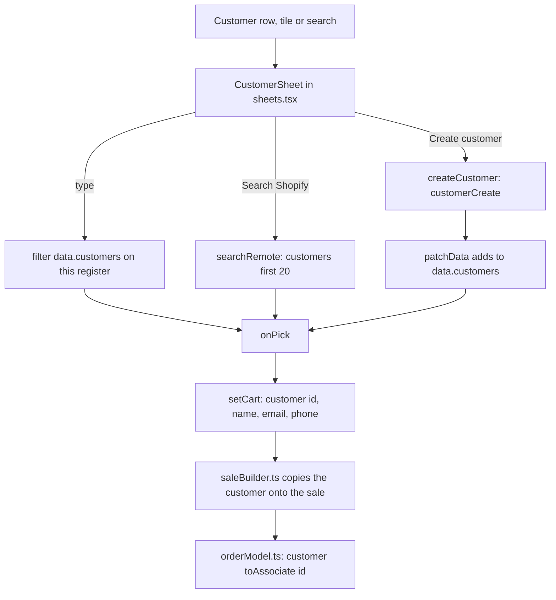

A customer is optional. Adding one links the sale to them in Shopify and fills in their email or mobile for receipts.

## Basic

### Adding a customer to a sale
Use any of these:
- The **customer row** at the top of the cart (it says **Add customer**, or **Add a customer (optional)** when explanations are on).
- The **Customers** tile on the Quick Menu.
- **⋯ ▸ Create customer** on the cart, which opens the sheet ready to type a new one.
- The Checkout search box, which lists matching customers.
- In the guided checkout, the **Customer** step.

A sheet opens with a search box. Type part of a name, email or phone and tap the person. To take the customer off again, tap the **✕** beside their name on the cart.

```screen
title: Add customer
input: Search name, email or phone | aiden
row: Aiden | aiden@example.com · 0412 345 678
row: Aiden's Sister | sister@example.com
button: Search Shopify
primary: Create customer
note: Tap a person to attach them to the sale. Tap "Search Shopify" to find someone this register has not seen yet.
```

### If they are not in the list
Tap **Search Shopify** (or press Return) to look in your Shopify store, which finds people this register has not heard of yet. If they are really new, tap **Create customer**, fill in **First name**, **Last name**, **Email** and **Mobile**, then tap **Create & attach**. You need at least one of name, email or mobile ("Add at least a name, email or phone").

### What having a customer on the sale does
- Their name shows on the cart, on a saved cart, and on the receipt.
- **Email receipt** and **Text receipt** start with their email or mobile already filled in.
- The order in Shopify is linked to them.

### The Customers list
**More ▸ Customers** shows everyone this register knows about (not shown in Minimal mode). Type in the search box to narrow it down, and press Return to search Shopify too. Tap a person to see their email, mobile, how many orders they have had, how much they have spent, and any note. From there:
- **Start sale** puts them on the cart and takes you to Checkout.
- **Edit** changes their first name, last name, email, mobile or note.
- The **person-plus** button at the top adds a new customer.

If saving fails you see **Could not save customer** or **Could not create customer** with Shopify's reason, such as an email that is already used.

## Deep

### Two lists, one store
Shopify is where customers really live. Each register keeps a copy, loaded by **Settings ▸ Shopify ▸ Import from Shopify**, so searching is quick and works with a poor connection. That copy is not refreshed by the background check that keeps stock, saved carts and the Quick Menu in step. So:
- A customer you create or edit on this register shows up here straight away.
- On another register they appear after that register imports again, **or** after someone there taps **Search Shopify**.
- If you attach a customer found by **Search Shopify**, the sale uses them correctly, but they are not added to this register's list until the next import.

### What search covers
Local search looks in the name, email and mobile, and shows up to 30 people when the box is empty and up to 40 matches when it is not. **Search Shopify** adds up to 20 more, hiding anyone already shown. The Customers list shows up to 200.

### What is carried onto the sale
Only the customer's name, email and mobile go onto the cart. Order count and total spent are for looking at on the Customers list and are not saved with the sale.

### Editing a name
The Edit form splits the saved name at the first space: the first word is the first name and the rest is the last name. A name like "Mary Jane Smith" becomes First "Mary", Last "Jane Smith". Check it before saving.

### What the app cannot do
It cannot delete or merge customers. Do that in Shopify, then import again.

### Gift cards
When you sell a gift card to someone with an email address, the app looks for a Shopify customer with that email and creates one if there is none, because Shopify needs a customer to send the card to.

## Advanced

### From picking a customer to the Shopify order


### Where the code is
| Job | Where |
|---|---|
| The picker and create form | `CustomerSheet` in `src/screens/sheets.tsx` (opened from `CartPane.tsx`, `Checkout.tsx` and `GuidedCheckout.tsx`) |
| The Customers screen | `src/screens/Customers.tsx` (`Customers`) |
| Shopify calls | `searchRemote`, `createCustomer`, `updateCustomer` in `src/lib/shopify/customers.ts` |
| The full import | `fetchCustomers` in `src/lib/shopify/catalogue.ts`, called from `importFromShopify` in `src/lib/sync.ts` |
| The local list | `data.customers` in `src/state/store.ts` (`patchData`) |
| What goes on a cart | `CustomerRef` in `src/lib/types.ts` (id, name, email, phone) |
| Linking the order | `orderModel.ts`: `customer: { toAssociate: { id } }` when the sale has a customer |
| Receipt prefill | `Receipt.tsx` uses `sale.customer?.email` and `sale.customer?.phone` |
| The button wording | `customerRowText` in `src/lib/simpleLabels.ts` |
| Whether the row is shown | `MORE_GROUPS`, `ROWS_BY_LEVEL` in `src/lib/uiMode.ts` (not in the Essential level) |
| Gift card recipients | `resolveRecipientId` in `src/lib/shopify/giftcards.ts` |
| Tests | `tests/simplelabels.test.ts` (the row wording). The customer calls themselves are not tested, because they need Shopify |

`customers.ts` maps a Shopify customer to `Customer` (`orders` from `numberOfOrders`, `spentCents` from `amountSpent`). `createCustomer` and `updateCustomer` drop empty fields and pass Shopify's `userErrors` to `throwUserErrors`, which is where the text in **Could not create customer** comes from.

### Reading the code for a fault
- **A customer made on another register is missing here.** The list is a copy. Import again in Settings ▸ Shopify, or tap **Search Shopify**.
- **The Customers list is empty.** The import has not run, or Shopify has no customers. Settings ▸ Shopify shows the counts from the last import.
- **Search Shopify finds nothing.** `searchRemote` takes Shopify's search syntax, so a typo or an exact-phone mismatch finds nothing. Try the email.
- **Could not create customer.** Read Shopify's reason in the message. An email or phone that is already used is the usual cause. Search for the existing person instead.
- **The receipt has no email filled in.** The customer has no email in Shopify, or the sale was started without a customer.
- **The Customers row is not on the More tab.** The staff member is on the Essential More level (Minimal, or a Custom setting). See `visibleMoreRows` in `src/lib/uiMode.ts`.
