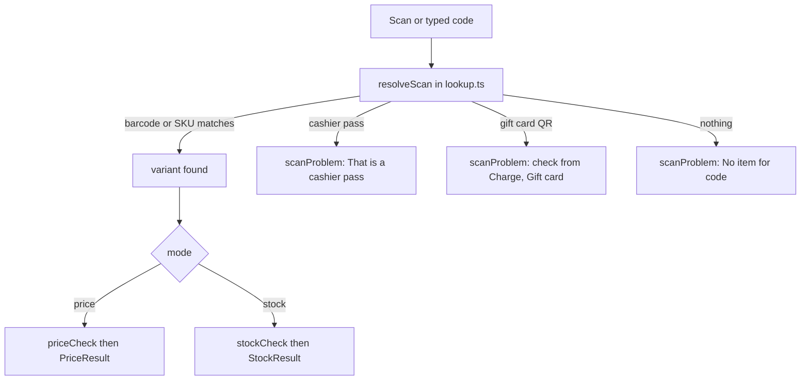
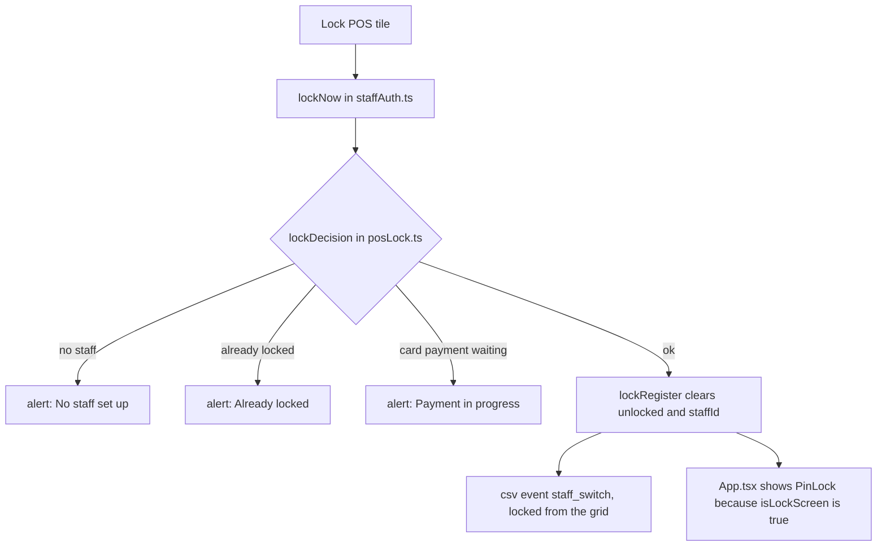

These buttons are for looking, not selling. Price check and Stock check never touch the cart, and Lock POS leaves it exactly as it is.

## Basic

### Lock POS
Tap the **Lock POS** tile when you step away. The register goes to the **Sign in** screen. The sale you were ringing up is still there when someone signs back in, with a PIN or by scanning a cashier pass.

You may see one of these instead of the lock:
| Message | What it means | What to do |
|---|---|---|
| **No staff set up** | Nobody has a PIN yet, so there would be no way back in. | Add a staff member in More ▸ Staff first. |
| **Payment in progress** | A card payment is waiting on the reader. | Finish or cancel it, then lock. |
| **Already locked** | The register is already on the Sign in screen. | Nothing to do. |

There is also **Lock register** in the More tab. It appears when your register asks for PINs and has staff set up.

### Price check
Tap **Price check** to open a full-screen sheet. Then do one of these:
- Scan an item with the Bluetooth scanner.
- Tap **Scan with camera** and scan it. The camera closes after a good scan.
- Type a name, SKU or barcode in the search box and tap the item.

You see the photo, the name, the price in big numbers, and the stock. If the item has a higher "compare at" price, that is shown crossed out beside it. Under that, **Deals this item can be part of** lists any automatic discount or bundle deal the item is in. If it says **Excluded from discounts**, no deal will ever apply to it.

Those deals are a hint. Minimum quantities still apply, so the cart shows the real price. Scan the next item and it replaces the last one. Tap **Clear** to start again.

### Stock check
Tap **Stock check** and find an item the same way. You see how many are in stock, then the **other variations** of the same product with their prices and counts. A line at the bottom adds them up, for example "14 in stock across all 3 variations". If the product has only one variation it says **This product has no other variations.**

Stock words mean what they do on the grid (see [[sales/variants-and-stock]]): **12 in stock**, **Out of stock**, **3 oversold**, **Not tracked**.

### If a scan shows a message
- **No item for …** and the code: nothing matches that barcode or SKU. See [[sales/scanners]].
- **That is a cashier pass, not an item.** You scanned a staff pass.
- **That is a gift card. Check its balance from Charge ▸ Gift card.** You scanned a gift card QR.

## Deep

### Why Lock POS will not lock during a card payment
A card payment that was started in the last five minutes and has not finished counts as "waiting on the reader". Locking then would hide the till while the customer is tapping their card, so it waits. After five minutes the attempt stops counting, so a payment that was abandoned does not block locking for ever. Switching to another staff member follows the same rule.

### What locking keeps
Locking only signs the person out. The cart, a half-finished payment on the cart and a saved cart are all left alone. The screensaver can also appear sooner on the Sign in screen than on a signed-in register, if that is switched on in Settings.

### What Price check shows, and what it does not
The price is the item's own price from your last import. It is not the price after deals. A deal is listed when:
- it is an automatic discount that is inside its dates, or a bundle deal that is switched on and inside its dates,
- and the item, its product or one of its collections is part of it. For a "buy this, get that" deal either side counts.

An item tagged `no-discount` never lists a deal. Because quantities are ignored, an item can list a "3 for $20" deal when you have only one. That is expected.

### What the Stock check total adds up
Only counts that are tracked are added, and a negative count is treated as 0, so oversold items do not pull the total down. Variations that are not tracked are mentioned in brackets after the total.

### Typed searches
A search shows one row per product, and every word you type must appear in the name, variation, SKU or barcode. It stops at 30 products. In Stock check, a row also says how many variations the product has.

## Advanced

### What happens on a scan or a pick

### What happens on Lock POS

### Where the code is
| Job | Where |
|---|---|
| The tiles | `Checkout.tsx`: the `lock_pos`, `price_check` and `stock_check` cases open `lockNow`, or the Price or Stock sheet |
| The sheet, scanner and results | `src/screens/Lookup.tsx` (`LookupSheet`, `PriceResult`, `StockResult`) |
| Scan resolution and messages | `resolveScan`, `scanProblem` in `src/lib/lookup.ts` |
| Price and deals | `priceCheck`, `dealsFor` in `src/lib/lookup.ts` (`dealLive` in `src/lib/bundles.ts`, `NO_DISCOUNT_TAG` in `src/lib/pricing.ts`) |
| Stock tone, words, totals | `stockToneOf`, `stockText`, `stockCheck` in `src/lib/lookup.ts` |
| Typed search | `searchVariants` in `src/lib/lookup.ts` |
| The lock rules | `lockDecision`, `isLockScreen` in `src/lib/posLock.ts` |
| Locking and signing back in | `lockNow`, `lockRegister`, `signInWithPin`, `signInWithPass` in `src/lib/staffAuth.ts`; `PinLock` in `src/screens/Staff.tsx` |
| The five-minute card rule | `paymentActive` in `src/lib/screensaver.ts` |
| The More row | `visibleMoreRows` in `src/lib/uiMode.ts`, which hides **Lock register** unless PINs are required and staff exist |
| Tests | `tests/lookup.test.ts` |

`resolveScan` checks barcodes and SKUs first, then cashier passes, then gift QRs, so a real barcode always wins. The sheet's scanner is `HidScanner enabled={visible && !cam}`, so it listens only while the sheet is open and the camera is closed. Each new result replaces the old one.

### Reading the code for a fault
- **Lock POS says "No staff set up".** `settings.staff` is empty on this register. Staff are shared between registers, so check that the settings pulled in (Settings ▸ Shopify, and the sync strip on Checkout).
- **Lock POS says "Payment in progress" with nothing on the reader.** An entry in `pos.attempts` has the status `started` and is under five minutes old. Finish or cancel the payment on the Pay screen, or wait out the window.
- **Locked, but the old cart is gone after signing in.** Locking never clears the cart. Look for a sale that was paid or a cart that was cleared.
- **Price check shows no deal you expected.** Is the item tagged `no-discount`? Is the discount inside its dates? Is the item, its product or one of its collections in the discount's target? For a bundle, is it switched on, in date, and is the variation or product in one of its sets?
- **A scan finds nothing.** The scan path is shared with Checkout, so use the fault list on [[sales/scanners]].
- **Stock differs from Shopify.** See [[sales/variants-and-stock]].
