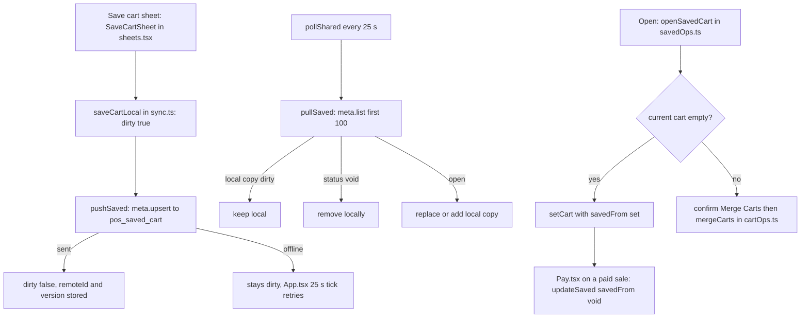

A saved cart is a sale put on hold: the items, the customer and a name, kept so you can come back to it. Every register sees the same saved carts.

## Basic

### Saving a cart
1. Put the items in the cart (add a customer if you like).
2. Tap **⋯** on the cart and choose **Save cart**.
3. Give it a name, such as *Sam, holding for Friday*, and add a note if you want. If you leave the name blank it uses the customer's name, or "Cart" with the time.
4. Tap **Save to Saved carts**. The cart is now empty and ready for the next customer.

You cannot save an empty cart ("Cart is empty"), or a cart that has had part of its payment taken ("Payment in progress").

### Finding and opening one
Open **More ▸ Saved carts**, or tap the **Saved carts** tile on the Quick Menu. Each row shows the name, how many items, the total, the customer, and any note. You can also type a name, note or customer in the Checkout search box and pick the **Saved carts** filter.

```screen
title: Saved carts
input: Search | friday
row: Sam, holding for Friday | 3 items · $28.50
text: For Aiden · Note: call when ready
row: Walk-in order | 1 item · $12.50
button: Open
button: Assign → Aiden
primary: Delete
note: Tap a saved cart to open, assign or delete it.
```

Tap a cart to see what is in it, then:
- **Open**: if your cart is empty the saved cart goes straight in. If it already has items you are asked **Merge Carts?**, and choosing **Merge** adds the saved items to what is already there.
- **Assign → name**: marks the cart as meant for that staff member. Their name appears on the row. It is a label only: anyone can still open it.
- **Delete**: asks "Delete saved cart?" first. It is removed from every register.

On the list you can also **swipe a row** to delete it. You are asked to confirm, and the row slides back if you say no.

### Good to know
- Opening a saved cart does not use it up. It stays in the list until the sale made from it is paid, then it is removed for you.
- A **whole order price** is not kept in a saved cart. The Save cart sheet warns you, and the cart comes back at its normal total.
- A row that says **not synced** has not reached the other registers yet. It sends as soon as the register is online.

## Deep

### How carts are shared
Saved carts are kept in your Shopify store, so any register can open them. A register sends its changes straight away, and every register checks for new or changed carts about every 25 seconds while the app is open. The cart you saved a moment ago may take up to that long to appear on another register.

If a register is offline, the cart is kept on that register (marked **not synced**) and sent when the connection returns. Until then, that register's copy wins over anything newer that arrives for the same cart, so your own unsent change is never overwritten.

### Deleting
Deleting marks the cart as void. Other registers drop it at their next check. There is no "undo", and nothing is asked a second time on the other registers.

### Open into an empty cart, or merge
- **Empty cart:** the saved items, customer and cart discount replace it. Any half-made payment details are cleared, so a saved cart can never bring a payment with it.
- **Cart with items:** the saved lines are added. If **Consolidate identical items** is on, the same item combines into one line, except lines that have been changed (a changed price, a discount, a note or an adjustment), which stay separate. Your current cart's customer and discount are kept, and the saved cart's are used only if the current cart has none. If any line in the merged cart has a price adjustment, the whole order price is dropped.

### Two registers, one cart
There is no lock on a saved cart. If two registers change the same one at nearly the same moment, the one that sends last wins. For a shop with a few registers this is rare, but it is a good reason to **Open** a cart rather than edit it in two places.

## Advanced

### From Save cart to another register


### Where the code is
| Job | Where |
|---|---|
| Save sheet (clears the cart after saving) | `SaveCartSheet` in `src/screens/sheets.tsx`; its `onSaved` empties the cart in `CartPane.tsx` and `GuidedCheckout.tsx` |
| The list, Open, Assign, Delete, swipe | `src/screens/SavedCarts.tsx` (`SavedCarts`, `SwipeRow` in `src/ui/SwipeRow.tsx`) |
| Open, delete, assign | `openSavedCart`, `deleteSavedCart`, `assignSavedCart` in `src/lib/savedOps.ts` |
| Saving and syncing | `saveCartLocal`, `updateSaved`, `pushSaved`, `pullSaved`, `cartFields` in `src/lib/sync.ts` |
| The stored shape | `SavedCart` in `src/state/store.ts`; the `pos_saved_cart` definition in `src/lib/shopify/metaobjects.ts` (`ensureDefinitions`, reached through `ensureShared` in `src/lib/syncBackend.ts`) |
| Merging | `mergeCarts` in `src/lib/cartOps.ts` |
| Removing a used cart | the `savedFrom` check in `Pay.tsx` |
| Search filter | the `carts` results in `Checkout.tsx` |
| The 25 second tick | `App.tsx` (`pollShared`, `pushSaved`) |

A saved cart stores `lines_json`, `discount_json` and `customer_json` along with the name, note, employee, register and a `version`. `SaveCartSheet` strips the cart's own name and `orderAdjust` before saving, which is why a whole order price does not survive. Assigning writes the status as `assigned:` followed by the staff id, and `pullSaved` reads it back. Nothing else reads that field.

`pullSaved` asks for up to 100 carts. A cart that is deleted elsewhere and is not in that list is left alone, because the code does not guess about deletions. The `locked_by` and `locked_at` fields exist in the Shopify definition but nothing writes them yet.

### Reading the code for a fault
- **A cart saved on one register is missing on another.** On the saving register, look for **not synced**: it is still `dirty`. Otherwise check the other register's sync strip, and that Settings ▸ Shopify ▸ **Set up shared storage** was run (it creates `pos_saved_cart`).
- **A deleted cart came back.** The register that still had it was offline with its own copy marked dirty, and sent it on reconnecting.
- **Saved, but the whole order price is gone.** Working as designed (see `SaveCartSheet`).
- **A saved cart is still listed after the sale was paid.** The sale was made from a merged cart, not an opened one: only `openSavedCart` into an empty cart sets `savedFrom`. Delete the saved cart by hand.
- **Merge made two lines of the same item.** One had a changed price, discount, note or adjustment, so `mergeCarts` keeps them apart.
- **Tests.** There is no test for the saved cart sync itself. `mergeCarts` is covered in `tests/itemadjust.test.ts` and `tests/lineadjust.test.ts`.
