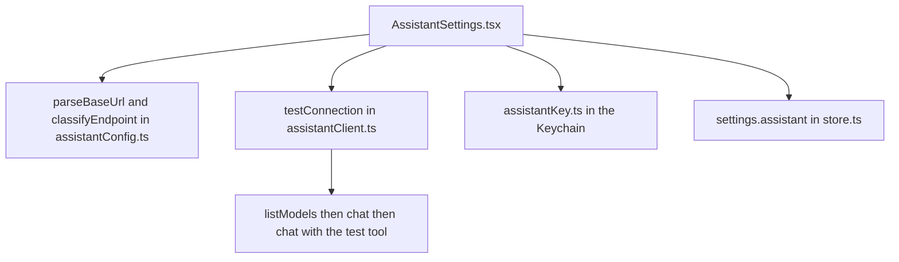

Use **More ▸ Settings ▸ AI assistant** to choose the model the Help assistant will use. Only an owner can open it, or a manager when the team has no owner. When staff sign-in is off, anyone can. Other people do not see the row.

This page sets up and tests the connection. To use the assistant, see [[settings/ask-assistant]].

## Basic

### Set it up with Ollama on the shop PC
1. On the PC, install Ollama and download a model that supports tools.
2. Make sure the iPad and the PC are on the same Wi-Fi, and that Ollama accepts connections from the network.
3. In **Address**, type the PC's address and port with `/v1` on the end, for example `http://192.168.1.20:11434/v1`.
4. In **Model name**, type the model, for example `llama3.1:8b`. Leave **API key** empty, because Ollama does not need one.
5. Tap **Test connection**. Three checks run: the server answers, the model replies, and the model can call a tool.
6. Tap **Save**.

The first time the iPad talks to a computer on your Wi-Fi, iPadOS asks for permission to find devices on the local network. Tap **Allow**.

### Use a hosted provider instead
Type the provider's address (it ends in `/v1`), the model name it gives you, and the API key. The key is kept in the iPad's Keychain and is never shown back in full.

### What the test sends
Test connection sends a short fixed message and a fake test tool. It sends nothing from the shop: no products, customers or sales.

### If a check fails
The message says what went wrong: the server could not be reached, the request took too long, the key was not accepted, the model name was not found (it lists the names the server has), or the model does not support tools. Fix that one thing and test again.

## Deep

### Local or remote
Under the address, the page says whether it counts as **Local** or **Remote**. Local means this iPad, a private network address (`192.168.x.x`, `10.x.x.x`, `172.16.x.x` to `172.31.x.x`) or a name ending in `.local`. Everything else counts as remote, including an address the app cannot read.

The assistant's data rules use this. Customer details and emails may go to a local address only, and payment details and keys never go anywhere. Those rules arrive with the assistant's data tools. Below that is a three way choice. **Auto** follows the address, and is right for nearly everyone. **Local** is for a private network the app does not recognise. **Remote** is for a tunnel or proxy that forwards out of your network, even when its address looks private. If you are not sure, choose Remote: it only means less is shared with the model. When you choose Local or Remote, the page adds *(set by you)* to the line above.

### Options
- **Temperature** is how adventurous the model's wording is. Low is steadier.
- **Timeout** is how long one request may take. The default is 120 seconds.
- **Context size** is how much text the model can read at once. If the provider reports it, Test connection fills it in. With Ollama, set the context size on the Ollama side too, because this connection cannot set it.
- **Tool call limit** stops a model that gets stuck calling tools in a loop. The default is 15.

### Per iPad, and in backups
These settings are for this iPad and are not shared with other registers. They are included in **Backup & transfer**, together with the key, so a restored iPad can reach the same model. See [[settings/backup]].

## Advanced

### How it is built

- The settings are `settings.assistant` (type `AssistantSettings` in `src/lib/assistantConfig.ts`). `normaliseAssistant` fills defaults and clamps every value, on load and on restore.
- `pushSharedSettings` in `src/lib/sync.ts` builds its list by hand and does not include `assistant`, so nothing here syncs between registers.
- The key is stored as `pos.assistantKey` through `src/lib/assistantKey.ts`. It is not in `settings`. It is carried in the backup credentials as `assistantKey` (`src/lib/backupFile.ts`, `src/lib/backupIO.ts`).
- `src/lib/assistantClient.ts` takes a `fetch` function, so the tests run without a network. It does not stream replies. Server error text is cut short and the key is removed from it before it is shown.
- The row is shown when `canEditAdjustPerms(actingRole(...), staff)` is true. Practice mode blocks saving, Test connection and writing the key.
- iOS reaches a local address over plain http because the local networking exception (NSAllowsLocalNetworking) is set in `app.json`.

Tests: `tests/assistantconfig.test.ts`, `tests/assistantclient.test.ts`, `tests/assistantsettings.test.ts`.

Known to change: the chat screen, the data rules (a gate in front of every tool result) and the per-category toggles are later patches. See `docs/AI_ASSISTANT_PLAN.md`.
