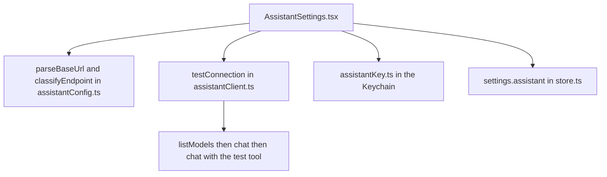

Use **More ▸ Settings ▸ AI assistant** to choose the model the Help assistant will use. Only an owner can open it, or a manager when the team has no owner. When staff sign-in is off, anyone can. Other people do not see the row.

This page sets up and tests the connection. To use the assistant, see [[settings/ask-assistant]].

## Basic

### Set it up with Ollama on the shop PC
1. On the PC, install Ollama and download a model that supports tools.
2. Make sure the iPad and the PC are on the same Wi-Fi, and that Ollama accepts connections from the network.
3. In **Address**, type the PC's address and port with `/v1` on the end, for example `http://192.168.1.20:11434/v1`.
4. In **Model name**, type the model, for example `llama3.1:8b`. Leave **API key** empty, because Ollama does not need one.
5. Tap **Test connection**. Three checks run: the server answers, the model replies, and the model can call a tool.
6. Tap **Save**.

The first time the iPad talks to a computer on your Wi-Fi, iPadOS asks for permission to find devices on the local network. Tap **Allow**.

### Use a hosted provider instead
Type the provider's address (it ends in `/v1`), the model name it gives you, and the API key. The key is kept in the iPad's Keychain and is never shown back in full.

### What the test sends
Test connection sends a short fixed message and a fake test tool. It sends nothing from the shop: no products, customers or sales.

### If a check fails
The message says what went wrong: the server could not be reached, the request took too long, the key was not accepted, the model name was not found (it lists the names the server has), or the model does not support tools. Fix that one thing and test again.

## Deep

### Local or remote
Under the address, the page says whether it counts as **Local** or **Remote**. Local means this iPad, a private network address (`192.168.x.x`, `10.x.x.x`, `172.16.x.x` to `172.31.x.x`) or a name ending in `.local`. Everything else counts as remote, including an address the app cannot read.

The assistant's data rules use this (see **What the assistant may see**, below). Customer details and emails may go to a local address only, and payment details and keys never go anywhere. Below that is a three way choice. **Auto** follows the address, and is right for nearly everyone. **Local** is for a private network the app does not recognise. **Remote** is for a tunnel or proxy that forwards out of your network, even when its address looks private. If you are not sure, choose Remote: it only means less is shared with the model. When you choose Local or Remote, the page adds *(set by you)* to the line above.

### What the assistant may see
The section **What the assistant may see** lists the kinds of shop data the assistant could be given, one row each, with a three way choice:

- **Auto** follows the rules for this address. On a local address customer details, email addresses and gift card balances are sent, and gift card codes only as the last four characters. On a remote address none of those are sent. Order totals and items, cost prices and profit, and stock, sales, products and deals are sent on either.
- **Always allow** sends that kind of data even where Auto would not. On a remote address the page warns you, because it means the details leave your own network. Gift card codes are never sent whole, even here: the most that goes is the last four characters.
- **Never allow** keeps that kind of data out even where Auto would send it.

Under each row, **Right now** says what the choice comes to for this address: *Sent*, *Not sent* or *Last four characters only*. **Payment details** (card details and terminal details) and **keys and passwords** are never sent, whatever you choose, and the page shows them as fixed.

These rules are applied by the app to every result before the model sees it, so the model cannot be talked into ignoring them. If something is hidden, the model is told that it was hidden and what kind it was (for example *customer details*), never what it said, so it will say it cannot show it. Order notes and other free text are checked too: an email address or phone number in a note is hidden unless that kind of data is allowed, and card numbers and keys are always hidden. If you later change the address to a remote one, or switch a row to Never allow, earlier answers in the chat that used that kind of data are no longer sent to the model. You can still read them.

These choices decide what every lookup the assistant makes, about products, sales, orders, customers, gift cards, the settings and how the till is doing, is allowed to return.

### What the assistant can read about the settings
You and the other owners and managers can ask the assistant how the register is set up: *Is cash rounding on?*, *Who has to use a PIN?*, *Which roles can't change prices?*, *Is the screensaver on?* or *What are the card fee rates?* It reads the settings as they are and says where to change one, but it never changes one. It sees yes or no and plain values: cash rounding, smart change, the fee rates, whether a receipt page, ABN, return policy, gift card claim page or pass server is set, how many owners, managers and cashiers there are, the price adjustment limits, cart warnings, display and screensaver choices, and the options on this page. It is never shown a web address, a key, a PIN, a badge code, a staff name, the business's contact details or a logo address, only whether one is set. Cashiers are not offered this tool at all, so to them a question about settings gets the same *I couldn't find anything on that* as a question about something that does not exist. The AI assistant options on this page are in the answer only for a person who can open this page.

### Options
- **Temperature** is how adventurous the model's wording is. Low is steadier.
- **Timeout** is how long one request may take. The default is 120 seconds.
- **Context size** is how much text the model can read at once. If the provider reports it, Test connection fills it in. With Ollama, set the context size on the Ollama side too, because this connection cannot set it.
- **Tool call limit** stops a model that gets stuck calling tools in a loop. The default is 15.

### Per iPad, and in backups
These settings are for this iPad and are not shared with other registers. They are included in **Backup & transfer**, together with the key, so a restored iPad can reach the same model. See [[settings/backup]].

## Advanced

### How it is built

- The settings are `settings.assistant` (type `AssistantSettings` in `src/lib/assistantConfig.ts`). `normaliseAssistant` fills defaults and clamps every value, on load and on restore.
- `pushSharedSettings` in `src/lib/sync.ts` builds its list by hand and does not include `assistant`, so nothing here syncs between registers.
- The key is stored as `pos.assistantKey` through `src/lib/assistantKey.ts`. It is not in `settings`. It is carried in the backup credentials as `assistantKey` (`src/lib/backupFile.ts`, `src/lib/backupIO.ts`).
- `src/lib/assistantClient.ts` takes a `fetch` function, so the tests run without a network. It does not stream replies. Server error text is cut short and the key is removed from it before it is shown.
- The row is shown when `canEditAdjustPerms(actingRole(...), staff)` is true. Practice mode blocks saving, Test connection and writing the key.
- iOS reaches a local address over plain http because the local networking exception (NSAllowsLocalNetworking) is set in `app.json`.

Tests: `tests/assistantconfig.test.ts`, `tests/assistantclient.test.ts`, `tests/assistantsettings.test.ts`, `tests/assistantgate.test.ts`.

### How the settings reader works
`read_settings` is in `src/lib/assistantStatus.ts`. It lists `roles: ['manager', 'owner']` on the tool, and `toolsFor(role)` in `assistantTools.ts` leaves it out of the request for anyone else, with the prompt built from the same list (`buildSystemPrompt` takes the tool names), so a cashier's request does not name it. If it is called anyway the answer is the one for a tool that does not exist. `takeTillState(role)` (`src/lib/assistantStatusIO.ts`) only builds the settings view for a manager or an owner, and `buildSettingsView` copies plain values only: it never receives or copies an address, a token, a PIN hash, a badge hash or a staff name. The AI assistant group is built only when `canEditAdjustPerms` says this person may see these settings, the same rule as the row in Settings. The tool takes one optional group (`register`, `checkout`, `receipts`, `staff` or `display`); the AI assistant group is only in the full answer. Every field is *shop data* in the gate. Tests: `tests/assistantstatus.test.ts`.

### The data gate
`src/lib/assistantGate.ts` is the one place the data rules live. `resolvePolicy(scope, toggles)` turns the endpoint class (`classifyEndpoint`) and the per category toggles (`settings.assistant.gate`) into a decision for each of nine categories: `allow`, `last4` or `deny`. Payment and secret are always `deny`, and Always allow on `gift_code` is `last4`. `applyGate(result, spec, policy)` walks a tool result.

- Every tool declares `gate` (`AssistantTool` in `assistantTools.ts`): a field map that names each field it can return and its category, or `'content'` for tools that return only help text. `runToolCall` calls `applyGate` straight after `tool.run`, before the result is cut to size, so the model and the log only ever hold the gated result.
- A field the map does not name is dropped and counted under `unknown`. An object where the map expects a single value is dropped too. Nothing is thrown.
- Every string that is kept goes through the scrubber (`assistantScrub.ts`). Emails are left alone only when `email` is `allow`, phone numbers only when `personal` is `allow`. Card numbers that pass the Luhn check and key shaped strings are always masked.
- With no policy given, `FAIL_CLOSED_POLICY` (the remote rules) applies.
- Each reply is marked with the categories its tool results held (`used` on the chat entry). `forModel` leaves out a reply, and its question, when the current policy no longer sends one of them.
- The counts of what was withheld, by category and never the items, are on each tool record and on the log event (`withheld`).

Tests: `tests/assistantgate.test.ts`. `assertNoUnknownFields` in that file is the check every data tool added later should call with realistic data.

Known to change: the data tools themselves (products, inventory, sales, customers and the rest) are later patches. See `docs/AI_ASSISTANT_PLAN.md`.
