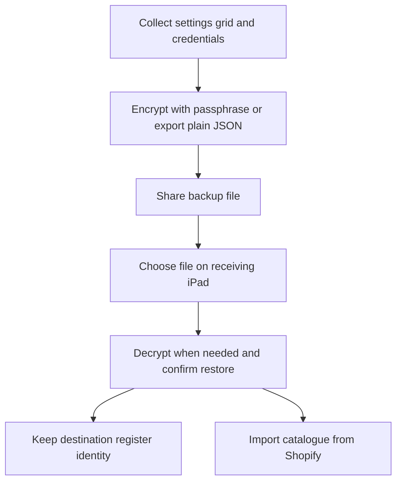

Use **More ▸ Settings ▸ Backup & transfer** to move settings and logins to another iPad. Use **More ▸ Settings ▸ Data** to export or delete this iPad's local CSV history; these are separate tools.

## Basic

### Create a backup
1. In **Backup & transfer**, enter a passphrase of at least **8 characters** in **Passphrase** and **Repeat passphrase**.
2. Tap **Export encrypted backup**, then save or share the file somewhere safe.
3. Keep the passphrase separate and safe. It is needed to open the encrypted backup.

The encrypted backup includes settings, staff, the grid layout and logins, including the AI assistant's address, model and API key (see [[settings/assistant]]). It does not include sales history or the product catalogue. Zeller reader pairing stays on the original iPad.

**Export plain JSON (not encrypted)** is available only after a warning and confirmation. The file contains Shopify and other login secrets in readable text. Prefer the encrypted backup; if you export plain JSON, protect it and delete it after importing.

### Restore on another iPad
Tap **Choose backup file…** and select the backup. For an encrypted file, enter its passphrase and tap **Decrypt & restore**. Confirm the restore. It replaces the receiving iPad's settings, grid and logins, but keeps that iPad's own register name and ID.

After restoring, open **Settings ▸ Shopify** and tap **Import from Shopify** to reload the catalogue. Pair the Zeller reader again on the receiving device.

### Export or delete CSV history
Open **Settings ▸ Data**. **Export CSV** shares the local history files. Every sale, refund and declined card attempt is kept on this device and the files are not auto-cleared.

**Delete local history** asks twice before erasing the CSV files from this iPad. Export first if you need them. Deleting these local files does not delete the orders in Shopify.

## Deep

### What is and is not transferred
The backup carries settings, staff, the Checkout grid and configured logins such as Shopify, receipt and pass-server credentials. Sales history and the imported catalogue are not in the backup; Shopify remains the source to import them again. The Zeller reader pairing, register name and register ID belong to the receiving device and are not overwritten.

An encrypted file cannot be opened without its passphrase. A plain JSON backup includes secrets and should be treated like a password file. Uploaded screensaver logos can be included in the backup; the device-specific local file path is not copied.

### Local CSV history
The CSV files are separate from Shopify orders and the backup. They stay in the app's files on this iPad until you share or delete them. Deleting the local files cannot be undone from this screen.

## Advanced

### Backup and restore path

| Job | Where |
|---|---|
| Backup and Data screens | `BackupSettings`, `DataSettings` in `src/screens/Settings.tsx` |
| Collect and apply settings, logins and grid | `collectBackup`, `applyBackup` in `src/lib/backupIO.ts` |
| Validate, encrypt and decrypt backup files | `validateBackup`, `encryptBackup`, `decryptBackup` in `src/lib/backupFile.ts` |
| CSV export and deletion | `src/lib/csvStore.ts` |
| Test backup and restore rules | `tests/backup.test.ts` |

Encrypted backups use a passphrase-derived key and authenticated encryption. Plain JSON explicitly confirms before exporting because it contains credentials. Restoring merges nested settings with the receiving app's defaults and preserves its register identity.
