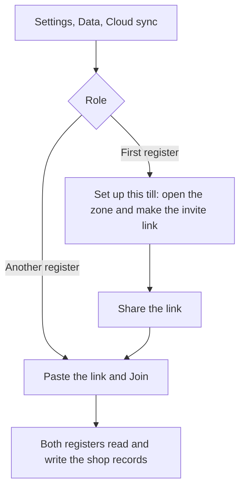

Open **More ▸ Settings ▸ Data ▸ Cloud sync** to link a second register to the records this one holds. One register sets the shop up and shows a link; every other register joins with that link. Both iPads need to be signed in to iCloud, and only managers and owners see this page.

## Basic

### Set up the register that holds the shop
- Open **Settings**, tap **Data**, then **Cloud sync**.
- Tap **Set up this till**. The page says this register holds the shop records and shows an **Invite link**.
- Tap **Share the invite link** to send it by Messages, email or AirDrop, or to copy it.

### Join from another register
- On the other iPad, open **Settings ▸ Data ▸ Cloud sync**.
- Paste the link into the box and tap **Join**. The page then says the register has joined.
- If the link is tapped on the iPad itself, the app opens with the link already in the box: just tap **Join**.

### What you need
- Both iPads signed in to iCloud. The top of the Cloud sync page says whether this one is.
- One register set up first. Joining needs its link: there is no list of shops to pick from.
- A manager or owner signed in, on both iPads.

## Deep

### One register holds the records
The register that sets the shop up is the owner. The shared records live in that Apple ID's iCloud storage, and that account's storage allowance pays for them, not each iPad's. A share can carry up to 100 registers.

Two things follow from that:
- If that Apple ID is lost, or the share is turned off, the shared copy goes with it. Shopify, and the CSV files each iPad keeps, are not affected.
- Ownership cannot be handed to another register later.

### What travels
- Sales, refunds, gift cards and the other shop records travel, so every register can report on all of them.
- Cash stays on the register it was counted on: the drawer, its float and its ledger belong to one till and are never merged.
- Settings are unchanged: each register keeps its own, and [[settings/backup]] is still how you copy them across.

## Advanced

### How a register is linked

| Job | Where |
|---|---|
| The page itself | `src/screens/CloudSync.tsx` |
| The bridge and the no-native fallback | `modules/cloudkit-sync/index.ts` and `modules/cloudkit-sync/status.ts` |
| The CloudKit calls (zone, share, join) | `modules/cloudkit-sync/ios/CloudKitSyncModule.swift` |
| The iCloud container and the share link handler | `plugins/withCloudKit.js` |
| The plan and the patch list | `dev_docs/CLOUDKIT_SYNC_PLAN.md` |

### If it will not join
- **"This till is not signed in to iCloud."** Sign in to iCloud in the iPad's own Settings app on this iPad, then tap **Check again**.
- **The link opens nothing.** The app was built without its iCloud entitlement, or the link belongs to a different iCloud container. Rebuild with `npm run ios:reset`.
- **A link from another shop will not join.** A link only opens the shop it was made for. Ask the other shop's owner for its link, or set this register up as its own shop.
- **CloudKit has two environments.** A build from Xcode uses the development environment; TestFlight and the App Store use production. A share made in one is not visible in the other, so link registers that were built the same way.

### The parts that are easy to miss
- The zone is called Store on both sides. The register that set up holds it in its private database; a register that joined sees it in its shared database. That is how each register knows which side it is on.
- The invite link lets anyone who has it read and write the shop records, so treat it like a password. Turning the share off in iCloud stops it.
- iOS gives the app the share link through the AppDelegate method added by `plugins/withCloudKit.js`, because Expo does not forward that call itself. The link is also kept, so a link tapped while the app was closed can be finished from the page.
