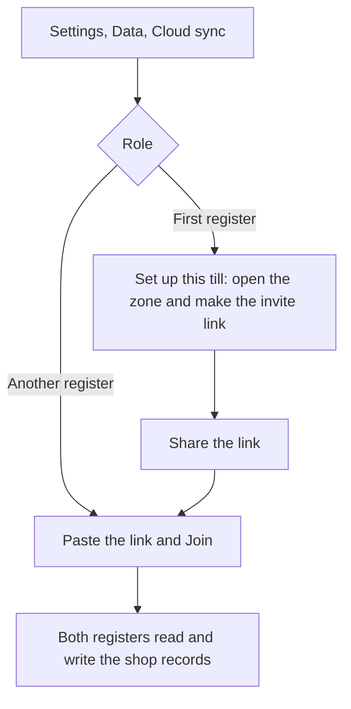

Open **More ▸ Settings ▸ Data ▸ Cloud sync** to link a second register to the records this one holds. One register sets the shop up and shows a link; every other register joins with that link. Both iPads need to be signed in to iCloud, and only managers and owners see this page.

## Basic

### Set up the register that holds the shop
- Open **Settings**, tap **Data**, then **Cloud sync**.
- Tap **Set up this till**. The page says this register holds the shop records and shows an **Invite link**.
- Tap **Share the invite link** to send it by Messages, email or AirDrop, or to copy it.

### Join from another register
- On the other iPad, open **Settings ▸ Data ▸ Cloud sync**.
- Paste the link into the box and tap **Join**. The page then says the register has joined.
- If the link is tapped on the iPad itself, the app opens with the link already in the box: just tap **Join**.

### What you need
- Both iPads signed in to iCloud. The top of the Cloud sync page says whether this one is.
- One register set up first. Joining needs its link: there is no list of shops to pick from.
- A manager or owner signed in, on both iPads.

## Deep

### One register holds the records
The register that sets the shop up is the owner. The shared records live in that Apple ID's iCloud storage, and that account's storage allowance pays for them, not each iPad's. A share can carry up to 100 registers.

Two things follow from that:
- If that Apple ID is lost, or the share is turned off, the shared copy goes with it. Shopify, and the CSV files each iPad keeps, are not affected.
- Ownership cannot be handed to another register later.

### What travels
- Sales, refunds, gift cards and the other shop records travel, so every register can report on all of them.
- The cash drawer is one drawer for the whole shop: its shift (open or closed, float, paid in and out, any loan) and its notes and coins ledger are merged between registers, so a cash sale on one iPad counts everywhere.
- The shared settings are the same on every register: staff (with each person's display settings), bundles, fees, cash rounding, Require PIN, adjust permissions, cart warnings, and, once sync is on, the shop name, the receipt details and the receipt, pass and claim server addresses, auto-receipt, Smart change, Consolidate identical items, and the AI assistant's address, model name and options. How each iPad looks (theme, accent, tile size, screensaver), its register name, and the assistant's log size and data rules stay on that iPad, and [[settings/backup]] is still how you copy a whole setup across.
- If two registers change settings while apart, they are joined when they meet. A setting changed on one is kept, a setting changed on both takes the later one, and people added to Staff on two registers are both kept. Someone removed from Staff on either stays removed.

### One file of every register's events
Once sync is switched on, the Cloud sync page has an **Export all events** button. It makes one CSV of the declined payments, voids, overrides, paid in and out, shift opens and closes, no-sales, cancelled and failed refunds and staff switches from every register, oldest first, with a **register** column at the end. It is built from iCloud each time you tap it. Each iPad's own `events.csv` is not changed. Practice mode cannot make it.

### Cash and refund notices on every register
Once sync is switched on, two kinds of notice reach every register: **cash** (cash taken outside the drawer, to add to the next count) and **refund** (a refund Shopify did not record, which needs a manager). A notice raised on one iPad shows up unread on the others a few seconds later, with **From** and the register's name above it. The other kinds (sync, queue, stock, reader, pass and info) describe one iPad, so they stay on it.

Reading or clearing a notice only affects the iPad you do it on. It is never sent, so it does not clear the notice on the other iPads, and a notice you cleared does not come back. A notice older than a week is not sent or shown, so a register that has just joined does not open on a pile of old ones. Practice mode never sends or takes in any.

### The logo on every register
Once sync is switched on, the logo image you upload under **Settings ▸ Screensaver & display** is shared. Upload it on one iPad and the others pick it up a few seconds later, with nothing to upload on them. Replace it and they follow. Remove it and it is removed on the others too, so they fall back to the logo link. If two iPads change it at the same moment, the one that finishes last is kept. The logo link (the https address) is not shared, and neither is anything else on that page. The image must be a PNG, JPG, GIF or WebP under 700 KB; a larger one stays on the iPad you uploaded it on. Practice mode never sends or takes in a logo.

### Square history on every register
Once sync is switched on, imported Square history is shared one month at a time. Import it on one iPad and the others take the months in a little later, with no QR code or PC. A newer import of a month replaces it everywhere, and **Delete imported Square history** removes it from iCloud and every register, which the confirmation says. If two registers changed the same month, the one with more sales is kept on both. A month is only ever deleted on a register that had not changed it since the last time it agreed with the shop. The copy in iCloud has every customer's name, email and phone taken out, so a register that took the history from iCloud shows those sales without a customer name; the register that imported keeps its full files. Practice mode never sends or takes in history.

### Training progress on every register
Once sync is switched on, each person's training progress is shared, so a tick earned on one iPad shows on the others. Work done on two registers is joined, not replaced. Owners and managers can reset progress from **More → Training**, and a reset clears it on every register. Practice data is never shared.

### The assistant's conversation log on every register
Once sync is on and the encrypted switch has been turned on, each conversation with the assistant is also sent to iCloud, encrypted, with the register's name. A manager opens **Settings ▸ AI assistant ▸ conversation log** and chooses **All registers** to read every register's conversations. This includes what a local model was sent, which can include a customer's name, so the copy is encrypted and only registers in your share can read it. A register's own log is sent once after it joins. Clearing or purging the log on an iPad does not remove the copy in iCloud. Conversations in a practice run are sent after the run ends. Nothing is sent until the encrypted switch is on.

### What is and is not kept in iCloud
The Cloud sync page lists this in full under **What is kept in iCloud**. In short:
- **Kept, and readable by every till in the share:** shop settings, staff (with PIN and badge hashes, not PINs), sales (card details encrypted, amounts plain), payment attempts, events, the one shared cash drawer, the grid layout, saved carts, Square history, cash and refund notices, training progress and the assistant's log (encrypted). The Shopify login, the pass, gift claim and receipt secrets, the assistant's key and cashier pass codes join them only after the encryption test has passed.
- **Never kept:** the Shopify access token, the cart being rung up, each iPad's own look and settings, the queue of sales waiting for Shopify, the catalogue cache and Training or Demo data.
- **Customer names:** sales hold only the Shopify customer id, and the Square history in iCloud has customer names, emails and phones removed. The assistant's log can still contain names a local model was sent, and a sale's note or a Square ticket name can contain one.
- **The invite link is a key.** Anyone who holds it can read and write the shop records.

Your shop's own privacy policy and App Store privacy details are yours to update.

## Advanced

### How a register is linked

| Job | Where |
|---|---|
| The page itself, and the all-events export | `src/screens/CloudSync.tsx` |
| The wording of the iCloud note | `src/lib/icloudNote.ts` |
| The bridge and the no-native fallback | `modules/cloudkit-sync/index.ts` and `modules/cloudkit-sync/status.ts` |
| The CloudKit calls (zone, share, join) | `modules/cloudkit-sync/ios/CloudKitSyncModule.swift` |
| The iCloud container and the share link handler | `plugins/withCloudKit.js` |
| The plan and the patch list | `dev_docs/CLOUDKIT_SYNC_PLAN.md` |

### If it will not join
- **"This till is not signed in to iCloud."** Sign in to iCloud in the iPad's own Settings app on this iPad, then tap **Check again**.
- **The link opens nothing.** The app was built without its iCloud entitlement, or the link belongs to a different iCloud container. Rebuild with `npm run ios:reset`.
- **A link from another shop will not join.** A link only opens the shop it was made for. Ask the other shop's owner for its link, or set this register up as its own shop.
- **CloudKit has two environments.** A build from Xcode uses the development environment; TestFlight and the App Store use production. A share made in one is not visible in the other, so link registers that were built the same way.

### The parts that are easy to miss
- The zone is called Store on both sides. The register that set up holds it in its private database; a register that joined sees it in its shared database. That is how each register knows which side it is on.
- The invite link lets anyone who has it read and write the shop records, so treat it like a password. Turning the share off in iCloud stops it.
- iOS gives the app the share link through the AppDelegate method added by `plugins/withCloudKit.js`, because Expo does not forward that call itself. The link is also kept, so a link tapped while the app was closed can be finished from the page.
