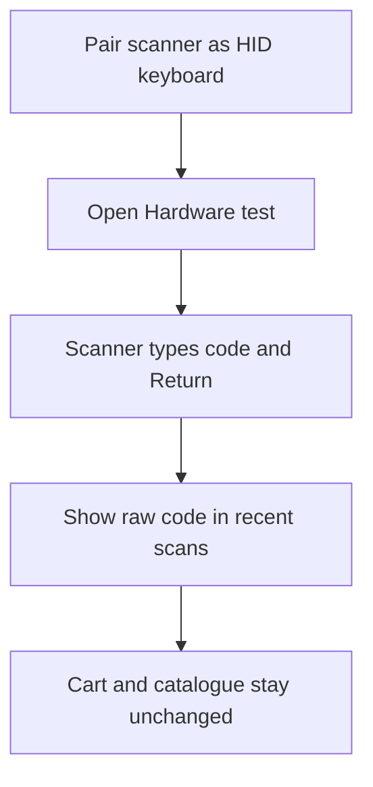

Use **More ▸ Settings ▸ Hardware** to test a Bluetooth scanner without changing the cart. Pair the scanner in the iPad's Bluetooth settings in **HID keyboard** mode first.

## Basic

### Test a scanner
1. Pair the Bluetooth scanner with the iPad as a keyboard in HID mode.
2. Open **More ▸ Settings ▸ Hardware**.
3. Scan a barcode. The scanner test lists the last few codes it received, with how fast each one was typed in (milliseconds per character).

The test shows the raw scanned text. It does not look up an item and does not add anything to a cart. For the camera scanner, item lookup and common scan problems, see [[sales/scanners]].

### If the scan does not appear
Check that the scanner is connected to this iPad and configured as a keyboard (HID). Return to **Hardware** and scan again. If it appears in the test but not on Checkout, use the scanner guide to check the screen and input rules: [[sales/scanners]].

### The speed test
If scanned codes come in with missing or wrong characters, use **Speed test** on the same screen. Tap **Show the speed test barcode**, scan it, and the app times the scan, says which scanner speed it matches, and offers the next slower speed's barcode. The setup barcodes are on [[settings/scanner-codes]].

### Calibrate (managers and owners)
Managers and owners also see **Admin ▸ Calibrate**. Pick a speed, set the scanner to it by scanning its setup barcode, then scan the speed test barcode 3 to 12 times and tap **Save**. Do this for all four speeds. Every register then uses the same ranges. **Reset to the manual's ranges** removes the calibration.

## Deep

### How the HID test works
A Bluetooth HID scanner sends the barcode as keyboard input and finishes it with Return. The POS catches that text in a hidden input field; the Hardware test then shows the complete scanned value. Because this screen only records scans, it can confirm what the scanner sent without depending on a product's barcode or SKU being correct.

### How the speed is timed and shared
The hidden scan box records when its text changes. The time from the first change to the last, divided by the number of gaps between characters, is the milliseconds per character. If the iPad hands over several characters at once at the fastest speeds, the measurement reads a little slow, which is why calibrating on this iPad is better than trusting the manual's numbers. A calibrated range runs from the lowest to the highest measurement, widened by 10% (at least 0.5 ms). A calibration is refused if the speeds end up out of order. It is saved in the `pos_settings` metaobject under the handle `scanner`, so it needs no new setup, and the registers pick it up when they next poll. If Shopify cannot be reached it is kept on this register and sent later.

## Advanced

### Test input path

| Job | Where |
|---|---|
| Hardware test UI, recent scan list, speed test and Calibrate menu | `HardwareTest`, `CalibrateSheet` in `src/screens/ScannerSpeed.tsx` |
| Bluetooth HID input | `HidScanner` in `src/screens/Scanner.tsx` |
| Scan activity and input completion | `noteActivity` in `src/lib/idle.ts`, submit handler in `src/screens/Scanner.tsx` |
| Item/pass/gift-card scan handling | `src/screens/Scanner.tsx`, `src/lib/lookup.ts` |
| Timing a scan, ranges, saving rules | `noteChange`, `measure`, `rangeFromSamples`, `calibrationProblems`, `canCalibrate` in `src/lib/scanSpeed.ts` |
| Share the calibration between registers | `saveScannerCalibration`, `pushScannerCalibration` in `src/lib/sync.ts` (pulled in the same poll as the other shared settings) |
| Scanner guide | `help/sales/scanners.md` |

The Hardware test keeps the most recent eight scans in memory while it is open. It does not save those scan values to the catalogue or sales history.
