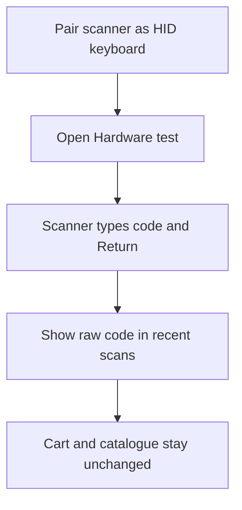

Use **More ▸ Settings ▸ Hardware** to test a Bluetooth scanner without changing the cart. Pair the scanner in the iPad's Bluetooth settings in **HID keyboard** mode first.

## Basic

### Test a scanner
1. Pair the Bluetooth scanner with the iPad as a keyboard in HID mode.
2. Open **More ▸ Settings ▸ Hardware**.
3. Scan a barcode. The scanner test lists the last few codes it received.

The test shows the raw scanned text. It does not look up an item and does not add anything to a cart. For the camera scanner, item lookup and common scan problems, see [[sales/scanners]].

### If the scan does not appear
Check that the scanner is connected to this iPad and configured as a keyboard (HID). Return to **Hardware** and scan again. If it appears in the test but not on Checkout, use the scanner guide to check the screen and input rules: [[sales/scanners]].

## Deep

### How the HID test works
A Bluetooth HID scanner sends the barcode as keyboard input and finishes it with Return. The POS catches that text in a hidden input field; the Hardware test then shows the complete scanned value. Because this screen only records scans, it can confirm what the scanner sent without depending on a product's barcode or SKU being correct.

## Advanced

### Test input path

| Job | Where |
|---|---|
| Hardware test UI and recent scan list | `HardwareTest` in `src/screens/Settings.tsx` |
| Bluetooth HID input | `HidScanner` in `src/screens/Scanner.tsx` |
| Scan activity and input completion | `noteActivity` in `src/lib/idle.ts`, submit handler in `src/screens/Scanner.tsx` |
| Item/pass/gift-card scan handling | `src/screens/Scanner.tsx`, `src/lib/lookup.ts` |
| Scanner guide | `help/sales/scanners.md` |

The Hardware test keeps the most recent eight scans in memory while it is open. It does not save those scan values to the catalogue or sales history.
