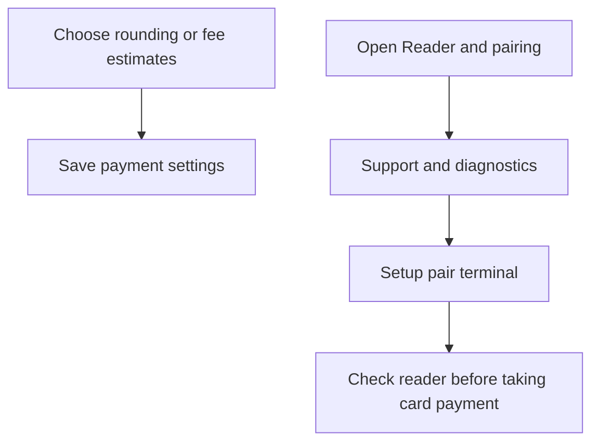

Open **More ▸ Settings ▸ Payments** to choose cash rounding, Smart change and the fee rates used in POS estimates. Reader setup is in **Support & diagnostics**.

## Basic

### Cash rounding
**Cash rounding (5c)** rounds the amount due in cash to the nearest five cents. It applies to the cash amount only; card payments are not rounded by this setting. The setting is on by default.

### Smart change
Turn on **Smart change** to choose notes and coins that leave the drawer better stocked for later sales. It applies to this register only. For how the choice is calculated, see [[cash/smart-change]].

### Card fee rates and the terminal
Set **Card-present fee %** and **Keyed / card-not-present fee %** to match the rates you use. They are estimates for reports; the Zeller SDK does not return the actual fee. A card refund does not return the original fee.

To pair or check the reader, tap **Reader & pairing**. In **Support & diagnostics**, use **Setup (pair terminal)**. Card payments need a network connection and a paired terminal. The **Automatic cash tender machine** option is still under construction and disabled; cash notes and coins are handled by hand.

## Deep

### What each choice affects
- Cash rounding applies to the amount due on a cash tender, not card or gift-card amounts.
- Smart change is a per-register preference and works with the drawer's note-and-coin counts and sales history.
- Card fee rates are stored as shared settings and are used to estimate fees. Changing a rate does not change the amount charged by Zeller.
- Reader pairing is device-specific. If you reinstall the app, pair the terminal again.

The default estimates are **1.4%** for card-present and **1.7%** for keyed/card-not-present. Adjust them if your actual rate differs.

## Advanced

### Payment settings and reader path

| Job | Where |
|---|---|
| Payments section | `src/screens/Settings.tsx` |
| Default fee rates and rate selection | `DEFAULT_FEES`, `feeRate` in `src/lib/fees.ts` |
| Cash rounding | `cashRounding` in `src/lib/cashSale.ts` |
| Reader pairing and test purchase controls | `src/screens/Diagnostics.tsx` |
| Zeller payment request and results | `src/lib/zeller.ts`, `src/screens/Pay.tsx` |

The fee estimates are recorded with sales for reporting; they are not a quote from the terminal. The Settings footer explains that actual card fees are not provided by the Zeller SDK.
