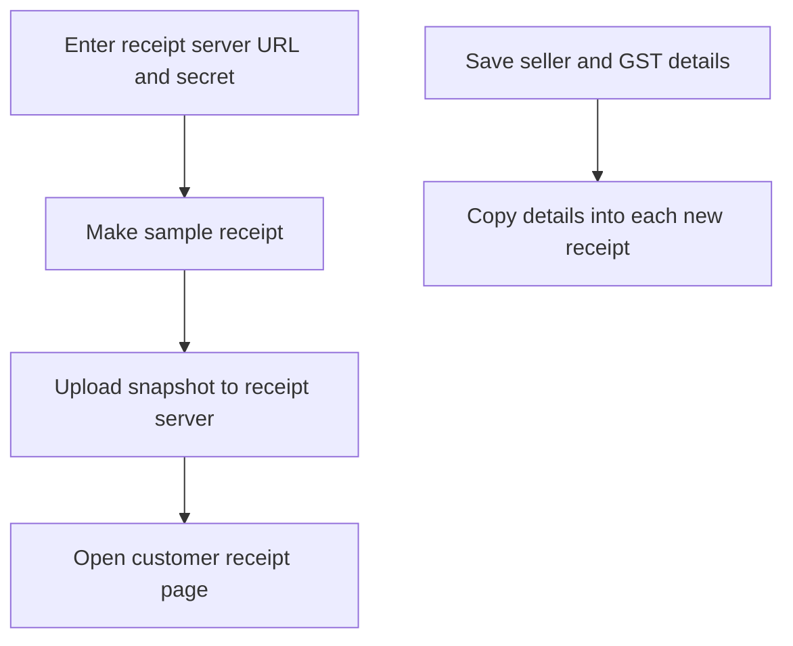

Open **More ▸ Settings ▸ Receipts** to add your business details to receipts and connect the receipt page that customers open from a QR code or link.

## Basic

### Enter business details
Fill in **Business / trading name**, **ABN**, **Address**, **Phone**, **Email** and **Website** as needed. Add a **Return policy (optional)** if you want it printed. When the business name is blank, the receipt uses your Shopify shop name.

These details are copied into each receipt when it is made. Changing them later does not rewrite receipts that have already been issued.

### Connect and test the receipt page
Enter the **Receipt server URL** and **Receipt server secret (RECEIPT_SECRET)** supplied for your receipt server. Tap **Send test receipt** to upload a sample and open its page. The server must be deployed and configured before the link can work.

When a receipt page is configured, the customer can scan a QR or open a link to see the receipt and download it. For the customer-facing Receipt sheet and receipt page, see [[pay/receipts]].

### GST tax invoices
Turn on **Registered for GST** only if your business is registered. Receipts are then titled **Tax invoice** and show the GST included in the total. Prices are treated as GST-inclusive; gift-card lines are excluded from the GST calculation.

## Deep

### What appears on the receipt
The seller name, ABN and contact details, return policy, receipt and order information, items, payments and totals are captured in the receipt snapshot. The GST amount is calculated as one-eleventh of the GST-inclusive total for non-gift-card lines. The Receipt server renders the uploaded snapshot as a page with PDF and image download.

Use the test button to check that the URL and server secret work together. If it fails, confirm the Worker is deployed and that the URL and `RECEIPT_SECRET` match its configuration.

## Advanced

### Receipt publishing path

| Job | Where |
|---|---|
| Receipt settings form and test upload | `ReceiptSettings` in `src/screens/Settings.tsx` |
| Receipt profile and GST calculation | `ReceiptProfile`, `gstIncluded`, `buildReceiptDoc` in `src/lib/receiptDoc.ts` |
| Upload a sample receipt | `uploadSampleReceipt` in `src/lib/receiptSync.ts` |
| Save the server secret | `getReceiptSecret`, `setReceiptSecret` in `src/lib/shopify/client.ts` |
| Receipt page and customer options | `help/pay/receipts.md` |

The receipt server URL is a setting; the receipt secret is stored in the iOS Keychain on this device. The POS snapshots business details into each new receipt so old receipts keep the details they were issued with.
