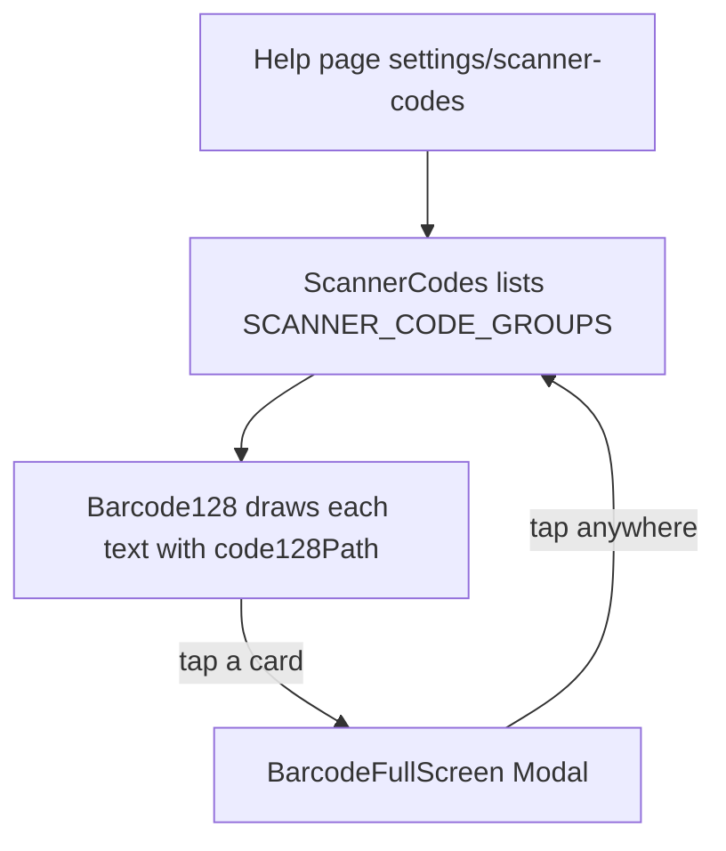

The scanner is changed by scanning special setup barcodes. This page shows them on the screen, so you do not need the paper manual. Scan the barcode **from the iPad's screen** with the scanner you want to change.

## Basic

### How to use it
1. Scroll to the setting you want to change below.
2. Tap its barcode. The whole screen goes white and shows only that barcode and a line saying what it does.
3. Point the scanner at the barcode and scan it. The scanner beeps or buzzes to say it took the setting.
4. Tap anywhere to go back.

Turn the screen brightness up if the scanner struggles to read it.

### What each group does
- **Pairing.** Scan **Pairing mode**, then pair the scanner in the iPad's Settings ▸ Bluetooth so it works as a keyboard (HID).
- **Vibration** and **Volume.** How the scanner tells you a scan worked.
- **Sleep.** How long it waits, unused, before sleeping. **Never sleep** drains the battery faster.
- **Scanning mode.** **Manual** scans only while you press the trigger. **Auto** scans by itself when a barcode is held in front of it.
- **Data entry speed.** How fast the scanner types the code into the iPad.

Settings marked **(default)** are how the scanner leaves the factory.

### If barcodes come in wrong
Characters missing or jumbled when you scan an item usually mean the scanner is typing faster than the iPad can take it. Scan **Medium speed**, then try again. Still wrong? Try **Slow speed**, then **Super slow speed**. To find the right one without guessing, see the speed test below.

## Deep

### The speed test
The app times it for you: open Settings ▸ **Hardware**, tap **Show the speed test barcode** and scan it (see [[settings/hardware]]). The scanner types `HID_SCANNER_SPEED_TEST` and then presses Return. The app divides the time from first to last character by the number of gaps and picks the nearest speed. The manual's ranges, used until a manager or owner calibrates, are:

| Setting | Time between characters |
|---|---|
| Fast | 3 to 6 ms |
| Medium | 17 to 21 ms |
| Slow | 42 to 46 ms |
| Super slow | 150 to 152 ms |

If a result is between two rows, the nearer one wins, and if two are equally near, the one whose middle is closer. A manager or owner can replace these ranges with measured ones in **Hardware ▸ Admin ▸ Calibrate**, and every register shares them. The speeds are named by how long a whole code takes: Fast is about 6 codes a second, Medium about 1 a second, Slow about 1.5 seconds a code and Super slow about 6 seconds a code.

### Why scanning a screen works
Each setup barcode is an ordinary Code 128 barcode whose text is a command the scanner understands, such as `%%SpecCode77`. The scanner reads the text and changes its own setting instead of typing it. Because the POS draws the barcode itself from that text, nothing needs printing.

## Advanced

### From tap to full screen

| Job | Where |
|---|---|
| The codes (label, text, what it does, default) | `SCANNER_CODE_GROUPS` in `src/lib/scannerCodes.ts` |
| Picking a speed from a measured time | `speedForInterval`, `SPEED_TABLE`, `DEFAULT_SPEED_RANGES` in `src/lib/scannerCodes.ts` |
| Timing, calibration and sharing | `src/lib/scanSpeed.ts`, `src/screens/ScannerSpeed.tsx`, `saveScannerCalibration` in `src/lib/sync.ts` |
| The list and the full-screen view | `ScannerCodes`, `BarcodeFullScreen` in `src/screens/ScannerCodes.tsx` |
| Drawing a barcode from text | `code128Path` in `src/lib/code128.ts`, `Barcode128` in `src/ui/Barcode128.tsx` |
| The shortcut buttons (big one on Checkout help) | `SCANNER_SHORTCUT` in `src/screens/Help.tsx` |
| Tests | `tests/scannercodes.test.ts`, `tests/scanspeed.test.ts` |

To add or fix a code, edit its `text` in `SCANNER_CODE_GROUPS`. Only printable ASCII works (Code 128 subset B); `tests/scannercodes.test.ts` fails on anything else or on a repeated id or text.

### Reading the code for a fault
- **The scanner does not react.** The text differs from the manual by a character, or the screen is too dim. Compare `text` with the manual.
- **A code will not draw.** `code128Modules` throws on characters outside ASCII 32 to 126; the test catches this.
